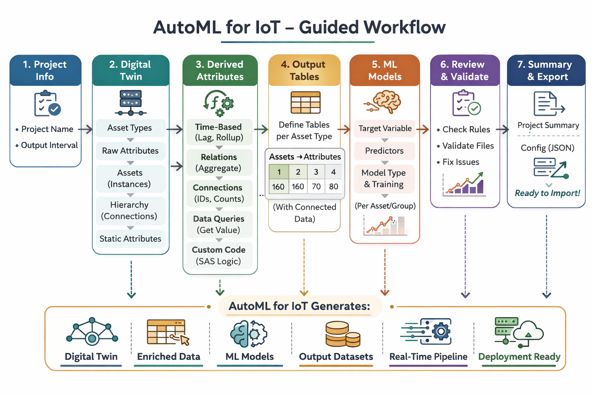
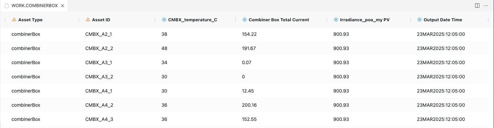
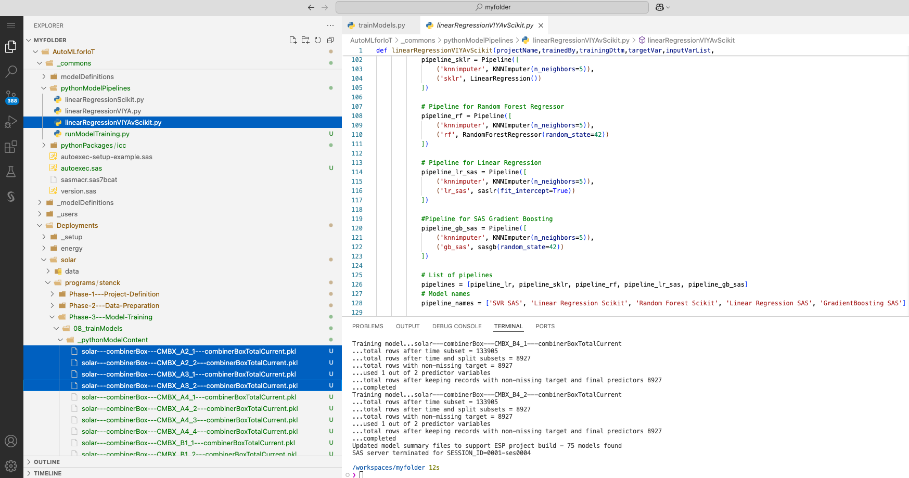
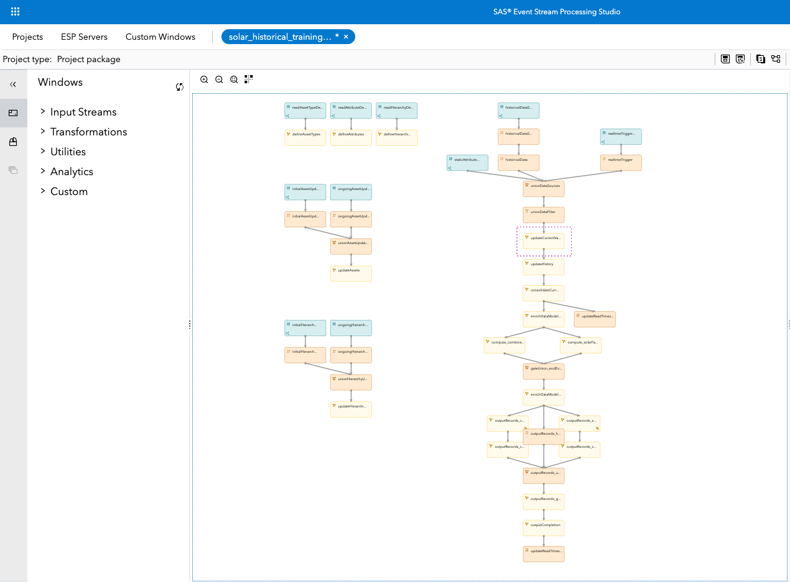
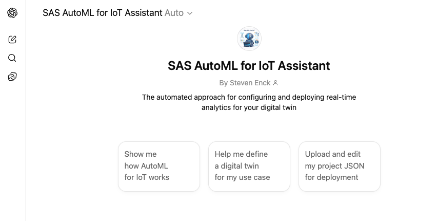

# sas-automl-for-iot

# Table of Contents
1. [Overview](#overview)
2. [How It Works](#how-it-works)
3. [Applicable Use Cases](#applicable-use-cases)
4. [AI Assistant](#ai-assistant)
5. [Installation](#installation)
6. [Contributing](#contributing)
7. [License](#license)

## Overview

Are you interested in deploying analytics in real-time?  

Would you like to realize tangible value from your data in days/weeks as opposed to months/years?

Do you prefer to limit cloud costs and have agile deployment options?

Would you like an AI assistant to help guide you through the process?

If so, you are in the right place!

SAS AutoML for IoT is an automated approach that dramatically simplifies solving your real-time analytics use case. It relies on just a few configuration files that a subject matter expert could provide - and then automates the entire process. From transforming simple sensor data into analytic datasets, to training models for all of your key metrics and settings, to configuring rules and alerts, to deploying your project to run in real-time 24/7, SAS AutoML for IoT does it all!

How is this possible?  SAS has capabilities that extend across the entire analytics lifecycle - from data ingestion and processing, to analytical modeling, to model management, to deployment. These capabilities are designed to work seemlessly together - SAS AutoML for IoT simply connects all of these capabilities elegantly and allows users to quickly tackle customer use cases.

Watch this short video to learn more... This video focuses on the integration of Viya Workbench and Event Stream Processing, but the same capabilities are available using the entire Viya suite (SAS Studio, Model Studio, Model Manager, Event Stream Processing, etc.).

 |

## How It Works

SAS AutoML for IoT provides a digital twin approach to address your use case. At a high level, it follows a guided workflow with the following steps...

 

Let's go a little deeper so you get a feeling for what is done in each of those steps... We'll look at a small example for a solar farm, where we have...
- strings of solar panels that gather solar energy
- combiner boxes which collect the energy generated from various solar panel strings
- arrays - here, this is just used to an organize our assets into logical groupings
- inverters which convert the energy from DC to AC so that energy can be used more broadly
- solar farm which provides an overarching grouping and collects information about the solar irradiance via its devoted sensor

 

With AutoML for IoT, users create a digital twin of their use case - in other words, a picture of the assets you have, what is measured for each of those assets, and how the assets are connected... Here's an example for our solar farm...

 

Then users enrich that digital twin with calculated measures - summarize data over time, across connected assets, run custom code, etc. These new attributes become part of the digital twin. Here's the same diagram - now with derived attributes added in blue to indicate that they are being calculated.

SAS AutoMLfor IoT automatically maintains this picture in memory and will keep it up-to-date as data arrives in real time.

 

Then, users simply describe what to output and model in this digital twin. No complexity... just describe...
- what asset types you want to output tables for
- which measures you'd like to output as columns - you can retrieve data easily from any connected asset
- how often you'd like to output updates (for example, every minute)
- what analytical models you would like to train - provide the target, predictors, a date range to train on, and a model pipeline to use

Then, SAS AutoML for IoT does the rest!  In just a few minutes, you will have...

 

**Analytic-Ready Datasets...**

 

 

 

 

**Trained Models via Viya's Model Studio (drag and drop)...**

 

 

 

 

**OR... Trained Models via Viya Workbench (SAS or Open-Source)...**

 

  

 

 

**A Ready-to-Deploy Real-Time SAS Event Stream Processing Project (which can even be exported to a container to run anywhere)...**

 

 

 

 

**In Short, You Will Have Machine Learning Models Monitoring or Predicting Every Key Metric and Setting of Importance to You!!!**

## Applicable Use Cases

SAS AutoML for IoT has been used to...

- monitor and improve the operation and efficiency of HVAC equipment - from chillers to boilers to air handlers, etc.
- optimize manufacturing plants
- enhance the operation of wind turbines and solar farms
- provide continuous review of medical data, including lab tests, vital signs, etc.
- monitor train movement, expected arrival times/delays, etc.
- etc.

And, the list is growing! Fundamentally, you can think of it this way... You need to be able to describe the assets in your use case (machines, people, locations, etc.), what you measure about those assets (temperatures, pressures, quantities, etc.), and connect the assets to reflect any dependencies that exist. Then you simply request what you want to know - what you want to predict, forecast, be notified of, etc. 

SAS AutoML for IoT takes care of the rest. Your team gets to spend more time focused on the analytics and less time orchestrating every little detail.

## AI Assistant

While every step in the AutoML for IoT process is simple in nature, we've found it even more efficient to allow users to engage with an AI assistant to configure their projects using simple conversation...  

 

More on this later!!! 

 

 

## Installation

It's easy to get started!  

Click [here](installation/README.md) to learn how to set up everything you will need!

### Prerequisites

SAS AutoML for IoT integrates multiple products in SAS Viya, including SAS Studio, Model Studio, Model Manager, Event Stream Processing Studio, and Event Stream Manager. If you already have these in your SAS installation, great!  If not, the installation page shows you how to obtain a trial environment to try this out.

### Getting Started / Examples

Once you've installed what you need, this [page](setting-up-your-first-project/README.md) will show you how to set up your first project - and it also includes five training projects that each add a new capabiity as well as several full examples of projects that you can work through and set live.

### Additional Resources

As you work through designing and deploying your SAS AutoML for IoT project, you will find it useful to refer to resources on this [page](enablement-home/README.md). It provides supporting materials related to each step.

## License

This project is licensed under the [SAS License Agreement for Corrective Code or Additional Functionality](LICENSE).

      
