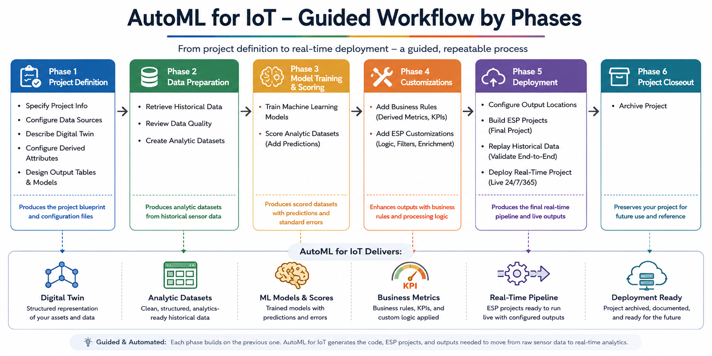
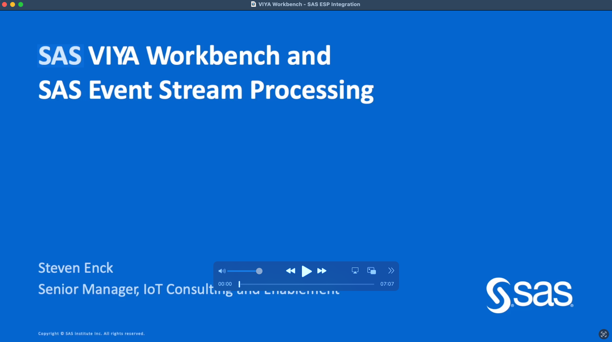
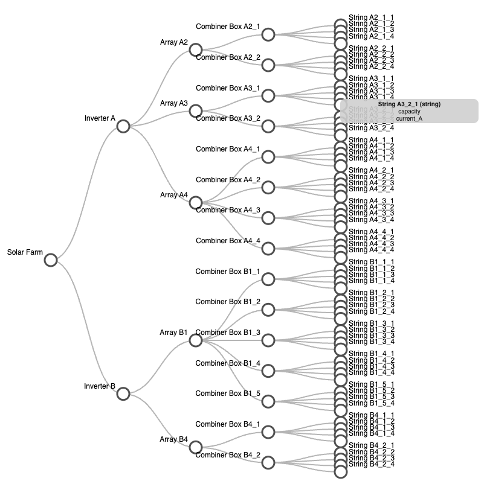
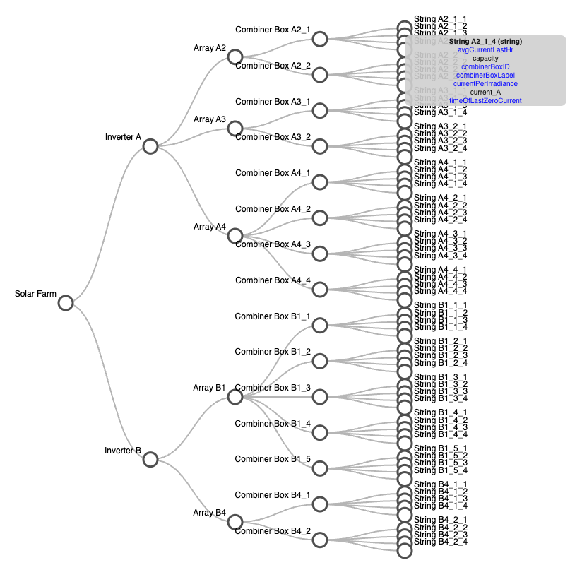
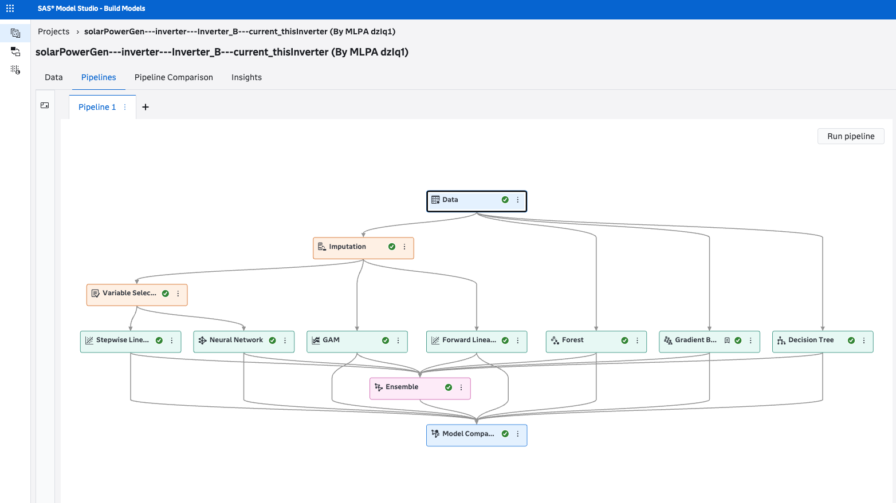

# SAS AutoML for IoT

SAS AutoML for IoT is a configuration-driven framework for building and deploying real-time analytical applications with SAS.

It combines digital-twin modeling, streaming data processing, data enrichment, automated model training and scoring, business rules, and SAS Event Stream Processing deployment into a guided workflow.

Use this repository to install the solution, explore example and training projects, configure your own use case, and deploy completed projects for historical replay or real-time processing.

## Watch the Overview

This short video provides an introduction to SAS AutoML for IoT and shows how SAS Viya Workbench and SAS Event Stream Processing can work together as part of the solution.

The same overall workflow can also be used with the broader SAS Viya environment.

---

## Requirements

AutoML for IoT requires:

- **SAS Viya** or **SAS Viya Workbench**
- **SAS Event Stream Processing**

When using SAS Viya, AutoML for IoT integrates capabilities in SAS Model Studio to train models, SAS Model Manager to manage models, and SAS Event Stream Processing/Manager to deploy the final project. When using the lighter weight SAS Viya Workbench, models are automatically trained in Python using popular packages such as scikit learn (packaged as pkl files) or in SAS using available procs (with scoring code or astores depending on procs used) and deployed using SAS Event Stream Processing/Manager.

If you do not already have the required environment, the installation guide walks through the available setup paths and the AutoML for IoT installation process.

[Install SAS AutoML for IoT](installation/README.md)

---

## Choose How You Want to Get Started

### See How AutoML for IoT Is Used

Explore complete example projects across energy, transportation, healthcare, manufacturing, and flood prediction.

[Explore Example Projects](setting-up-your-first-project/example-projects.md)

### Learn with Guided Training Projects

Work through five progressive projects that introduce the core AutoML for IoT capabilities step by step.

[Explore Training Projects](setting-up-your-first-project/training-projects.md)

### Build Your Own Project

Register as an AutoML for IoT user, create a blank project or import an existing one, and then work through the project documentation.

[Set Up Your First Project](setting-up-your-first-project/README.md)

### Use the AI Assistant

Use a guided conversation to learn how AutoML for IoT works, describe a new use case, or review and modify an existing project. Then import those configurations directly into AutoML for IoT and execute/deploy in SAS.

[Work with the AI Assistant](working-with-the-ai-assistant/README.md)

---

## What AutoML for IoT Does

AutoML for IoT represents an operational environment as a digital twin: the assets in the use case, the information measured for those assets, and the relationships between connected assets.

For example, a solar-power project can represent panel strings, combiner boxes, arrays, inverters, and the overall solar farm.

The digital twin can then be enriched with calculated information such as values from prior time periods, aggregations over time, values from connected assets, and custom calculations.

From that configuration, AutoML for IoT automatically creates analytic-ready datasets for historical analysis and writes a project to continuously update those output tables to support real-time processing.

Projects can optionally train and deploy machine-learning models using SAS Model Studio, SAS, or Python analytical pipelines. 

The completed configuration is then automatically packaged into SAS Event Stream Processing projects which can be used for real-time deployment and/or historical replay.

---

## Documentation

The project documentation guides you from initial configuration through data preparation, model training, customizations, deployment, and archiving.

[Open the AutoML for IoT Documentation](enablement-home/README.md)

Advanced topics, including defining custom analytical pipelines, are linked from the relevant sections of the documentation.

---

## Contributing

For information about contributing to this repository, see [CONTRIBUTING.md](CONTRIBUTING.md).

## Support

For support information, see [SUPPORT.md](SUPPORT.md).

## License

This project is licensed under the [SAS License Agreement for Corrective Code or Additional Functionality](LICENSE).
