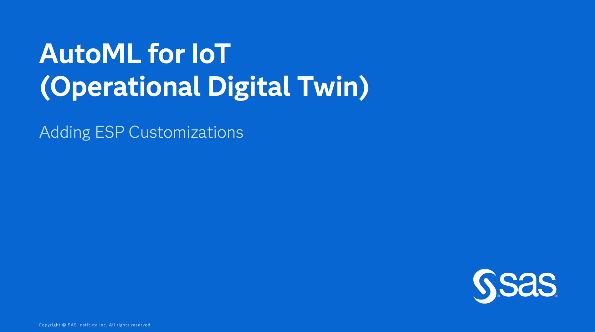

# Adding Customizations

Thus far, AutoML for IoT has simplified the process of transforming your simple sensor data into analytic-ready datasets, and it has trained and integrated machine learning models for all of your key metrics and settings.

Now, you have the option to add some customizations to finish up your project. There are two types of customizations you can make...

- Business Rules - this is code that will run on your final analytic-ready datasets. You have designed your output tables and integrated model predictions. Now, you can choose to write new variables that use any/all of those columns. For example, compare actual and predicted values and create an alert variable if they are far from one another. Or calculate a new metric that uses the model predictions - for example, actual power generation divided by predicted would give you a measure of efficiency. For each variable, you'll just need to provide a list of the other variables you will reference and the code itself. The orchestration is managed by AutoML for IoT.

- ESP Customizations - SAS Event Stream Processing has many different capabilities - there are windows that will train models as the data arrives, calculate Shapley values, examine the data for specific patterns, etc. This section allows you to add ESP windows to your project. Generally, users will explore the ESP project that AutoML for IoT wrote in SAS Event Stream Processing Studio. Then, the user will drag in new windows and connect them in their existing project. Once done, the user can copy the content they've added into the appropriate spots in the AutoML for IoT config files. Then, anytime you make changes to the AutoML for IoT project going forward, these customizations will always automatically be integrated into the final project.

Both of these options is discussed in the following sections in detail. Users can choose to use one, both, or neither of these options. If you do not want to integrate either option, you can skip this step entirely.

## Defining Business Rules 

The below powerpoint will walk you through the process of defining business rules, testing them out to ensure they will have the desired result, and then integrating them into your AutoML for IoT project.

Step-by-Step Guide         |  
:-------------------------:|
 |

## Adding ESP Customizations 

The below powerpoint will walk you through the process of integrating additional ESP windows, edges, etc. into your ESP project.

Step-by-Step Guide         | 
:-------------------------:|
 |

      