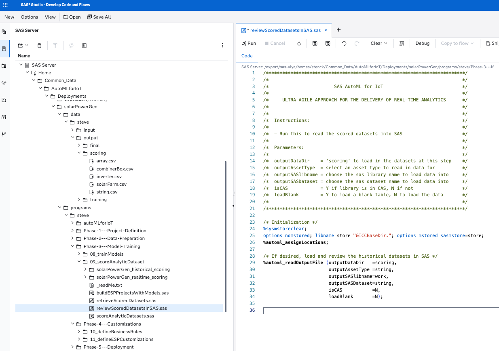
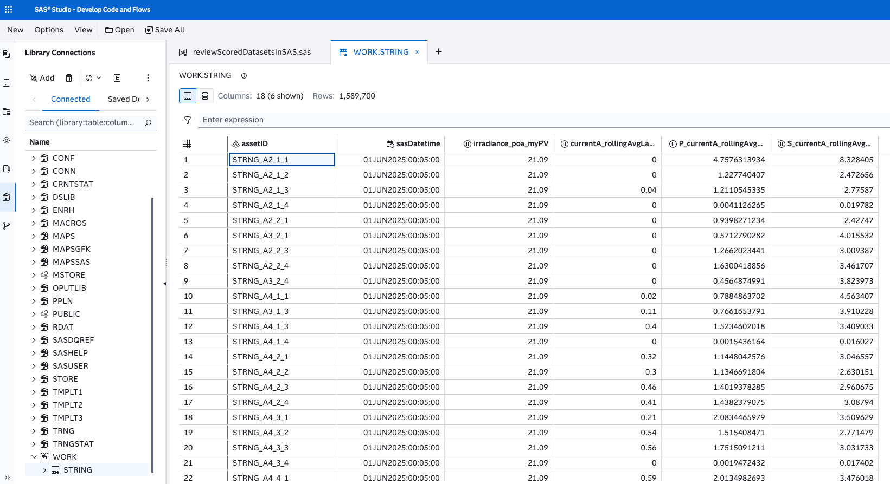
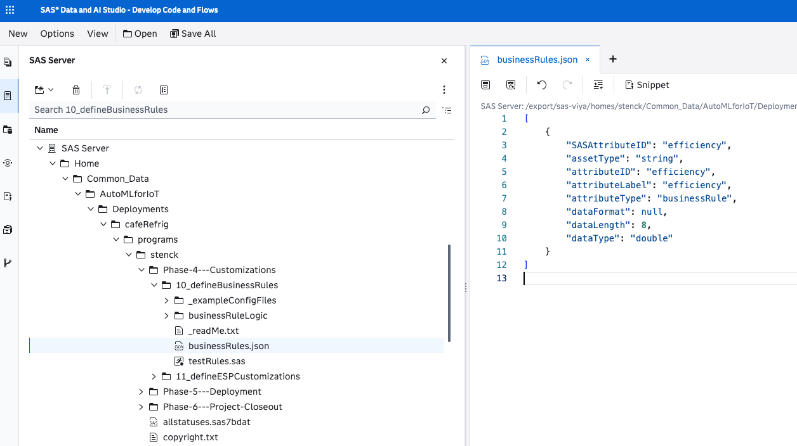
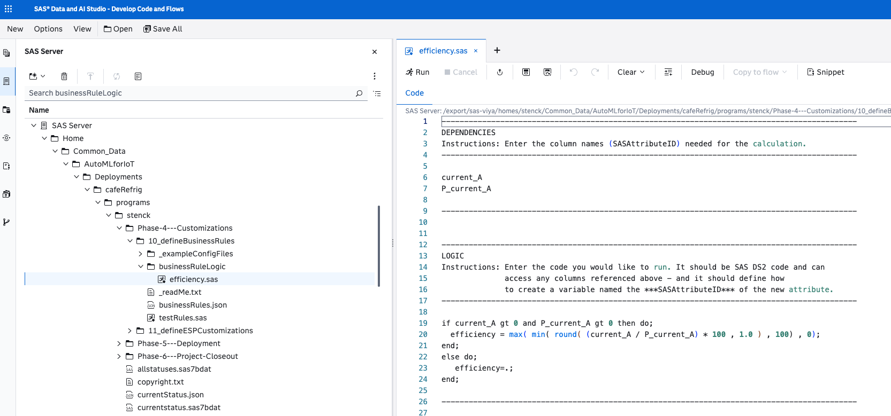
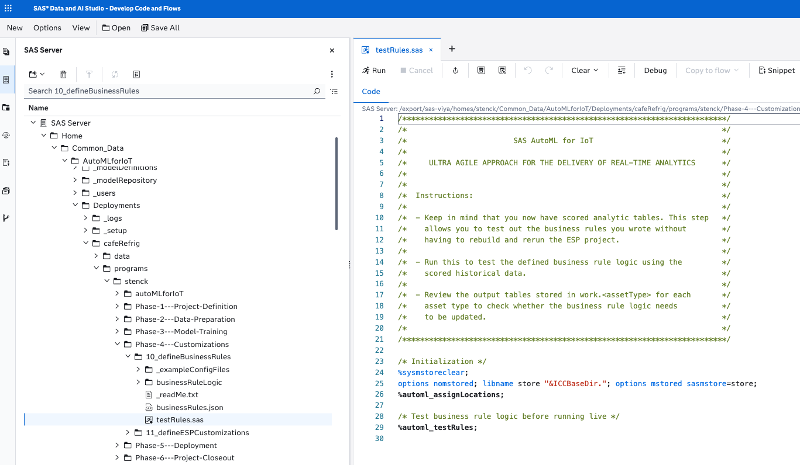

# Define Business Rules

Business Rules are optional calculations that run **after model predictions have been added to the output tables**.

They create new variables from columns already present in a scored output table.

## When to Use Business Rules

Use business rules when the desired output depends on scored analytic data.

Examples include:

- compare actual and predicted values and flag large differences
- recommend an action based on model results and sensor measurements
- calculate a performance metric such as:

```text
actual power generation / predicted power generation
```

Business rules are different from derived attributes because they operate after model scoring rather than during the earlier digital-twin enrichment stage.

## Review the Scored Output Table First

Before creating a rule, inspect the scored output table so you know which columns are available to reference by updating and executing this program...

```text
reviewScoredDatasetsInSAS
```



Open the resulting SAS table and inspect the sensor, derived, prediction, and other scoring columns that can participate in the rule.



## Business Rules Use Two Definitions

A business rule is described using a two step process.

### Step 1: Define the New Business-Rule Variable

Provide the basic information about the new variable in:

```text
Phase-4---Customizations/10_defineBusinessRules/businessRules.json
```

An example is available in the project's `_exampleConfigFiles` area.



Business rule definitions should specify these pieces of information:

- output table on which the new variable is created
- new `attributeID`
- SAS-compatible attribute ID
- variable label
- data type: `double` or `string`
- data length
- optional SAS format
- attribute type, which is `businessRule`

For numeric `double` variables, the length should always be:

```text
8
```

The SAS attribute ID must:

- be no more than 30 characters
- contain only letters, numbers, and underscores
- not begin with a number

### Step 2: Define the Rule Logic

Create the logic in a corresponding SAS program in:

```text
Phase-4---Customizations/10_defineBusinessRules/businessRuleLogic/<SASAttributeID>.sas
```

An example code file can be found in `_exampleConfigFiles`.



The logic file follows a very specific structure and identifies:

- the existing scored-table columns that the new variable depends on
- the SAS code used to calculate the new variable

The variable names referenced in the code are the SAS attribute IDs from the project attributes or the prediction column names generated by the models.

The code must be valid SAS DS2 code.

## Declare Dependencies

List every scored-table column required by the calculation.

AutoML for IoT uses that dependency list to orchestrate the calculations in the correct order.

For example, a business rule that calculates efficiency might depend on:

```text
current_A
P_current_A
```

and then calculate something conceptually like:

```sas
efficiency = current_A / P_current_A;
```

The exact variable names must match the columns available in the scored output table.

## Optionally Test the Business Rules

You can **optionally** test the business rules before the final ESP project is built.

Run:

```text
testRules.sas
```

No asset-type-specific calls need to be configured. The program automatically tests the defined business rules for **all asset types** using the scored historical data.



Review the resulting output tables for the applicable asset types to confirm that the new business-rule values behave as expected. This provides a convenient way to validate the logic without rebuilding and replaying the full ESP project.

## Integration into the Final Project

Business rules are processed during the later deployment step when the final ESP project is built.

Note that the configured rules are integrated into both:

- the final historical ESP project
- the final real-time ESP project


## Previous

If you need to inspect the scored historical output before defining a rule, see [Load and Review Scored Datasets in SAS](../scoring-the-analytic-dataset/review-scored-datasets-in-sas.md).

## Next

If the project also needs native ESP windows, edges, or connectors that are not generated automatically, see [Add ESP Customizations](esp-customizations.md).

## Related Information

For an overview of the two optional customization approaches, see [Adding Customizations](README.md).
