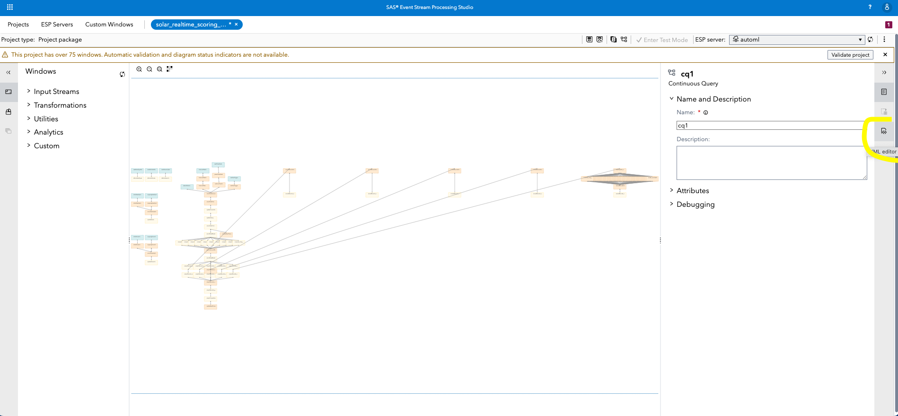
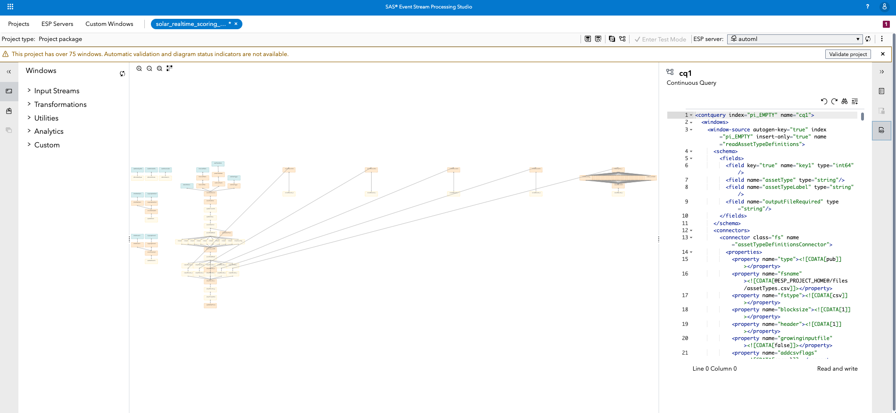
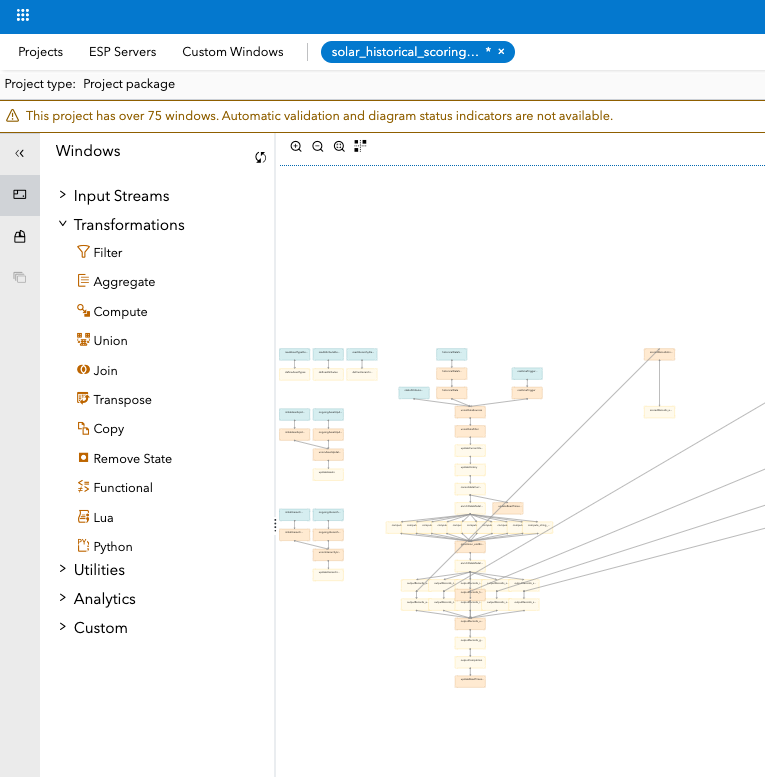
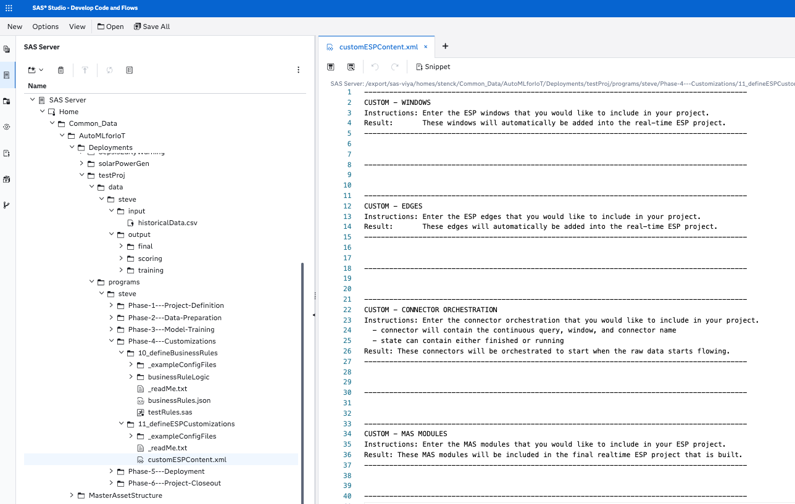
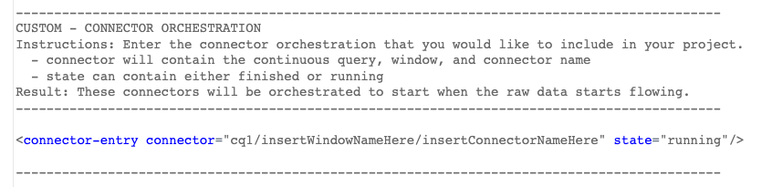
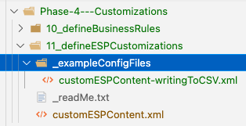
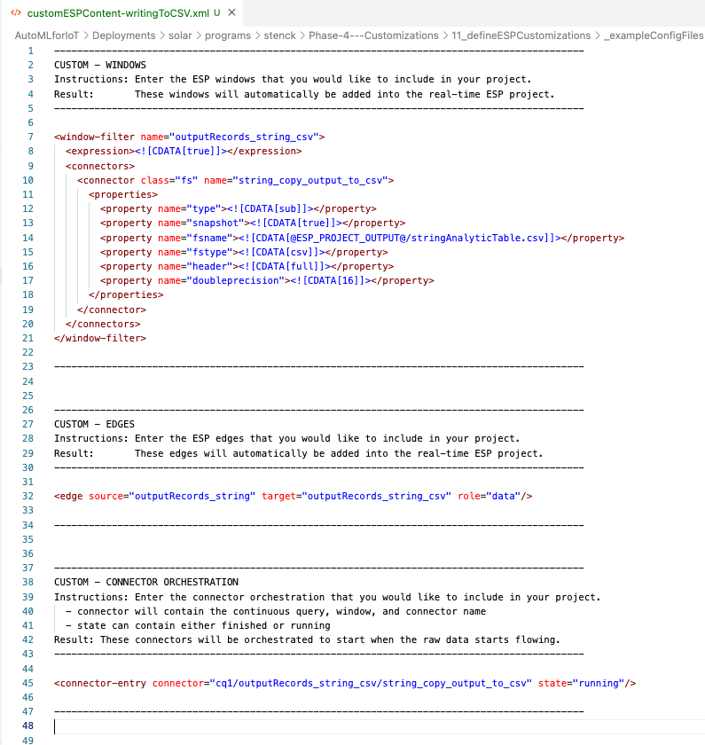

# Add ESP Customizations

ESP Customizations are optional additions to the SAS Event Stream Processing projects generated by AutoML for IoT.

Use them when the project needs native ESP capabilities that are not already generated from the standard AutoML for IoT configuration.

Examples where customizations can be useful include:

- additional modeling capabilities
- Shapley-value processing
- models that train as data arrives
- native ESP calculations
- additional ESP windows and edges

## How the Customization Workflow Works

The documented process has two major parts:

1. build and test the desired ESP content visually in SAS Event Stream Processing Studio
2. copy the XML for only the new content into the AutoML for IoT customization file

This allows AutoML for IoT to preserve those additions whenever the generated project is rebuilt.

## Step 1: Open the Scoring Project in ESP Studio

Open the scoring ESP project generated earlier.

The ESP Studio interface presents the project as a connected flow diagram.



Under the hood, the ESP project is represented as XML.

Use the XML view in ESP Studio to inspect the XML associated with selected windows and edges.



## Step 2: Add and Test the Desired ESP Content

In ESP Studio:

- drag in the required windows
- configure their settings
- create the necessary edges
- configure any connectors
- test the modified project directly in ESP Studio



Complete the visual design and testing before transferring the customization back into the AutoML for IoT project.

## Step 3: Open `customESPContent.xml`

After the new ESP content works as intended, open:

```text
Phase-4---Customizations/11_defineESPCustomizations/customESPContent.xml
```



Users will copy content from the ESP project into specific sections in this file.

## Copy New Windows

Copy the XML for each new ESP window into the:

```text
custom - windows
```

section.

Only copy the windows you added as part of the customization.

## Copy New Edges

Copy the XML for each new edge into the:

```text
custom - edges
```

section.

These edges connect the new windows to the appropriate parts of the generated ESP flow.

## Copy MAS Modules When Needed

If the customization includes MAS modules, copy the corresponding XML into the:

```text
custom - mas modules
```

section.

This section is used less often and is generally associated with SAS DS2 code windows.

## Configure New Connectors

If any new window contains a connector to an external data source, add an entry in the:

```text
custom - connector orchestration
```

section.

This tells AutoML for IoT how the connector should be started when the generated project runs.

Each orchestration entry identifies:

- the ESP window containing the connector
- the connector name
- the desired connector state

The connector state should typically be set to:

```text
running
```

for data-source connectors.



## Example Customization

Below is an example that combines:

- a custom ESP window
- a custom edge
- a connector
- the matching connector-orchestration entry



The corresponding ESP flow can be reviewed visually in ESP Studio.



## Integration into the Final Project

ESP customizations are incorporated later when the final deployment ESP projects are built.

Note that customizations entered through this mechanism are integrated into both:

- the historical project
- the real-time project


This is the reason to copy tested additions back into `customESPContent.xml`: direct edits made only inside a generated ESP project would otherwise not be preserved when AutoML for IoT rebuilds the project.

## Previous

If the project needs calculations on scored output columns rather than new ESP topology, see [Define Business Rules](business-rules.md).

## Next

After optional customizations are complete, configure the final output destinations. See [Configuring Output Locations](../configuring-output-locations/README.md).

## Related Information

For an overview of both optional customization paths, see [Adding Customizations](README.md).
