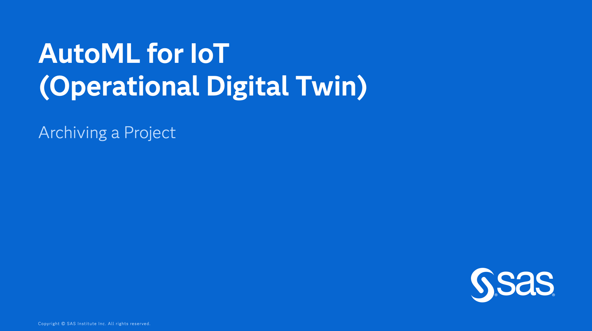

# Archiving a Project

Would you like to package up your project and share with someone else?  Or archive it for later use without the full directory structure?

The below powerpoint will walk you through how to archive your project into a single JSON which you can then store or share.

IMPORTANT... Note that while all of the config files are output into the JSON file, model content is not. If using Viya, then those models are stored automatically in Model Studio / Model Manager. If using Viya Workbench, the models are stored in /AutoMLforIoT/_modelRepository/python and would need to be backed up separately. 

Step-by-Step Guide         |  
:-------------------------:|
 |

       
