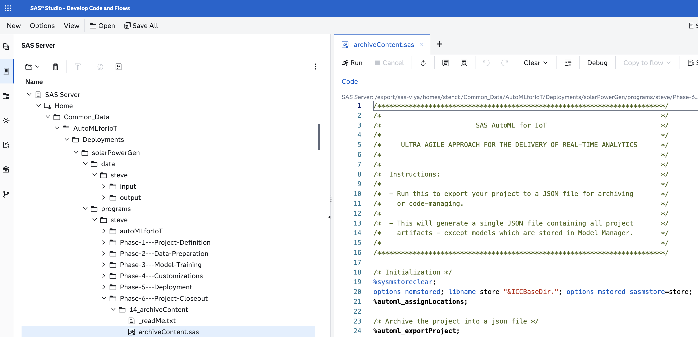
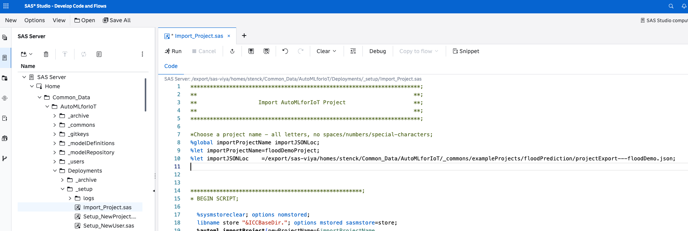

# Archiving a Project

After an AutoML for IoT project is complete, you can package its configuration into a single export file for storage or sharing.

The archive utility consolidates the project configuration into one JSON file.

> **Important:** The project export does **not** include trained model content. Model artifacts must be preserved separately.

## When to Archive a Project

Archive a project when you want to:

- preserve a completed project in a compact format
- move the project configuration to another environment
- share the project configuration with another user
- retain a recoverable copy without keeping the full working directory structure

## Export the Project

Open and run the archive utility in:

```text
Phase-6---Project-Closeout/14_archiveContent
```

The program is:

```text
archiveContent
```

Run the program to create the project export.



## Project Export File

After the archive utility completes, a JSON export file appears in the project's top-level directory (at the same level as the Phase-x--- directories).

The filename follows this pattern:

```text
projectExport---<projectName>---<datetime>.json
```

This single JSON file contains the AutoML for IoT project configuration that can later be imported to recreate the project.

## Trained Models Are Not Included

The project export contains the project configuration, but it does not contain the trained model artifacts themselves.

How models are preserved depends on the environment.

### SAS Viya

Models trained in SAS Model Studio are stored in SAS Model Studio and managed by SAS Model Manager.

Custom SAS model content and Python model content are stored in the model repository under:

```text
/AutoMLforIoT/_modelRepository
```

Python model content is stored under:

```text
/AutoMLforIoT/_modelRepository/python
```

And SAS custom model content is stored under:

```text
/AutoMLforIoT/_modelRepository/sas
```

Back up the required model repository content separately from the project export.


### SAS Viya Workbench

Model content is stored in the model repository under:

```text
/AutoMLforIoT/_modelRepository
```

Python model content is stored under:

```text
/AutoMLforIoT/_modelRepository/python
```

And SAS custom model content is stored under:

```text
/AutoMLforIoT/_modelRepository/sas
```

Back up the required model repository content separately from the project export.

## Import an Archived Project

To import a previously archived project, open:

```text
/AutoMLforIoT/Deployments/_setup/Import_Project.sas
```



Users should provide:

- the project name to use for the imported project
- the path to the exported project JSON file

Then run `Import_Project.sas`.

After the import completes, the project appears under the `Deployments` area.

## What to Preserve Together

For a complete project archive, retain:

- `projectExport---<projectName>---<datetime>.json`
- any separately backed-up trained model artifacts that the project requires

The exported project JSON preserves the project configuration. The model backup preserves the trained analytical content that is intentionally outside the export.

## Next

Archiving is the final section in the documented AutoML for IoT project workflow. Return to [Enablement Home](../enablement-home/README.md).
