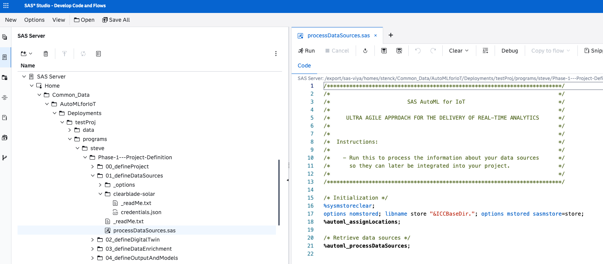

# Configuring Data Sources

In this step, a user can set up connection to a historical data source, real-time feed, or to an operational ClearBlade environment. In most cases, a user will skip this step for the time being and first define the digital twin for their use case - then return here to configure connection to its historical/real-time data. However, if a user has already configured that twin in ClearBlade, then they can enter that information here to facilitate later steps.

Choose the option that matches your project.

- **I need to set up my digital twin.** First define the asset types, attributes, assets, metadata, and relationships that [describe your digital twin](../describing-your-digital-twin/README.md). After the digital twin has been defined, return here to configure real-time and/or historical data connections for it.


- **I already set my digital twin up in ClearBlade.** [Configure the connection to your existing ClearBlade data source](clearblade.md). AutoML for IoT will use this information to query your existing ClearBlade environment and retrieve details about the digital twin, historical data for model training, and real-time updates. 

---

## Where the Configuration Goes

Data sources are configured under:

```text
Phase-1---Project-Definition/
└── 01_defineDataSources/
    ├── _options/
    │   ├── clearblade-example/
    │   ├── customESP-example/
    │   └── historicalDB-example/
    ├── <your configured data-source folders>/
    └── processDataSources.sas
```

The `_options` directory contains **templates**. Do not edit those template folders in place.

For each data source that your project needs:

1. Open `01_defineDataSources/_options`.
2. Copy the appropriate template folder into `01_defineDataSources`.
3. Rename the copied folder so it identifies that specific connection.
4. Edit the configuration files inside the copied folder.
5. Repeat the process if the project uses more than one data source.
6. Run `processDataSources.sas` after the configured source folders are ready.

For example, a configured project might contain:

```text
01_defineDataSources/
├── _options/
├── customESP-readSemtech/
├── historicalDB-buildingHistory/
└── processDataSources.sas
```

Only the copied and configured folders under `01_defineDataSources` become project data sources. The folders inside `_options` remain available as starting templates.

## Setting Up Real-Time and Historical Data Connections

After the digital twin has been configured, AutoML for IoT can retrieve historical information about the assets and attributes, connect to real-time updates, or do both.

If you are creating a demonstration project and do not require direct data connections, you can skip this step and manually create historical data later in the process.

Choose one or more of the following connection types.

### Real-Time Data Source

Use SAS Event Stream Processing to connect to a real-time source and transform incoming events into the standard schema expected by AutoML for IoT.

SAS Event Stream Processing supports many connection patterns, including message feeds such as Kafka and MQTT, database queries, and API-based integrations.

For details about configuring connection to a real-time data source, see [Configure a Custom ESP Real-Time Data Source](custom-esp.md).

### Historical Database

Configure a database connection when historical sensor readings are stored in a database.

After this connection is configured, later steps that need historical data can retrieve it from the database automatically.

For details about configuring a historical-database source, see [Configure a Historical Database](historical-database.md).

### ClearBlade

If your digital twin already exists in ClearBlade, configure the native ClearBlade integration.

This connection can be used to:

- retrieve information about assets, attributes, and hierarchies
- retrieve historical data for model training
- connect to real-time updates

For details about configuring a ClearBlade data source, see [Configure a ClearBlade Data Source](clearblade.md).

## Using Multiple Data Sources

A project can contain more than one configured source.

Create one copied-and-renamed folder for each connection. For example:

```text
01_defineDataSources/
├── clearblade-production/
├── historicalDB-archive/
├── customESP-weather/
└── processDataSources.sas
```

Each folder is configured independently. After all required source folders are ready, run `processDataSources.sas` so AutoML for IoT can process the complete set of configured data sources.



Note that future steps will make use of the configured data sources as needed. Any historical data sources will automatically be used when history data retrieval is performed, and the final real-time project will automatically integrate the content needed to connect via custom ESP connection or ClearBlade.

## Previous

To review the project name and timing settings that should be defined before data connections are configured, see [Specifying Project Information](../specifying-project-information/README.md).

## Next

After the required data-source decisions are understood, define the structure of the digital twin that the incoming data will update. For details about asset types, attributes, assets, metadata, and hierarchies, see [Describing Your Digital Twin](../describing-your-digital-twin/README.md).

## Related Information

For the overall AutoML for IoT workflow and links to the remaining project phases, see [Enablement Home](../enablement-home/README.md).
