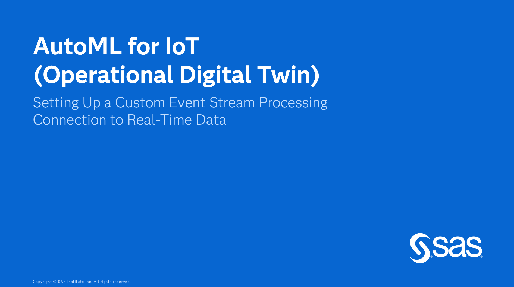
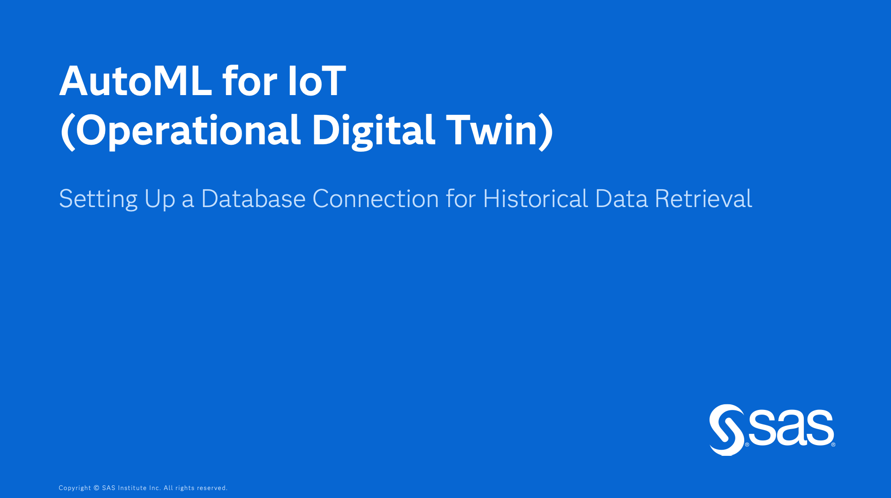

# Configuring Data Sources 

Please choose one of the options below...

- [I already set my digital twin up in ClearBlade](#configuring-your-connection-to-clearblade) - If you've already set your digital twin up in ClearBlade, then click [here](#configuring-your-connection-to-clearblade) to configure your connection before you proceed to the next steps... Since you've already configured your digital twin, we'll use that information wherever possible! 

- [I need to set up my digital twin](../describing-your-digital-twin/README.md) - We'll have you skip this step for now and first describe your digital twin by clicking [here](../describing-your-digital-twin/README.md). Then you can return to this step later on to set up [connections](#setting-up-real-time-and-historical-data-connections) to retrieve real-time and/or historical data about your digital twin.

## Setting Up Real-Time and Historical Data Connections 

Now that your digital twin has been configured, we need to retrieve historical data related to your assets/attributes  **and/or**  get connected to real-time updates.

It is easy to configure connections to both real-time data sources and to historical databases. Details about each of these options are provided in the sections below. If you are creating a demo project only and do not require either of these direct connections, then you may skip this step and manually create your historical dataset when you get to the 'retrieveHistoricalData' step in the process.

### Configuring a Connection to a Real-Time Data Source

The below powerpoint will walk you through how to create a real-time connection to your data source. SAS Event Stream Processing has more than 20 existing [connectors](https://go.documentation.sas.com/doc/en/espcdc/v_059/espca/titlepage.htm) that can be used to retrieve real-time data. This includes connecting to message feeds (kafka, mqtt, etc), querying databases at a specified time interval, running API calls, etc. The powerpoint will show you how to set up these connections and then how to integrate that information into your SAS AutoML for IoT project. 

Step-by-Step Guide         |  
:-------------------------:|
 |

### Configuring a Connection to a Historical Database

The below powerpoint will walk you through how to configure a connection to a historical sensor database that holds historical sensor readings for the assets/attributes in your digital twin. If you have this configured, then whenever historical data is needed (for example, replaying a historical time period), data will be retrieved automatically from this source.

Step-by-Step Guide         |  
:-------------------------:|
 |

## Configuring Your Connection to ClearBlade

The below powerpoint will walk you through how to create a connection to an existing ClearBlade instance. This will allow you to automatically retrieve the information about your digital twin, retrieve any needed historical data for model training, and ultimately connect to a real-time stream of data.

Step-by-Step Guide         |  
:-------------------------:|
 |

      
