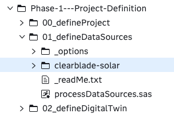
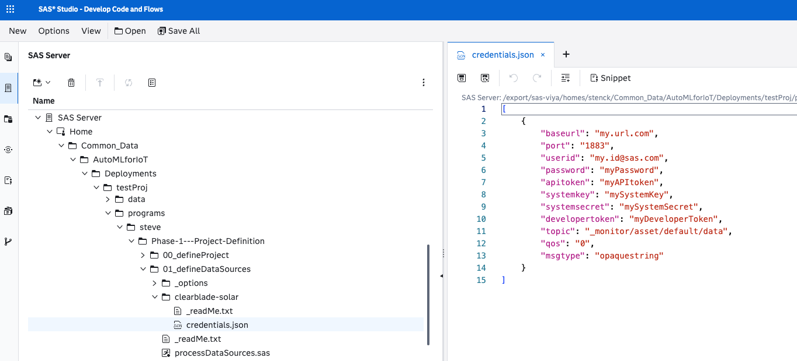
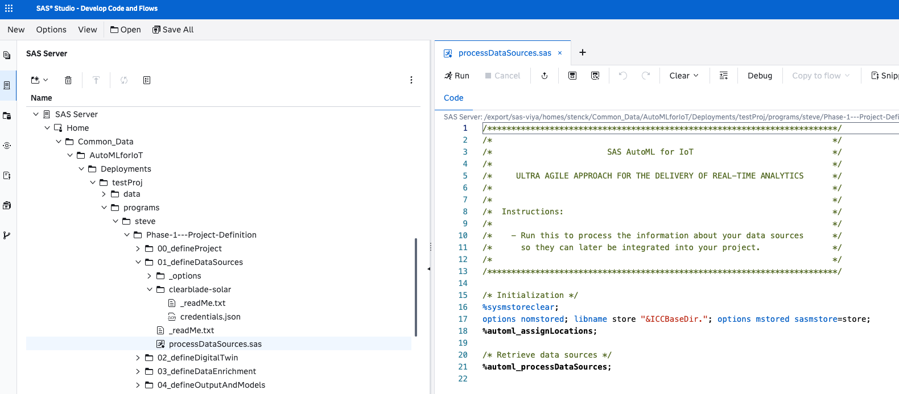

# Configure a ClearBlade Data Source

Use this option when a digital twin for the use case already exists in ClearBlade.

The ClearBlade integration can enable AutoML for IoT to:

- retrieve information about assets, attributes, hierarchies, and related digital-twin content
- obtain historical data for model training
- connect to real-time updates

## Add the ClearBlade Data Source

Start with the ClearBlade template under:

```text
Phase-1---Project-Definition/
└── 01_defineDataSources/
    └── _options/
        └── clearblade-example/
```

Do not configure the template inside `_options` directly.

Instead:

1. Copy `clearblade-example` from `_options` into `01_defineDataSources`.
2. Rename the copied folder, for example:

   ```text
   clearblade-solar
   ```

The copied folder is the project's active ClearBlade data-source configuration. The original folder under `_options` remains an unchanged template.

The new directory appears under `01_defineDataSources`.



## Configure the ClearBlade Connection

Open the `credentials.json` file in the copied ClearBlade data-source directory and enter the connection information required for your ClearBlade environment.

If you do not know the required values, obtain them from the appropriate ClearBlade administrator.



## Process the Data Sources

After the ClearBlade connection is configured:

1. Open the `processDataSources` program in `01_defineDataSources`.
2. Run the program.
3. Review the log and confirm that the ClearBlade source was processed successfully.



After the connection is processed, continue with the project workflow. When the digital twin already exists in ClearBlade, AutoML for IoT can use that information wherever the integration supports it.

## Next

Return to the main landing page for [Configuring Data Sources](README.md).
