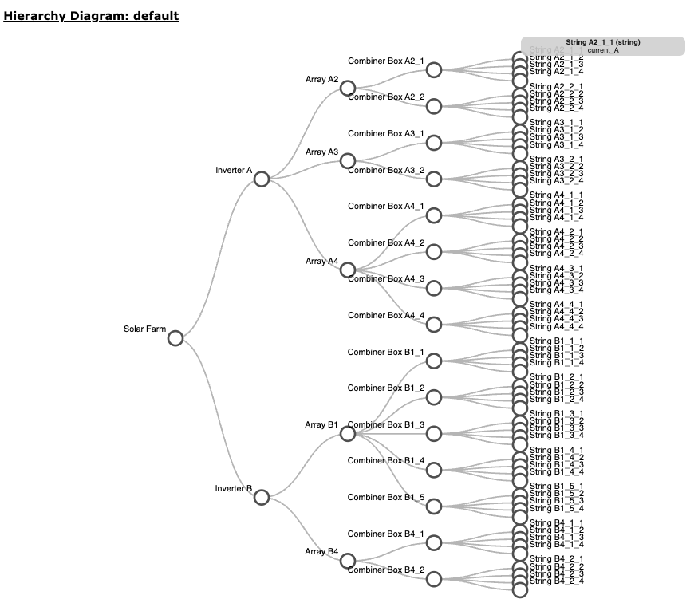
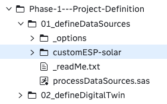
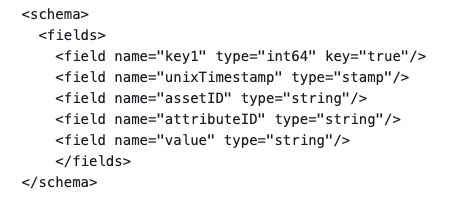
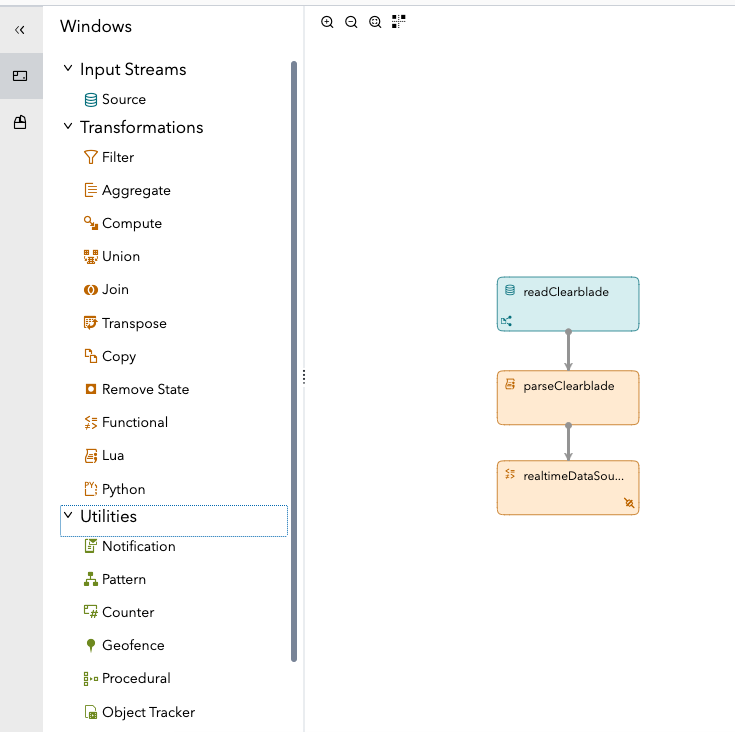
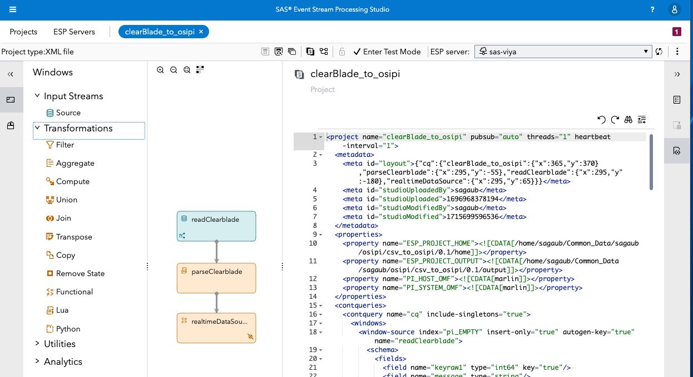
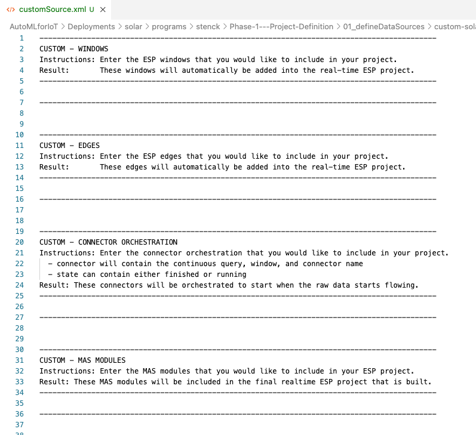
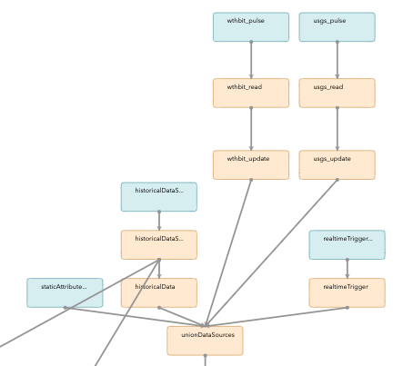
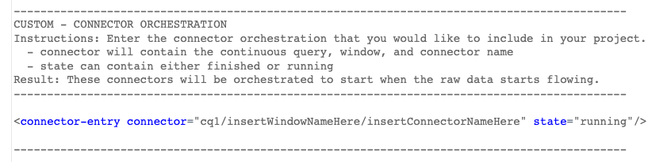
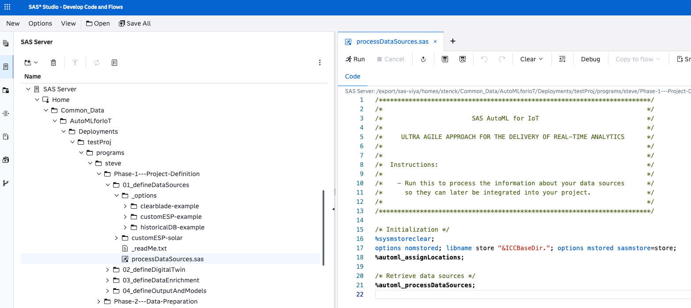

# Configure a Custom ESP Real-Time Data Source

Use this option when you want AutoML for IoT to receive real-time sensor updates from a source that you connect to through SAS Event Stream Processing.

Before completing this task, define the digital twin so that you know the asset IDs, asset types, and attributes that the real-time feed must update.



## Add the customESP Data Source

Start with the custom ESP template under:

```text
Phase-1---Project-Definition/
└── 01_defineDataSources/
    └── _options/
        └── customESP-example/
```

Do not configure the template inside `_options` directly.

Instead:

1. Copy `customESP-example` from `_options` into `01_defineDataSources`.
2. Rename the copied folder, for example:

   ```text
   customESP-solar
   ```

The copied folder is the project's active custom ESP data-source configuration. The original folder under `_options` remains an unchanged template.

The resulting directory should contain the configured custom ESP source.



We will update the `customSource.xml` file inside the new folder, but first we need to configure a connection to the real-time data source.

## Understand the Required Real-Time Data

The goal of the real-time connection is to retrieve updates about individual assets and attributes in the digital twin.

For example, if a solar-panel string has an attribute for electrical current, the real-time feed provides new values for that asset/attribute combination as measurements arrive.

We will dynamically configure an Event Stream Processing project to connect to the data source in whatever way is appropriate, but the key thing is that its final window must be configured so that it provides one sensor update per event using the schema expected by AutoML for IoT.

In other words, the final window must include one row per asset/attribute update and include the following fields:

- the timestamp, in UTC microseconds
- the asset ID
- the attribute ID
- the value

The values of `assetID` and `attributeID` should match assets and attributes defined in the digital twin, and the schema for the updates should match the following:



## Interactively Design an ESP Project to Connect to Your Real-Time Data Source

1. Open SAS Event Stream Processing Studio.
2. Create a new ESP project.
3. Add the windows, edges, and connectors required to connect to your real-time data source.
4. Transform the incoming records so that the last ESP window uses the AutoML for IoT sensor-update schema.
5. Test the ESP project and confirm that it produces the expected records.

An example ESP project is shown below.



## View the ESP XML

After the ESP project is working:

1. Use the XML view in SAS Event Stream Processing Studio.
2. Select each window or edge to view the XML associated with it.
3. This XML will be copied into specific locations in AutoML for IoT so that it can be incorporated into your final project.



## Copy the ESP Content Directly into Your AutoML for IoT Project

Open:

```text
customSource.xml
```

in the newly created custom data-source directory.

Copy the XML from your ESP project into the corresponding sections of this file:

- copy ESP windows into the **custom - windows** section of the file
- copy ESP edges into the **custom - edges** section of the file
- copy MAS modules into the **custom - mas modules** section of the file (when applicable)

MAS modules are less common and are generally needed only when the ESP project runs SAS DS2 logic.



## Add an Edge to Connect Your Final ESP Window to `unionDataSources`

All source data in the generated AutoML for IoT ESP project must be unioned into a window named:

```text
unionDataSources
```

Add one additional edge to the custom-edges section so that your final ESP window connects to `unionDataSources`.

For example, if the final custom window is named `usgs_update`, add an edge from that window to `unionDataSources`.



## Configure Connector Orchestration

The final ESP project needs to start the configured connectors when it starts.

In the **custom - connector orchestration** section, add a row for each connector used by your custom XML.

For each connector, specify the matching window and connector names from the ESP project.

The connector state should typically be:

```text
running
```



## Examples

A few custom data-source examples are available in the project's `_examples` directory. Use these as a reference.

## Process the Data Sources

After the custom source is configured:

1. Open the `processDataSources` program in `01_defineDataSources`.
2. Run the program.
3. Review the log and confirm that the expected data sources were processed.



## Next

To return to the available real-time and historical connection options, see [Configuring Data Sources](README.md).
