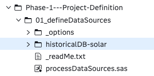
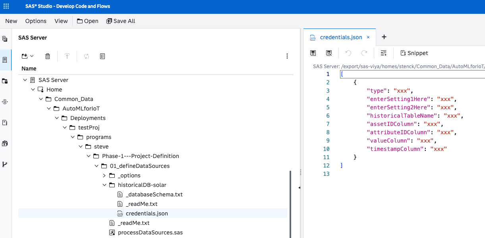
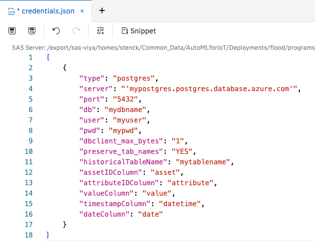
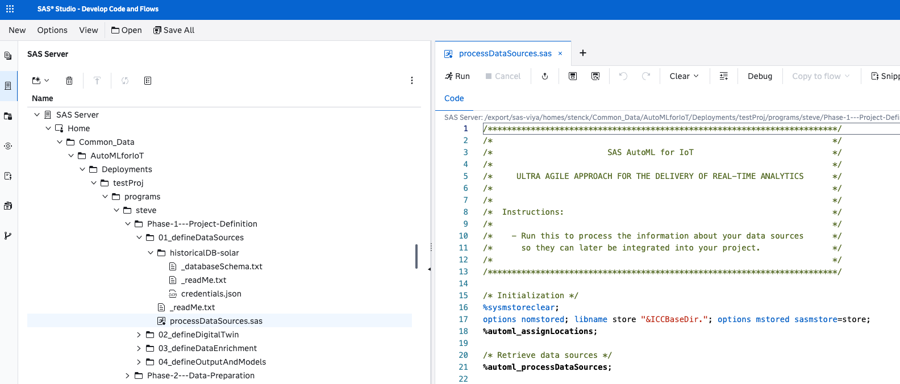

# Configure a Historical Database

Use this option when historical sensor readings for the assets and attributes in your digital twin are stored in a database.

After the historical database connection is configured, later AutoML for IoT steps that require historical data can use this source automatically.

## Add the Historical Database Data Source

Start with the historical-database template under:

```text
Phase-1---Project-Definition/
└── 01_defineDataSources/
    └── _options/
        └── historicalDB-example/
```

Do not configure the template inside `_options` directly.

Instead:

1. Copy `historicalDB-example` from `_options` into `01_defineDataSources`.
2. Rename the copied folder, for example:

   ```text
   historicalDB-solar
   ```

The copied folder is the project's active historical-database configuration. The original folder under `_options` remains an unchanged template.

The resulting data-source directory appears under `01_defineDataSources`.



## Configure the Database Connection

Open the `credentials.json` file in the copied historical-database directory.

The configuration identifies the database and describes where the historical sensor information is stored.

The following database connection types are supported:

- `postgres`
- `singlestore`
- `odbc`

Note that if you are using Quasar as your database, select ODBC as the database option.

The configuration also identifies:

- the historical table
- the column containing the asset ID
- the column containing the attribute ID
- the column containing the sensor value
- the timestamp column
- the date column



An example is provided below for illustration. In this example, `type` specifies the database type, the connection settings from `server` through `preserve_tab_names` provide options used to define the SAS `LIBNAME` connection, and the remaining fields specify the table and column names to use from the database.



## Process the Data Sources

After the database connection is configured:

1. Open the `processDataSources` program in `01_defineDataSources`.
2. Run the program.
3. Review the log and confirm that the historical database source was processed successfully.



## Next

To return to the available real-time and historical connection options, see [Configuring Data Sources](README.md).
