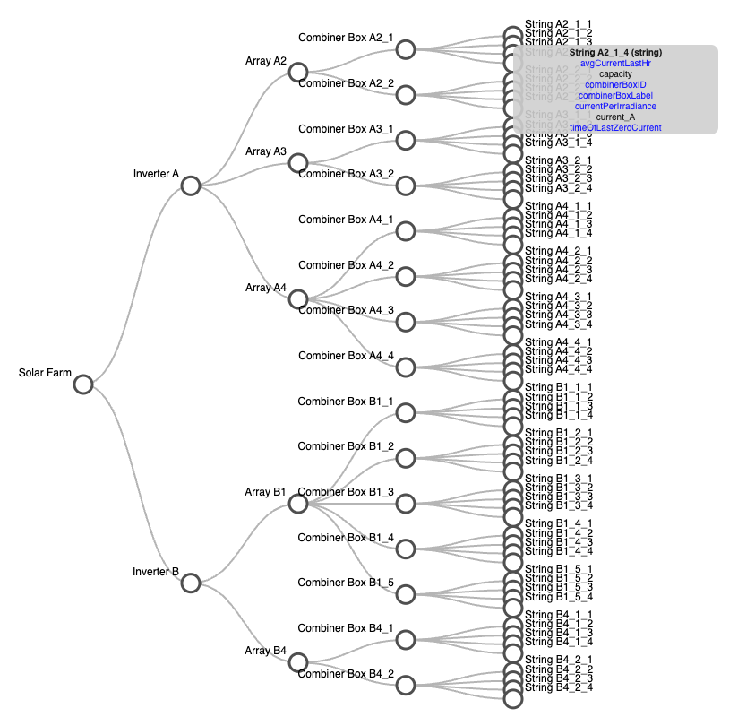

# Configuring Derived Attributes

In an ideal world, all of the information needed for a digital twin would arrive directly as raw sensor data. In practical applications, however, it is often necessary to calculate additional metrics from the information that is already available in the digital twin.

For example, you might need to know:

- the value of a sensor from an hour ago
- the change in a measurement over a period of time
- the average reading over the past 30 minutes
- the total value across connected assets
- the ID or label of a connected asset
- the value of an attribute from another asset
- the result of custom SAS calculation logic

Derived attributes add these calculated measures to the digital twin. Once defined, they can be used in structured output tables and analytical models in the same way as other attributes.



The current types of attribute types available in AutoML for IoT are described below.

## Time-Focused Attributes

Time-focused derived attributes use current and historical values from the same asset type.

### Lag

A `lag` attribute retrieves the value of an attribute from an earlier point in time.

Examples include:

- What was the pressure one hour ago?
- What was the current 15 minutes ago?

The lookback period can be a fixed number of seconds or, when supported by the project design, can be determined dynamically from another attribute.

For details about selecting the target attribute, defining a fixed or dynamic lookback period, and entering both the high-level and lag-specific configuration, see [Configure a Lag Attribute](lag.md).

### Delta

A `delta` attribute calculates the difference in one attribute between two points in time.

Examples include:

- How much did the temperature change over the past hour?
- How much did the river height increase during the past 30 minutes?

For details about defining the older and more recent comparison periods and entering the required configuration, see [Configure a Delta Attribute](delta.md).

### Temporal Aggregation

A `temporalAgg` attribute summarizes values over a period of time.

Supported summary calculations include:

- average
- sum
- minimum
- maximum

Examples include:

- What was the average irradiance over the past 15 minutes?
- What was the maximum temperature over the past hour?
- What was the total energy used during the previous hour?

For details about selecting the target attribute, summary calculation, time window, and historical-resolution requirements, see [Configure a Temporal Aggregation Attribute](temporal-aggregation.md).

## Relationship-Focused Attributes

Relationship-focused derived attributes use the connections defined in the digital twin.

### Relational Aggregation

A `relationalAgg` attribute navigates a hierarchy and summarizes a value across connected assets.

Supported summary calculations include:

- average
- sum
- minimum
- maximum

Examples include:

- What is the total airflow from the fan powered boxes connected to this air handler?
- What is the maximum damper position across connected fan powered boxes?
- What is the total current from connected solar-panel strings?

For details about selecting the hierarchy, navigation direction, number of levels, target attribute, and summary logic, see [Configure a Relational Aggregation Attribute](relational-aggregation.md).

### Count Connections

A `countConn` attribute counts parent or child connections for an asset.

Examples include:

- How many patients are connected to this hospital?
- How many child assets are connected to this piece of equipment?

The calculation can also be restricted to a particular connected asset type when needed.

For details about selecting the hierarchy, parent or child direction, optional asset-type filtering, and the asset whose connections should be counted, see [Configure a Count Connections Attribute](count-connections.md).

### Get Connection

A `getConn` attribute retrieves the asset ID of a particular parent or child connection.

This is useful when you need a specific connection rather than a count of the available connections.

For details about choosing the hierarchy, connection direction, instance number, search logic, and optional asset-type filtering, see [Configure a Get Connection Attribute](get-connection.md).

## Retrieving Connected Asset IDs and Labels

These attribute types retrieve identifying information from an asset or from its connected assets.

### Get Asset ID

A `getAssetID` attribute makes an asset's `assetID` available as a normal attribute in the digital twin.

This is especially useful when building output tables for dashboards. For example, a table focused on `string` assets might also include the IDs of the connected:

```text
solarFarm
inverter
combinerBox
string
```

Those ID fields make it easy for a dashboard to filter and drill from the solar farm level down to individual strings.

For details about identifying the target asset type and validating that the connection is unambiguous, see [Configure a Get Asset ID Attribute](get-asset-id.md).

### Get Asset Label

A `getAssetLabel` derived attribute makes an asset's human-readable `assetLabel` available as a normal attribute in the digital twin.

This is especially useful for dashboard and reporting output. For example, a table focused on `string` assets might also include the labels of the connected:

```text
solarFarm
inverter
combinerBox
string
```

Those label fields make it easier for users to understand, filter, and drill through the asset hierarchy without relying only on internal asset IDs.

For details about identifying the target asset type and entering the required configuration, see [Configure a Get Asset Label Attribute](get-asset-label.md).

## User-Written SAS Code

### Code

A `code` derived attribute executes custom SAS code to calculate a new metric from one or more raw or derived attributes.

This is the appropriate attribute type when the desired calculation is not represented by one of the built-in derived-attribute calculations.

For example, use a `code` attribute to calculate the difference between two different variables. A `delta` attribute should be used only when calculating the change in the **same** attribute between two points in time.

All attributes referenced by the SAS logic must be explicitly listed as inputs to the calculation, and the logic must be valid SAS code.

For details about defining the new attribute, listing its input attributes, writing the SAS calculation, and validating the required code entry, see [Configure a Custom SAS Code Attribute](custom-code.md).

## Advanced Attributes

### Get Value

A `getValue` attribute copies or retrieves a value from another asset.

This is useful when simply asking for an attribute from a connected asset would be ambiguous or when the target asset ID is stored as metadata.

Examples include:

- retrieve the gauge height from a specific upstream river segment
- retrieve a measurement from a hospital bed currently associated with a patient
- retrieve a value from an asset found by navigating a hierarchy in a specific direction

A `getValue` calculation can either navigate a hierarchy using defined search rules or go directly to an asset ID stored in another attribute.

For details about selecting the target attribute, choosing the navigation method, and configuring hierarchy or known-asset-ID logic, see [Configure a Get Value Attribute](get-value.md).

### Search Events

A `searchEvents` attribute searches individual sensor updates that occurred during a defined time period.

This differs from most interval-based derived attributes because it can inspect the individual events that occurred between output or history intervals.

Depending on the configuration, it can be used to:

- find minimum or maximum observed readings
- average or sum individual readings
- retrieve an ordered event such as the newest, second-newest, oldest, or second-oldest reading
- determine when a particular value was observed

For details about defining the search period, search logic, return value, event ordering, and optional filtering, see [Configure a Search Events Attribute](search-events.md).

## How Derived Attributes Are Configured

The details related to configuring each derived attribute type are presented in their respecitve sections. However, it is useful to note that each derived attribute is defined in two parts.

First, the high-level information about each new attribute is provided in `derivedAttributes.json`. This identifies the asset type, attribute ID, SAS-compatible attribute ID, display label, attribute type, and data characteristics.

Second, the details related to the calculation logic neeeded for that attribute is presented in a configuration specific to the selected derived-attribute type. For example:

- a `lag` attribute also requires a record in `derivedAttributeDetails_lag.json`
- a `temporalAgg` attribute also requires a record in `derivedAttributeDetails_temporalAgg.json`
- a `relationalAgg` attribute also requires a record in `derivedAttributeDetails_relationalAgg.json`
- a `code` attribute also requires a matching record in `userDefinedCode.json`

The two definitions must remain consistent. For most derived-attribute types, the high-level record and the corresponding detail record are linked by `assetType/attributeID`. A `code` attribute is linked to its user-defined-code record through `SASAttributeID`.

For details about the fields, supported values, calculation-specific settings, examples, and validation rules for each type, see the page for the derived attribute type of interest.

## Derived Attributes Can Depend on Other Derived Attributes

Many derived attributes can reference other derived attributes.

For example, you can:

1. calculate a rolling average
2. use that rolling average as the target of another derived calculation
3. use the resulting derived attribute in an output table or machine learning model

For example:

```text
string/current_A
    ↓
string/current_A_15m_avg
    ↓
solarFarm/totalCurrent_15m_avg
```

In this example, the raw string current is first summarized over time and the resulting measure is then aggregated across connected assets.

## Validate Derived Attributes

Before moving on from this section, confirm that:

- every derived attribute references a valid asset type
- every `attributeID` is unique within its asset type
- no derived `assetType/attributeID` duplicates a raw attribute
- every `SASAttributeID` follows SAS variable-name rules and is no more than 30 characters
- every `attributeType` uses a supported derived-attribute type
- every derived attribute has the required matching type-specific detail record
- every `code` attribute has a matching `userDefinedCode.json` record
- all referenced raw and derived attributes exist
- all hierarchy references exist when hierarchy-based logic is used

Because each derived attribute is configured in both a high-level definition and a type-specific definition, validate both parts before proceeding to the next attribute.

## Previous

If you need to review the asset types, raw attributes, assets, metadata, or hierarchies that derived calculations depend on, see [Describing Your Digital Twin](../describing-your-digital-twin/README.md).

## Next

After the digital twin has been enriched with the calculated measures needed for the use case, define the structured output tables and analytical models that should use those attributes. For details about the next step, see [Designing Output Tables and Models](../designing-output-tables-and-models/README.md).
