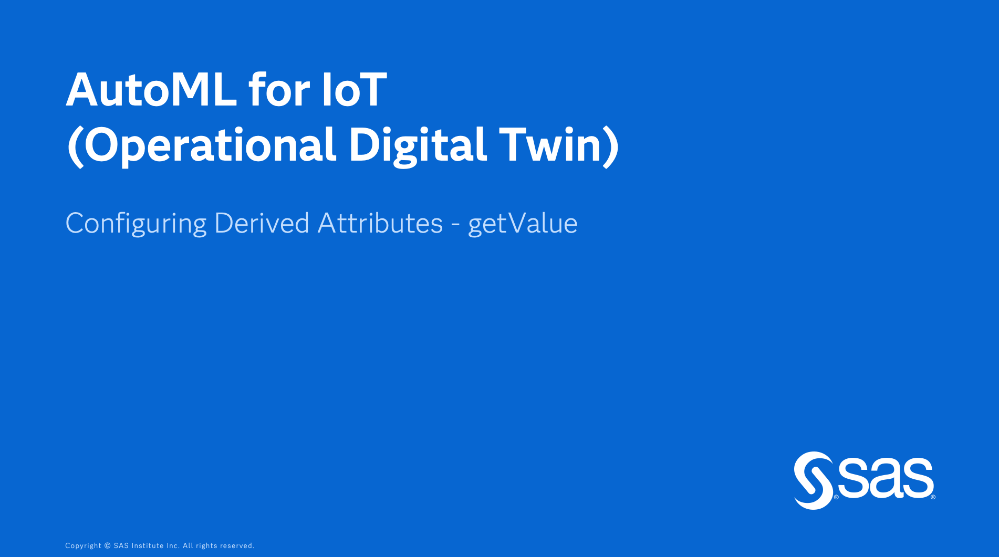

# Configuring Derived Attributes

In an ideal world, all information needed for your digital twin would broadcast as raw sensor data. However, typically this is not the case in practical applications. It is many times necessary to calculate additional metrics based on information available in your digital twin. For example, it may be important to know the value of a sensor from an hour ago, or the average reading over the past 30 minutes, or to aggregate information from connected assets, or just execute code.

Derived attributes allow you to add new calculated measures to your digital twin - and they are configured simply by answering straightforward questions. Each attribute is described in detail in their sections below, and they are grouped based on their function as shown below. 

**These attributes will become part of your digital twin and you can use them later in your analytical models or output them to datasets you design. As shown below, these new attributes will appear in your digital twin in blue.**

Below is a list of the derived attributes that are built-in to AutoML for IoT currently...

* **Time-Focused Attributes**
    * lag - store the value from a prior period
    * delta - calculate the change in an attribute from one time to another
    * temporalAgg - calculate the average/sum/min/max of an attribute over time

* **Relationship-Focused Attributes**
    * relationalAgg - calculated the average/sum/min/max of an attribute across connected assets
    * countConn - obtain the number of parents or children for each asset
    * getConn - obtain a specific assetID of a parent or child asset

* **Retrieving Connected Asset IDs and Labels**
    * getAssetID - store the ID of a connected asset 
    * getAssetLabel - store the label of a connected asset 

* **User-Written SAS Code**
    * code - run customized SAS code that references one or multiple attributes from the digital twin

* **Advanced**
    * getValue - copy the value of an attributeID from one asset to another
    * searchEvents - search recent events for a specific value and return the last time observed

Each of these derived attributes is described in detail in the sections below. Click on a powerpoint to learn more about how they work and how to configure them to enrich your digital twin.

Note that many derived attributes allow you to reference other derived attributes - so you can easily define an attribute and then use that attribute in yet another calculation. For example, a lag variable allows you to pull a sensor's value from some time ago. You could pull the value from an hour ago - that would be a 'static' lag. Or you could instead reference another derived attribute and the lag would become 'dynamic'. This is especially useful for manufacturing applications where the line speed could vary throughout the day.

## Time-Focused Attributes

### lag 

The below powerpoint will walk you through how to configure a 'lag' derived attribute. This is used to retrieve the value of an attribute from some time ago.

Step-by-Step Guide         |  
:-------------------------:|
 |

### delta 

The below powerpoint will walk you through how to configure a 'delta' derived attribute. This is used to compute the change in an attribute from one time period to another.

Step-by-Step Guide         |  
:-------------------------:|
 |

### temporalAgg 

The below powerpoint will walk you through how to configure a 'temporalAgg' derived attribute. This is used to aggregate the value of an attribute over some time period (average, sum, min, max).

Step-by-Step Guide         |  
:-------------------------:|
 |

 

## Relationship-Focused Attributes

### relationalAgg 

The below powerpoint will walk you through how to configure a 'relationalAgg' derived attribute. This is used to aggregate the value of an attribute across connected assets.

Step-by-Step Guide         | 
:-------------------------:|
 |

### countConn 

The below powerpoint will walk you through how to configure a 'countConn' derived attribute. This is used to count the number of connections (parent or child) for an asset.

Step-by-Step Guide         |  
:-------------------------:|
 |

### getConn 

The below powerpoint will walk you through how to configure a 'getConn' derived attribute. This is used to obtain the assetID for a connected asset (parent or child).

Step-by-Step Guide         |  
:-------------------------:|
 |

 

## Retrieving Connected Asset IDs and Labels

### getAssetID 

The below powerpoint will walk you through how to configure a 'getAssetID' derived attribute. This is used to retrieve the ID of a connected asset.

Step-by-Step Guide         | 
:-------------------------:|
 |

### getAssetLabel 

The below powerpoint will walk you through how to configure a 'getAssetLabel' derived attribute. This is used to retrieve the label of a connected asset.

Step-by-Step Guide         | 
:-------------------------:|
 |

 

## User-Written SAS Code

### code

The below powerpoint will walk you through how to configure a 'code' derived attribute. This is used to execute user-written code to compute a new metric using one or more attributes from the digital twin.

Step-by-Step Guide         | 
:-------------------------:|
 |

 

## Advanced

### getValue 

The below powerpoint will walk you through how to configure a 'getValue' derived attribute. This is used to copy the value of an attribute from a connected asset. For example, for flood prediction, what is the river's height for an upstream river segment. Or for patient monitoring, a hospital bed may measure blood pressure, but we'd like to associate that with the patient once it is measured.

Step-by-Step Guide         |  
:-------------------------:|
 |

### searchEvents 

The below powerpoint will walk you through how to configure a 'searchEvents' derived attribute. This is used to search the individual updates/events for an attribute. This is unique in that most attributes utilize only the value that was current at the time the output record was generated - this attribute allows the user to actually search through all of the individual updates/events.

Step-by-Step Guide         |  
:-------------------------:|
 |

      
