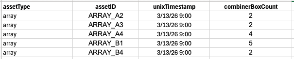
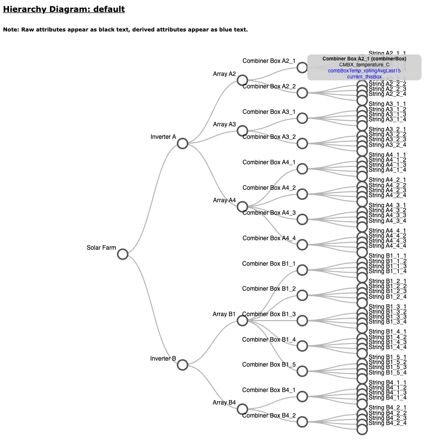

# Configure a Count Connections Derived Attribute

## What It Does

A `countConn` derived attribute counts the number of parent or child connections associated with an asset.

For example, suppose each array in a solar project is connected to multiple combiner boxes. You can create:

```text
array/combinerBoxCount
```

to store the number of child connections for each array.


The resulting count becomes part of the digital twin and can later be included in output tables or used by analytical models.



## When to Use It

Use `countConn` when the information you need is **how many connected assets** satisfy the selected relationship criteria.

Examples include:

- How many combiner boxes are children of this array?
- How many patients are connected to this hospital?
- How many parent assets are connected to this piece of equipment?
- How many assets of a particular type are connected to another asset?

`countConn` returns a count. If you need the asset ID of a specific parent or child connection instead, use `getConn`.

For details about retrieving a specific connected asset ID, see [Configure a Get Connection Derived Attribute](get-connection.md).

## Where the Configuration Goes

Every derived attribute is defined in two parts:

1. **Define the derived attribute itself** in:

   ```text
   Phase-1---Project-Definition/
   03_defineDataEnrichment/
   derivedAttributes.json
   ```

   This is where you provide the high-level information about the new attribute, including its asset type, attribute ID, label, data type, and derived-attribute type (`countConn`).

2. **Define the logic used to calculate it** in:

   ```text
   Phase-1---Project-Definition/
   03_defineDataEnrichment/
   derivedAttributeDetails/derivedAttributeDetails_countConn.json
   ```

   For this derived-attribute type, the detail file is:

   ```text
   derivedAttributeDetails_countConn.json
   ```

Keep these two responsibilities separate: `derivedAttributes.json` defines **what the attribute is**; `derivedAttributeDetails_countConn.json` defines **how it is calculated**.

## What You Need to Configure

The configuration follows the same two-step pattern used by other derived attributes: first define **what the new attribute is**, and then define **how AutoML for IoT calculates it**.

| Location | Purpose |
|---|---|
| `03_defineDataEnrichment/derivedAttributes.json` | Defines the high-level information for the new `countConn` derived attribute. |
| `03_defineDataEnrichment/derivedAttributeDetails/derivedAttributeDetails_countConn.json` | Defines the type-specific logic used to calculate the derived attribute. |

## Step 1: Define the New Derived Attribute

Each count-connections attribute requires a record in `derivedAttributes.json`.

### Required Fields

| Field | Type | Description |
|---|---|---|
| `assetType` | string | Asset type that receives the new count attribute. |
| `attributeID` | string | ID of the new derived attribute. Must be unique within the asset type and must not duplicate a raw attribute. |
| `SASAttributeID` | string | SAS-compatible ID. Must be 30 characters or fewer, contain only letters, numbers, and underscores, and cannot begin with a number. |
| `attributeLabel` | string | Human-readable label. |
| `attributeType` | string | Must be `"countConn"`. |
| `dataType` | string | Typically `"double"` because the result is a numeric count. |
| `dataLength` | number | `8` when `dataType` is `"double"`. |

The standard derived-attribute definition can also include the documented optional format and acceptable-range fields.

### Example

```json
[
  {
    "assetType": "array",
    "attributeID": "combinerBoxCount",
    "SASAttributeID": "combinerBoxCount",
    "attributeLabel": "Combiner Box Count",
    "attributeType": "countConn",
    "dataType": "double",
    "dataLength": 8
  }
]
```

## Step 2: Define Which Connections to Count

A `derivedAttributeDetails_countConn.json` record uses the following fields.

### Required Fields

| Field | Type | Description |
|---|---|---|
| `assetType` | string | Asset type of the new derived attribute. |
| `attributeID` | string | ID of the new derived attribute. Must match the Step 1 definition. |
| `parentsOrChildren` | string | Must be `"parents"` or `"children"`. |

You can control which hierarchy or hierarchies are searched using these fields:

| Field | Type | Description |
|---|---|---|
| `hierarchyValue` | string | A fixed hierarchy name. |
| `hierarchyAttributeID` | string | Attribute on the same asset type whose value contains the hierarchy name. |

Populate at most one of `hierarchyValue` and `hierarchyAttributeID`. If both are left empty, AutoML for IoT searches across all hierarchies.

### Optional Fields

| Field | Type | Description |
|---|---|---|
| `subsetAssetType` | string | If populated, count only connected assets of this asset type. |
| `queryAssetIDFromThisAttribID` | string | If populated, perform the connection lookup for the asset ID stored in this attribute rather than for the current asset itself. |

The documented example structure includes these fields even when they are unused, using empty strings.

## Choose the Approach That Matches Your Situation

## Choose the Hierarchy

There are three supported ways to determine which hierarchy or hierarchies to examine.

### Fixed Hierarchy

Use `hierarchyValue` when the same hierarchy should be used for every asset.

For example:

```text
hierarchyValue = "default"
hierarchyAttributeID = ""
```

The specified value should correspond to a hierarchy defined for the project.

### Dynamic Hierarchy

Use `hierarchyAttributeID` when the hierarchy name can differ from one asset to another.

For example, a transportation project might contain several route hierarchies. Each train could have:

```text
train/route
```

whose current value contains the hierarchy name that should be searched.

In that case:

```text
hierarchyValue = ""
hierarchyAttributeID = "route"
```

The referenced `assetType/hierarchyAttributeID` must identify a valid raw or derived attribute.

Use **either** a fixed hierarchy or a hierarchy attribute—not both.

### Search Across All Hierarchies

Leave both hierarchy fields empty when the calculation should consider matching connections across **all hierarchies**:

```text
hierarchyValue = ""
hierarchyAttributeID = ""
```

This is useful when the relationship you care about can appear in more than one hierarchy.

For example, a station might participate in several train-route hierarchies. If you want to count all trains connected to that station regardless of route, leave both hierarchy fields empty so the search is not limited to one route hierarchy.


## Choose Parents or Children

Use `parentsOrChildren` to choose which side of the relationship should be counted.

Use:

```text
"parents"
```

to count parent connections.

Use:

```text
"children"
```

to count child connections.

For example, if an array is the parent of multiple combiner boxes, counting the array's child connections uses:

```text
parentsOrChildren = "children"
```

## Optionally Restrict the Count by Asset Type

By default, `countConn` can count the selected parent or child connections.

If you want to count only connections to a specific asset type, populate:

```text
subsetAssetType
```

For example:

```text
subsetAssetType = "combinerBox"
```

restricts the result to connected combiner-box assets.

The value must identify a valid asset type defined in the project.

If no asset-type restriction is needed, follow the documented example structure and use:

```text
subsetAssetType = ""
```

## Count Connections for Another Asset

Normally, the calculation examines connections for the current asset.

However, some use cases need to calculate the connection count for a different asset whose ID is stored in another attribute.

Use:

```text
queryAssetIDFromThisAttribID
```

for that situation.

For example, suppose a train has:

```text
train/nextStation
```

and that attribute contains the asset ID of the station the train is approaching.

You could configure `countConn` so that, for each train, AutoML for IoT counts the people waiting at the station identified by `train/nextStation`.

In that case:

```text
queryAssetIDFromThisAttribID = "nextStation"
```

The referenced `assetType/queryAssetIDFromThisAttribID` must identify a valid raw or derived attribute.

If the current asset itself should be queried, use:

```text
queryAssetIDFromThisAttribID = ""
```

## Complete Example

The documented solar example creates:

```text
array/combinerBoxCount
```

and counts the child connections in the `default` hierarchy.

```json
[
  {
    "assetType": "array",
    "attributeID": "combinerBoxCount",
    "hierarchyValue": "default",
    "hierarchyAttributeID": "",
    "parentsOrChildren": "children",
    "subsetAssetType": "",
    "queryAssetIDFromThisAttribID": ""
  }
]
```

This example uses a fixed hierarchy, counts children, does not restrict the result to one asset type, and performs the lookup for the current array asset.

## Example with an Asset-Type Filter

If the hierarchy can contain several kinds of children but you want to count only combiner boxes:

```json
[
  {
    "assetType": "array",
    "attributeID": "combinerBoxCount",
    "hierarchyValue": "default",
    "hierarchyAttributeID": "",
    "parentsOrChildren": "children",
    "subsetAssetType": "combinerBox",
    "queryAssetIDFromThisAttribID": ""
  }
]
```

## Example with a Dynamic Hierarchy

Suppose each train has an attribute:

```text
train/route
```

that contains the name of the hierarchy that represents its current route.

The count configuration can use that attribute rather than a fixed hierarchy:

```json
[
  {
    "assetType": "train",
    "attributeID": "connectionCount",
    "hierarchyValue": "",
    "hierarchyAttributeID": "route",
    "parentsOrChildren": "children",
    "subsetAssetType": "",
    "queryAssetIDFromThisAttribID": ""
  }
]
```

The `train/route` attribute must exist as either a raw or derived attribute.

## Example: Count Across All Hierarchies

Suppose a station can have trains connected through several route hierarchies and you want to count all connected trains, regardless of route.

Leave both hierarchy fields empty:

```json
[
  {
    "assetType": "station",
    "attributeID": "trainCount",
    "hierarchyValue": "",
    "hierarchyAttributeID": "",
    "parentsOrChildren": "children",
    "subsetAssetType": "train",
    "queryAssetIDFromThisAttribID": ""
  }
]
```

With both hierarchy fields empty, the count includes qualifying train connections found across all hierarchies.

## Example Querying a Related Asset

Suppose each train has:

```text
train/nextStation
```

whose value contains the asset ID of the next station.

A `countConn` calculation can store a result on the train while querying the connections of that station:

```json
[
  {
    "assetType": "train",
    "attributeID": "peopleAtNextStation",
    "hierarchyValue": "default",
    "hierarchyAttributeID": "",
    "parentsOrChildren": "children",
    "subsetAssetType": "person",
    "queryAssetIDFromThisAttribID": "nextStation"
  }
]
```

This pattern separates:

- **where the result is stored** — each train
- **which asset's relationships are queried** — the station whose ID is stored in `train/nextStation`

## Review the Result and Integrate the Attribute

After the high-level derived-attribute definition and the countConn-specific definition are complete, run the data-enrichment preparation step.

Open and run:

```text
03_defineDataEnrichment/prepareDataEnrichment
```


This integrates the derived-attribute definitions into the project and creates an updated hierarchy review.

Download and open the generated `_reviewHierarchy*` document in a browser.

The derived attributes appear in blue when you inspect the assets in the updated digital twin.




## Validate and Continue

Before continuing, verify both parts of the configuration.

### High-Level Derived Attribute

Confirm that:

- `assetType` exists in the asset-type definition
- `attributeID` is unique within the asset type
- the new `assetType/attributeID` does not duplicate a raw attribute
- `SASAttributeID` follows SAS variable-name rules and is no more than 30 characters
- `attributeType` is `"countConn"`
- the data type and length follow the derived-attribute rules

### Count-Specific Definition

Confirm that:

- `assetType/attributeID` matches a record in `derivedAttributes.json` whose `attributeType` is `"countConn"`
- `parentsOrChildren` is exactly `"parents"` or `"children"`
- at most one of `hierarchyValue` and `hierarchyAttributeID` is populated; if both are empty, the search is performed across all hierarchies
- if `hierarchyAttributeID` is populated, `assetType/hierarchyAttributeID` identifies a valid raw or derived attribute
- if `subsetAssetType` is populated, it identifies a valid asset type
- if `queryAssetIDFromThisAttribID` is populated, `assetType/queryAssetIDFromThisAttribID` identifies a valid raw or derived attribute
- unused fields follow the documented empty-string structure

## Related Information

For details about creating and reviewing the hierarchy relationships used by connection-based calculations, see [Define Hierarchies](../describing-your-digital-twin/hierarchies.md).

## Return to Derived Attributes

[Return to Configuring Derived Attributes](README.md)
