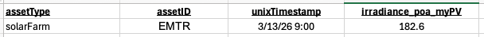
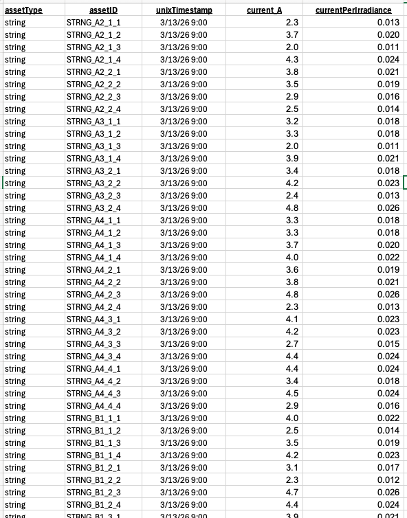
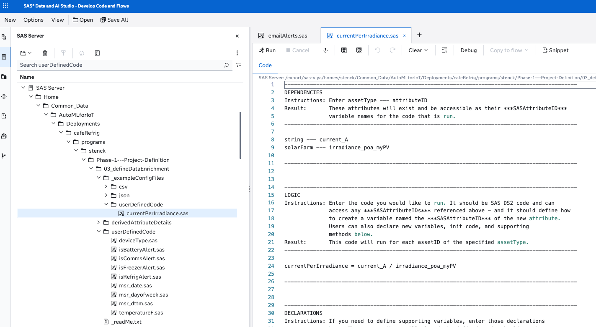
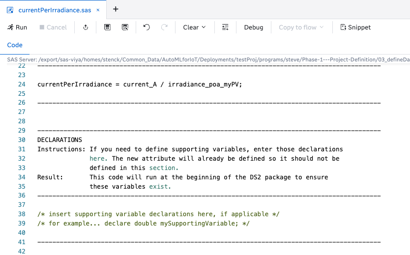
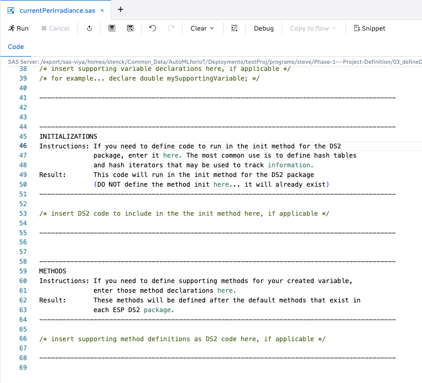
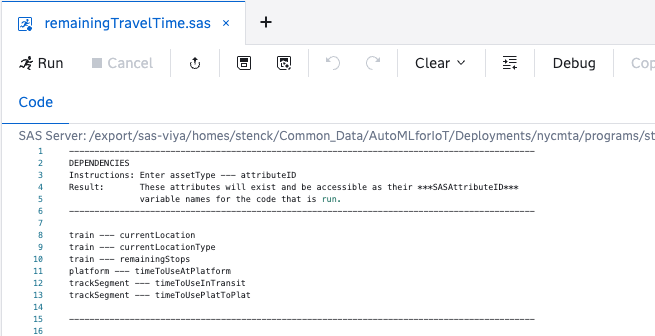
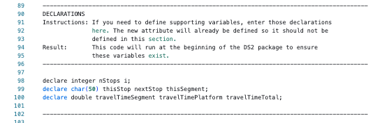
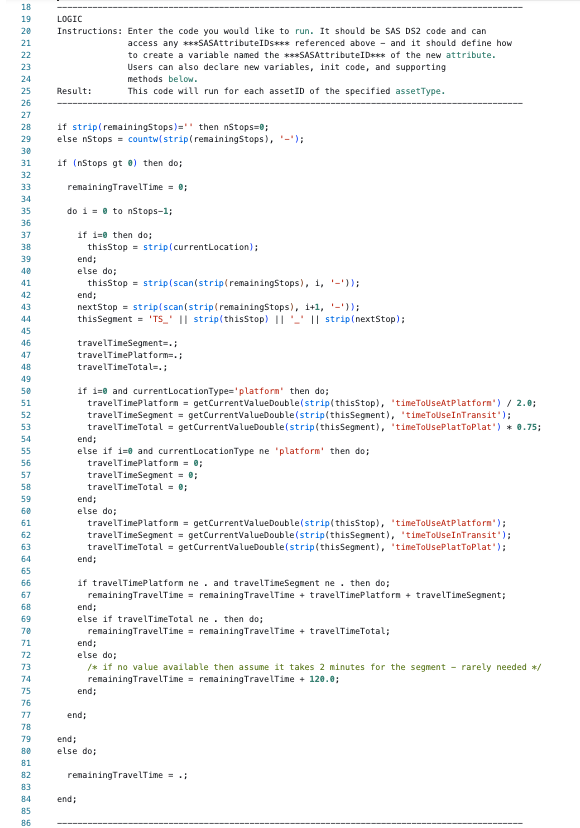
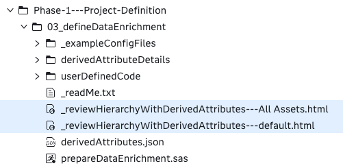

# Configure a Custom SAS Code Derived Attribute

## What It Does

A `code` derived attribute executes custom SAS code to calculate a new value from information available in the digital twin.

Use this option when the required calculation is not represented directly by one of the built-in derived-attribute types.

For example, suppose each string has:

```text
string/current_A
```

and the solar farm has an irradiance measure. You might want to calculate a new string-level measure such as:

```text
string/currentPerIrradiance
```

that divides string current by solar farm irradiance. Note that these attributes are from two DIFFERENT asset types.


The result is stored as a new derived attribute and can later be included in output tables or analytical models.



The calculation can also reference information elsewhere in the digital twin when that information is declared as an input.



## When to Use It

Use `code` when the desired calculation requires custom SAS logic.

Examples include:

- combining two or more attributes in a formula
- calculating ratios
- implementing conditional logic
- creating a metric that does not map directly to `lag`, `delta`, `temporalAgg`, `relationalAgg`, or the other built-in types

Use the most specific built-in derived-attribute type when one already represents the calculation.

For example:

- use `delta` to calculate the change in the **same** attribute between two points in time
- use `temporalAgg` to summarize one attribute across a historical window
- use `relationalAgg` to summarize one attribute across connected assets

Use `code` when those built-in calculations do not express the required logic.

## How Custom Code Is Evaluated

Derived attributes are calculated before each output from the digital twin.

The custom logic therefore executes for each asset of the asset type on which the derived attribute is defined.

For example, if:

```text
assetType = string
```

then the calculation is evaluated separately for each string asset.

The calculation can depend on zero or more raw or derived attributes. Those dependencies must be explicitly listed so AutoML for IoT can retrieve the required values and order dependent derived calculations correctly.

## Where the Configuration Goes

A custom-code derived attribute is configured in two places:

1. **Define the new attribute** in:

   ```text
   Phase-1---Project-Definition/
   03_defineDataEnrichment/
   derivedAttributes.json
   ```

   This defines the high-level information about the new attribute, such as its asset type, attribute ID, label, data type, and `SASAttributeID`.

2. **Define how the attribute is calculated** in a SAS program stored under:

   ```text
   Phase-1---Project-Definition/
   03_defineDataEnrichment/
   userDefinedCode/
   ```

   The SAS program is named using the new attribute's `SASAttributeID`:

   ```text
   <SASAttributeID>.sas
   ```

For example, if the new derived attribute has:

```text
SASAttributeID = currentPerIrradiance
```

then the corresponding code file is:

```text
userDefinedCode/currentPerIrradiance.sas
```

If the project was imported from an AutoML for IoT project export or created from an AI Assistant export, this SAS file is created automatically for the code derived attribute.

## What You Need to Configure

The configuration follows the same two-step pattern used by other derived attributes:

| Location | Purpose |
|---|---|
| `03_defineDataEnrichment/derivedAttributes.json` | Defines **what the new attribute is**. |
| `03_defineDataEnrichment/userDefinedCode/<SASAttributeID>.sas` | Defines **how the new attribute is calculated**. |

## Step 1: Define the New Derived Attribute

Add the high-level definition for the new attribute to:

```text
03_defineDataEnrichment/derivedAttributes.json
```

### Required Fields

| Field | Type | Description |
|---|---|---|
| `assetType` | string | Asset type that receives the new calculated attribute. |
| `attributeID` | string | ID of the new derived attribute. Must be unique within the asset type and must not duplicate a raw attribute. |
| `SASAttributeID` | string | SAS-compatible variable name used by the custom logic. Must be 30 characters or fewer, contain only letters, numbers, and underscores, and cannot begin with a number. |
| `attributeLabel` | string | Human-readable label for the new attribute. |
| `attributeType` | string | Must be `"code"`. |
| `dataType` | string | `"double"` or `"string"`. |
| `dataLength` | number | `8` for a double; otherwise a positive integer large enough for the string result. |

The standard derived-attribute definition can also include the documented optional format and acceptable-range fields.

### Example

```json
[
  {
    "assetType": "string",
    "attributeID": "currentPerIrradiance",
    "SASAttributeID": "currentPerIrradiance",
    "attributeLabel": "Current Per Irradiance",
    "attributeType": "code",
    "dataType": "double",
    "dataLength": 8
  }
]
```

## Step 2: Edit the SAS Program

Open the matching SAS program under:

```text
03_defineDataEnrichment/userDefinedCode/
```

For the example above, edit:

```text
currentPerIrradiance.sas
```

The program is structured so that you can provide the information AutoML for IoT needs in clearly defined sections.

### Template to Use for User-Defined Code Attributes

Each userDefinedCode `.sas` file must follow a specific structure as shown below. This template program is included in the same location in every project directory. You will add the dependencies and SAS DS2 logic in the indicated sections.



The most common custom-code attributes require only the dependency section and the calculation logic. The remaining sections are available for more advanced calculations.

For most calculations, focus first on:

1. the attributes the calculation depends on
2. the SAS DS2 logic that calculates the new value

Then use the optional sections only if the calculation needs them.

## Declare the Attribute Dependencies

In the dependency section of the SAS program, list every raw or derived attribute that the calculation depends on.

Enter each dependency using this exact format:

```text
assetType --- attributeID
```

For example:

```text
string --- current_A
solarFarm --- irradiance_poa_myPV
```

If the calculation also depends on another derived attribute, list it the same way. For example:

```text
string --- current_A_15m_avg
```

AutoML for IoT uses this list to:

- locate the required values in the digital twin
- navigate connected assets when needed
- make those values available to the code using their `SASAttributeID`
- determine the correct calculation order when one derived attribute depends on another

Every digital-twin attribute referenced directly by the SAS logic should be listed in the dependency section.

For the current-per-irradiance example, the dependency section would identify:

```text
string --- current_A
solarFarm --- irradiance_poa_myPV
```

When the code runs for each string, AutoML for IoT retrieves those values first and makes them available to the calculation.


## Write the Calculation Logic

Write the SAS DS2 code that calculates the new attribute.

The code should reference input values by their `SASAttributeID`, not by the `assetType --- attributeID` text used in the dependency section.

For example, if the dependencies are:

```text
string --- current_A
solarFarm --- irradiance_poa_myPV
```

and those attributes use the SAS variable names:

```text
current_A
irradiance_poa_myPV
```

the calculation can use:

```sas
currentPerIrradiance = current_A / irradiance_poa_myPV;
```

The final result must be assigned to a variable whose name exactly matches the new derived attribute's `SASAttributeID`.

A more defensive version of the same calculation could be:

```sas
if irradiance_poa_myPV > 0 then
    currentPerIrradiance = current_A / irradiance_poa_myPV;
else
    currentPerIrradiance = .;
```

The assigned value must be compatible with the `dataType` defined for the derived attribute.


## Optional: Declare Temporary Variables

Use the temporary-variable section when the calculation needs working variables that are not part of the digital twin.

Temporary variables must be declared using valid SAS DS2 declarations.

The generated SAS program includes a dedicated area for these declarations:



For a numeric variable:

```sas
declare double myVariable;
```

For a character variable, specify the character length:

```sas
declare char(100) myText;
```

For example, a calculation might declare:

```sas
declare double totalCurrent;
declare double connectionCount;
declare char(100) trainID;
```

Temporary variables can be used to:

- hold intermediate numeric results
- keep counters while looping through connections
- store temporary strings
- retain working values used by the calculation

These variables support the calculation only. They do not become derived attributes or output-table columns.


## Optional: Add Initialization Logic and Helper Methods

For advanced use cases, the SAS program provides an initialization section.

The same structured program also includes locations for initialization logic and user-defined methods:



Use the initialization section for code that should run once before the first derived-attribute calculation is made.

Typical reasons to use initialization logic include:

- initializing a reusable object or list
- setting a starting value that should not be recreated for every asset
- preparing reference information used later by the calculation

Most code attributes do **not** need initialization logic. Leave this section empty unless the calculation has a specific startup requirement.

If a user defines methods in that section, then those methods can be used in their logic section as needed.

The SAS program also provides a section where you can define your own SAS DS2 helper methods.

Use a helper method when part of the calculation is repeated or when moving logic into a method makes the main calculation easier to read.

A DS2 method specifies:

- the method name
- the input parameters and their data types
- the return data type
- the logic to execute
- the value to return

### Numeric Method Example

The following method accepts two integers and returns their sum:

```sas
method m(int x, int y) returns int; 
   return x + y;
end;
```

It could then be called from the calculation logic where an integer result is needed.

### Character Method Example

The following method accepts two character values and returns a combined character value:

```sas
method concat(char(100) x, char(100) y) returns char(200);
   return trim(x) || y;
end;
```

For example, the calculation logic could call:

```sas
combinedLabel = concat(assetPrefix, assetName);
```

Use user-defined methods for logic that belongs specifically to this code attribute.

These methods are separate from the **built-in AutoML for IoT helper methods** described below. Built-in helper methods provide access to digital-twin values and connections; user-defined methods let you organize your own DS2 calculation logic.


## Built-In Variables

Three runtime time variables are available automatically to the user defined code logic:

```text
assetID
unixTimestamp
sasDatetime
```

### `assetID`

Recall that all derived attribute logic is specified for the assetType / attributeID - and therefore that logic will execute for EVERY assetID of the specified asset type.

As the logic runs for each assetID, the variable `assetID` holds the ID of the asset.

### `unixTimestamp`

`unixTimestamp` contains the UTC timestamp for the current output period in microseconds since January 1, 1970.

### `sasDatetime`

`sasDatetime` contains the UTC time for the current output period as a SAS datetime value in seconds since January 1, 1960.

These variables can be referenced directly in the SAS code and do not need to be declared as attribute dependencies.

## Built-In Helper Methods

For more advanced calculations, AutoML for IoT provides helper methods that let the SAS code retrieve information directly from the digital twin.

These are especially useful when the calculation needs to work with assets or attributes that are discovered dynamically rather than supplied through the standard dependency list.

### `getCurrentValueString`

Use:

```text
getCurrentValueString(assetID, attributeID)
```

to retrieve the current value of a **string** attribute for a specific asset.

Example:

```sas
trainID = getCurrentValueString(platformID, "trainAtPlatform");
```

This retrieves the current value of the `trainAtPlatform` attribute for the asset whose ID is stored in `platformID`.

### `getCurrentValueDouble`

Use:

```text
getCurrentValueDouble(assetID, attributeID)
```

to retrieve the current value of a **numeric** attribute for a specific asset.

Example:

```sas
temperature = getCurrentValueDouble(combinerBoxID, "CMBX_temperature_C");
```

This retrieves the current numeric temperature value for the specified combiner box.

### `getHistoryValueString`

Use:

```text
getHistoryValueString(assetID, attributeID, numSeconds)
```

to retrieve the string value that was current for an asset/attribute `numSeconds` ago.

Example:

```sas
priorStatus = getHistoryValueString(machineID, "operatingStatus", 900);
```

This retrieves the machine's operating status from 900 seconds earlier.

Use this only when history is being maintained for the referenced attribute.

### `getHistoryValueDouble`

Use:

```text
getHistoryValueDouble(assetID, attributeID, numSeconds)
```

to retrieve the numeric value that was current for an asset/attribute `numSeconds` ago.

Example:

```sas
priorTemperature = getHistoryValueDouble(combinerBoxID, "CMBX_temperature_C", 900);
```

This retrieves the combiner-box temperature from 900 seconds earlier.

Use this only when history is being maintained for the referenced attribute.

### `getConnectionCount`

Use:

```text
getConnectionCount(assetID, hierarchyName, parentsOrChildren, assetType)
```

to count connections that satisfy the specified criteria.

For example:

```sas
numSegments =
    getConnectionCount(stationID, "default", "CHILDREN", "trackSegment");
```

This returns the number of child connections of type `trackSegment` for the specified station in the `default` hierarchy.

You can also broaden the search:

- leave `hierarchyName` blank to search across all hierarchies
- use `PARENTS` or `CHILDREN` to select direction
- leave `assetType` blank to include connections of any asset type

For example:

```sas
numConnections =
    getConnectionCount(stationID, "", "CHILDREN", "");
```

searches child connections across all hierarchies and all asset types.

### `getConnectionID`

Use:

```text
getConnectionID(assetID, hierarchyName, parentsOrChildren, assetType, i)
```

to retrieve the asset ID for the *i*th connection that satisfies the specified criteria.

Example:

```sas
trackSegmentID =
    getConnectionID(stationID, "default", "CHILDREN", "trackSegment", i);
```

This retrieves the asset ID of the `i`th child track-segment connection for the station.

As with `getConnectionCount`:

- leave the hierarchy name blank to search all hierarchies
- use `PARENTS` or `CHILDREN`
- leave `assetType` blank if the connection can be any type

### Example Using Helper Methods

The transportation example packaged with AutoML for IoT provides a more complete example of user-defined code using multiple helper methods.

In this example, each train has a `remainingTravelTime` derived attribute. The calculation examines the train's current location and remaining stops, determines the platform and track-segment assets involved in the remainder of the trip, and retrieves travel-time information from those assets.

This example combines values supplied directly from declared dependencies with values retrieved dynamically from specific assets using built-in helper methods.

#### 1. Declare the Dependencies

The dependency section identifies the digital-twin attributes used by the calculation:



The train-level attributes are available directly to the logic using their `SASAttributeID` values.

The platform and track-segment attributes are also declared as dependencies, but the particular platform or track segment needed changes as the code works through the train's remaining route. The helper methods allow the code to retrieve values from the specific asset IDs determined at runtime.

#### 2. Declare Working Variables

The calculation needs several temporary variables while it works through the remaining stops.

Those variables are declared in the `DECLARATIONS` section:



These are working variables used only by the calculation. They do not become attributes in the digital twin.

In this example:

- `nStops` stores the number of stops remaining
- `i` is used while looping through those stops
- `thisStop` and `nextStop` identify the stops currently being evaluated
- `thisSegment` identifies the track segment between those stops
- the `travelTime...` variables hold values used while calculating the total remaining travel time

#### 3. Use the Helper Methods in the Logic

The main logic first determines how many stops remain and then processes the route one segment at a time.



For each part of the route, the code determines the appropriate asset IDs and uses `getCurrentValueDouble` to retrieve values from those assets.

For example:

```sas
travelTimePlatform =
    getCurrentValueDouble(
        strip(thisStop),
        'timeToUseAtPlatform'
    );
```

retrieves `platform/timeToUseAtPlatform` for the platform whose asset ID is currently stored in `thisStop`.

Similarly:

```sas
travelTimeSegment =
    getCurrentValueDouble(
        strip(thisSegment),
        'timeToUseInTransit'
    );
```

retrieves `trackSegment/timeToUseInTransit` for the track segment whose asset ID is stored in `thisSegment`.

The same helper method can retrieve `trackSegment/timeToUsePlatToPlat` when that travel-time value is needed.

The code then adds the appropriate platform and travel times to `remainingTravelTime` as it works through the remaining route.

#### Why Use a Helper Method Here?

This is different from a simple calculation such as:

```sas
currentPerIrradiance = current_A / irradiance_poa_myPV;
```

In that simpler case, AutoML for IoT can supply the required dependency values directly before the calculation runs.

For `remainingTravelTime`, the specific platform and track-segment asset IDs that need to be queried depend on the train's `currentLocation` and `remainingStops`. Those asset IDs therefore change as the calculation works through the route.

The helper method is useful because the code first determines **which specific asset it needs** and can then retrieve the required attribute value from that asset.

This allows a custom-code derived attribute to combine declared dependencies, temporary working variables, loops and conditional logic, and dynamic retrieval of information from specific assets in the digital twin.

## Custom Code Can Depend on Other Derived Attributes

Dependencies can reference either raw or derived attributes.

This allows calculations to be built in stages.

For example:

```text
string/current_A
    ↓
string/current_A_15m_avg
    ↓
string/currentEfficiency
```

If `currentEfficiency` depends on `string/current_A_15m_avg`, include that derived attribute in the dependency section of the SAS program.

AutoML for IoT uses the declared dependencies to determine the correct calculation order.

## Review the Result and Integrate the Attribute

After the high-level derived-attribute definition and the code-specific definition are complete, run the data-enrichment preparation step.

Open and run:

```text
03_defineDataEnrichment/prepareDataEnrichment
```


This integrates the derived-attribute definitions into the project and creates an updated hierarchy review.

Download and open the generated `_reviewHierarchy*` document in a browser.

The derived attributes appear in blue when you inspect the assets in the updated digital twin.




## Validate and Continue

Before continuing, confirm that:

- the `code` derived attribute is defined in `derivedAttributes.json`
- the SAS program is named `<SASAttributeID>.sas`
- every digital-twin attribute referenced by the code is declared as a dependency using `assetType --- attributeID`
- the code references input variables by their `SASAttributeID`
- the code assigns the result to the new derived attribute's `SASAttributeID`
- the code uses valid SAS DS2 syntax
- the result is compatible with the configured `dataType`
- temporary variables, initialization logic, or helper methods are used only when needed

## Return to Derived Attributes

[Return to Configuring Derived Attributes](README.md)
