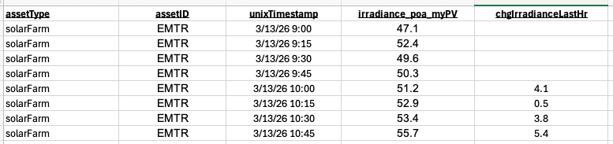

# Configure a Delta Derived Attribute

## What It Does

A `delta` derived attribute calculates the change in an attribute between two points in time.

For example, suppose the solar farm has a current irradiance attribute:

```text
solarFarm/irradiance_poa_myPV
```

You can create a new derived attribute such as:

```text
solarFarm/chgIrradianceLastHr
```

that calculates the change in irradiance from one hour ago to the current time.


The calculated change becomes part of the digital twin and can later be included in output tables or used as an input to analytical models.



## When to Use It

Use `delta` when you need the difference in the **same attribute** between two points in time.

Examples include:

- How much did the temperature change during the past hour?
- How much did river height increase during the past 30 minutes?
- How much did pressure change between 15 minutes ago and 5 minutes ago?

A delta does not simply retrieve a previous value. If you need the value of an attribute from an earlier point in time without calculating the difference, use a `lag` derived attribute.

For details about retrieving a prior value, including fixed and dynamic lookback periods, see [Configure a Lag Derived Attribute](lag.md).

## Where the Configuration Goes

Every derived attribute is defined in two parts:

1. **Define the derived attribute itself** in:

   ```text
   Phase-1---Project-Definition/
   03_defineDataEnrichment/
   derivedAttributes.json
   ```

   This is where you provide the high-level information about the new attribute, including its asset type, attribute ID, label, data type, and derived-attribute type (`delta`).

2. **Define the logic used to calculate it** in:

   ```text
   Phase-1---Project-Definition/
   03_defineDataEnrichment/
   derivedAttributeDetails/derivedAttributeDetails_delta.json
   ```

   For this derived-attribute type, the detail file is:

   ```text
   derivedAttributeDetails_delta.json
   ```

Keep these two responsibilities separate: `derivedAttributes.json` defines **what the attribute is**; `derivedAttributeDetails_delta.json` defines **how it is calculated**.

## What You Need to Configure

The configuration follows the same two-step pattern used by other derived attributes: first define **what the new attribute is**, and then define **how AutoML for IoT calculates it**.

| Location | Purpose |
|---|---|
| `03_defineDataEnrichment/derivedAttributes.json` | Defines the high-level information for the new `delta` derived attribute. |
| `03_defineDataEnrichment/derivedAttributeDetails/derivedAttributeDetails_delta.json` | Defines the type-specific logic used to calculate the derived attribute. |

## Step 1: Define the New Derived Attribute

Each delta attribute requires a record in `derivedAttributes.json`.

### Required Fields

| Field | Type | Description |
|---|---|---|
| `assetType` | string | Asset type that will receive the new delta attribute. Must exist in the asset-type configuration. |
| `attributeID` | string | ID of the new derived attribute. Must be unique within the asset type and must not duplicate a raw attribute. |
| `SASAttributeID` | string | SAS-compatible ID. Must be 30 characters or fewer, contain only letters, numbers, and underscores, and cannot begin with a number. |
| `attributeLabel` | string | Human-readable label. Use only letters, numbers, spaces, underscores, and dashes. |
| `attributeType` | string | Must be `"delta"`. |
| `dataType` | string | `"double"` for numeric values or `"string"` for text values. |
| `dataLength` | number | `8` when `dataType` is `"double"`; otherwise a positive integer large enough for typical string values. |

### Optional Fields

The standard derived-attribute definition also supports:

- `dataFormat`
- `acceptableMin`
- `acceptableMinLogic`
- `acceptableMax`
- `acceptableMaxLogic`

If an acceptable minimum or maximum is supplied, the matching logic field must also be supplied.

Supported acceptable-value logic is:

- `missing` — ignore values outside the configured range
- `limit` — replace an out-of-range value with the configured minimum or maximum

### Example

```json
[
  {
    "assetType": "solarFarm",
    "attributeID": "chgIrradianceLastHr",
    "SASAttributeID": "chgIrradianceLastHr",
    "attributeLabel": "Change in Irradiance Last Hour",
    "attributeType": "delta",
    "dataType": "double",
    "dataLength": 8
  }
]
```

## Step 2: Define the Two Comparison Times

A delta uses two explicit points in time, expressed as the number of seconds ago.

- `oldTimePeriodNumeric` is the older point in time.
- `recentTimePeriodNumeric` is the more recent point in time.

For example, to calculate the change from one hour ago to now:

```text
oldTimePeriodNumeric = 3600
recentTimePeriodNumeric = 0
```

To calculate the change from 30 minutes ago to 10 minutes ago:

```text
oldTimePeriodNumeric = 1800
recentTimePeriodNumeric = 600
```

The older time must always be greater than the recent time.

## Delta-Specific Fields

Each record in `derivedAttributeDetails_delta.json` contains exactly these required fields.

Where a time interval is specified, use a value that is an integer multiple of the project's `outputInterval`.

There are no optional fields in the delta-specific definition.

## Choose the Approach That Matches Your Situation

## Example: Change from One Hour Ago to Now

Suppose the project uses:

```text
outputInterval = 300
```

and the requirement is to calculate the change in:

```text
solarFarm/irradiance_poa_myPV
```

from one hour ago to the current time.

The delta-specific definition is:

```json
[
  {
    "assetType": "solarFarm",
    "attributeID": "chgIrradianceLastHr",
    "oldTimePeriodNumeric": "3600",
    "recentTimePeriodNumeric": "0",
    "targetAttributeID": "irradiance_poa_myPV"
  }
]
```

Because `3600` and `0` align with an output interval of `300` seconds, the time periods are valid.

## Timing Rules

Both comparison times must align with the project `outputInterval`.

For example, if:

```text
outputInterval = 300
```

then the following comparison points are valid:

| Time ago | Seconds | Valid? |
|---|---:|---|
| Now | 0 | Yes, for the recent time |
| 5 minutes | 300 | Yes |
| 15 minutes | 900 | Yes |
| 30 minutes | 1800 | Yes |
| 1 hour | 3600 | Yes |
| 7 minutes | 420 | No |

The older point must also satisfy:

```text
oldTimePeriodNumeric > recentTimePeriodNumeric
```

For additional background on the project output interval, see [Specifying Project Information](../specifying-project-information/README.md).

## Understanding the Direction of the Calculation

The delta represents the change from the older value to the more recent value.

Conceptually:

```text
delta = recent value - older value
```

For example, if irradiance was `500` one hour ago and is `650` now, the change is positive:

```text
650 - 500 = 150
```

If the value fell from `650` one hour ago to `500` now, the change is negative:

```text
500 - 650 = -150
```

This makes the sign of the delta useful for identifying whether the target attribute increased or decreased over the selected period.

## Target Attributes

`targetAttributeID` can reference a valid attribute from the same asset type.

The target can be:

- a raw attribute
- another derived attribute

For example, a project could first create a temporal average and then calculate how much that average changed between two points in time.

When referencing another derived attribute, ensure that the referenced definition is valid before preparing the data-enrichment project.

## Review the Result and Integrate the Attribute

After the high-level derived-attribute definition and the delta-specific definition are complete, run the data-enrichment preparation step.

Open and run:

```text
03_defineDataEnrichment/prepareDataEnrichment
```


This integrates the derived-attribute definitions into the project and creates an updated hierarchy review.

Download and open the generated `_reviewHierarchy*` document in a browser.

The derived attributes appear in blue when you inspect the assets in the updated digital twin.


## Validate and Continue

Before continuing, verify both parts of the configuration.

### High-Level Derived Attribute

Confirm that:

- `assetType` exists in the asset-type definition
- `attributeID` is unique within the asset type
- the new `assetType/attributeID` does not duplicate a raw attribute
- `SASAttributeID` follows SAS variable-name rules and is no more than 30 characters
- `attributeType` is `"delta"`
- `dataType` is `"double"` or `"string"`
- `dataLength` is `8` for a double or a positive integer for a string
- any acceptable minimum or maximum has its corresponding logic field

## Return to Derived Attributes

[Return to Configuring Derived Attributes](README.md)
