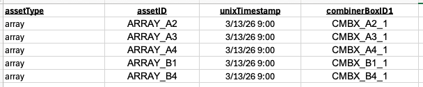

# Configure a Get Connection Derived Attribute

## What It Does

A `getConn` derived attribute retrieves the asset ID of a specific parent or child connection.

For example, suppose each array in a solar project is connected to multiple combiner boxes. You can create:

```text
array/combinerBoxID1
```

to return the asset ID of the first qualifying child connection for each array.


The selected asset ID becomes part of the digital twin and can later be included in output tables or used by other derived calculations.



## When to Use It

Use `getConn` when you need the asset ID of **one specific parent or child connection** and the selection must be based on connection order.

Examples include:

- What is the first child asset connected to this array?
- What is the newest parent connection for this asset?
- What is the second-oldest connected asset of a particular type?
- What asset is connected to another asset whose ID is stored in an attribute?

`getConn` differs from `countConn` because it returns an asset ID rather than the number of matching connections.

For details about counting connections instead of retrieving one, see [Configure a Count Connections Derived Attribute](count-connections.md).

## Where the Configuration Goes

Every derived attribute is defined in two parts:

1. **Define the derived attribute itself** in:

   ```text
   Phase-1---Project-Definition/
   03_defineDataEnrichment/
   derivedAttributes.json
   ```

   This is where you provide the high-level information about the new attribute, including its asset type, attribute ID, label, data type, and derived-attribute type (`getConn`).

2. **Define the logic used to calculate it** in:

   ```text
   Phase-1---Project-Definition/
   03_defineDataEnrichment/
   derivedAttributeDetails/derivedAttributeDetails_getConn.json
   ```

   For this derived-attribute type, the detail file is:

   ```text
   derivedAttributeDetails_getConn.json
   ```

Keep these two responsibilities separate: `derivedAttributes.json` defines **what the attribute is**; `derivedAttributeDetails_getConn.json` defines **how it is calculated**.

## What You Need to Configure

The configuration follows the same two-step pattern used by other derived attributes: first define **what the new attribute is**, and then define **how AutoML for IoT calculates it**.

| Location | Purpose |
|---|---|
| `03_defineDataEnrichment/derivedAttributes.json` | Defines the high-level information for the new `getConn` derived attribute. |
| `03_defineDataEnrichment/derivedAttributeDetails/derivedAttributeDetails_getConn.json` | Defines the type-specific logic used to calculate the derived attribute. |

## Step 1: Define the New Derived Attribute

Each `getConn` attribute requires a record in `derivedAttributes.json`.

Because the result is an asset ID, the output is typically represented as a string.

### Required Fields

| Field | Type | Description |
|---|---|---|
| `assetType` | string | Asset type that receives the selected connected asset ID. |
| `attributeID` | string | ID of the new derived attribute. Must be unique within the asset type and must not duplicate a raw attribute. |
| `SASAttributeID` | string | SAS-compatible ID. Must be 30 characters or fewer, contain only letters, numbers, and underscores, and cannot begin with a number. |
| `attributeLabel` | string | Human-readable label. |
| `attributeType` | string | Must be `"getConn"`. |
| `dataType` | string | Use the documented derived-attribute data type appropriate for storing the returned asset ID. |
| `dataLength` | number | Positive integer large enough for the returned value when the data type is a string. |

The standard derived-attribute definition can also include the documented optional format and acceptable-range fields.

## Step 2: Define the Connection Search

A `derivedAttributeDetails_getConn.json` record includes the following required fields:

| Field | Type | Description |
|---|---|---|
| `assetType` | string | Asset type of the new `getConn` attribute. |
| `attributeID` | string | ID of the new derived attribute. Must match the Step 1 definition. |
| `parentsOrChildren` | string | `"parents"` or `"children"`. |
| `searchLogic` | string | `"oldest"` or `"newest"`. |
| `instanceNumber` | number stored as a string | Which matching connection to return. Must represent an integer greater than 0. |

You can control which hierarchy or hierarchies are searched using these fields:

| Field | Type | Description |
|---|---|---|
| `hierarchyValue` | string | Fixed hierarchy name. |
| `hierarchyAttributeID` | string | Attribute on the same asset type whose value contains the hierarchy name. |

Populate at most one of `hierarchyValue` and `hierarchyAttributeID`. If both are left empty, AutoML for IoT searches across all hierarchies.

### Optional Fields

| Field | Type | Description |
|---|---|---|
| `subsetAssetType` | string | Restrict the search to connected assets of this asset type. |
| `queryAssetIDFromThisAttribID` | string | Search connections for the asset ID stored in this attribute instead of the current asset. |

The documented example structure includes these fields even when they are unused, using empty strings.

## Choose the Approach That Matches Your Situation

## Choose the Hierarchy

There are three supported ways to determine which hierarchy or hierarchies to search.

### Fixed Hierarchy

Use `hierarchyValue` when every asset should search the same hierarchy.

For example:

```text
hierarchyValue = "default"
hierarchyAttributeID = ""
```

The hierarchy value must match a valid hierarchy name in the project.

### Dynamic Hierarchy

Use `hierarchyAttributeID` when the hierarchy name should come from an attribute value.

For example, a transportation project might define:

```text
train/route
```

where the current value is the hierarchy name representing that train's route.

The configuration can then use:

```text
hierarchyValue = ""
hierarchyAttributeID = "route"
```

The referenced `assetType/hierarchyAttributeID` must exist as a raw or derived attribute.

Use one hierarchy method only.

### Search Across All Hierarchies

Leave both hierarchy fields empty when the connection search should consider matching connections across **all hierarchies**:

```text
hierarchyValue = ""
hierarchyAttributeID = ""
```

This is useful when a connected asset can be found through more than one hierarchy.

For example, a station might receive trains from multiple route or line hierarchies. If the goal is to determine which train is arriving first regardless of route, leave both hierarchy fields empty. AutoML for IoT can then evaluate qualifying train connections across all hierarchies before applying the configured `searchLogic` and `instanceNumber`.


## Choose Parents or Children

Use:

```text
parentsOrChildren = "parents"
```

to search parent connections.

Use:

```text
parentsOrChildren = "children"
```

to search child connections.

For example, if an array is the parent of multiple combiner boxes, retrieving a combiner-box connection from the array uses:

```text
parentsOrChildren = "children"
```

## Optionally Restrict by Asset Type

Use:

```text
subsetAssetType
```

when only connections to one asset type should be considered.

For example:

```text
subsetAssetType = "combinerBox"
```

means that other connected asset types are ignored.

The value must match an asset type defined in the project.

If no restriction is needed, follow the documented example structure and use an empty string.

## Select Which Connection to Return

When more than one qualifying connection exists, `getConn` uses two required fields to choose one:

- `searchLogic`
- `instanceNumber`

These fields are required even when the hierarchy currently contains only one matching connection.

### Search Logic

Use:

```text
"oldest"
```

to search beginning with the connection that was added first.

Use:

```text
"newest"
```

to search beginning with the connection that was added last.

### Instance Number

`instanceNumber` identifies which matching connection should be returned.

It is stored as a string and must represent an integer greater than 0.

For example:

```text
searchLogic = "oldest"
instanceNumber = "1"
```

returns the oldest matching connection.

```text
searchLogic = "oldest"
instanceNumber = "2"
```

returns the second-oldest matching connection.

```text
searchLogic = "newest"
instanceNumber = "1"
```

returns the newest matching connection.

Because selection is based on connection processing order, use this attribute type only when that order has meaningful and dependable interpretation for the use case.

## Query Connections for Another Asset

Normally, `getConn` examines relationships for the current asset.

Use:

```text
queryAssetIDFromThisAttribID
```

when the relationship search should instead be performed for another asset whose ID is stored in an attribute.

For example, suppose each train has:

```text
train/prevStation
```

and that attribute contains the asset ID of the previous station.

You could create a derived attribute on each train that retrieves a particular asset connected to that station.

In that case:

```text
queryAssetIDFromThisAttribID = "prevStation"
```

The referenced `assetType/queryAssetIDFromThisAttribID` must exist as a raw or derived attribute.

If the current asset should be searched, use an empty string.

## Complete Solar Example

The documented example creates:

```text
array/combinerBoxID1
```

and retrieves the first, oldest child connection of asset type `combinerBox` from the `default` hierarchy.

```json
[
  {
    "assetType": "array",
    "attributeID": "combinerBoxID1",
    "hierarchyValue": "default",
    "hierarchyAttributeID": "",
    "parentsOrChildren": "children",
    "subsetAssetType": "combinerBox",
    "instanceNumber": "1",
    "searchLogic": "oldest",
    "queryAssetIDFromThisAttribID": ""
  }
]
```

This assumes that the order in which those connections were added corresponds to the order you want to retrieve.

## Example: Retrieve the Newest Connection

To retrieve the most recently added qualifying connection instead:

```json
[
  {
    "assetType": "array",
    "attributeID": "newestCombinerBoxID",
    "hierarchyValue": "default",
    "hierarchyAttributeID": "",
    "parentsOrChildren": "children",
    "subsetAssetType": "combinerBox",
    "instanceNumber": "1",
    "searchLogic": "newest",
    "queryAssetIDFromThisAttribID": ""
  }
]
```

## Example: Search a Dynamic Hierarchy

Suppose each train has:

```text
train/route
```

whose value identifies the hierarchy that should be searched.

A `getConn` definition can use:

```json
[
  {
    "assetType": "train",
    "attributeID": "nextConnectedAsset",
    "hierarchyValue": "",
    "hierarchyAttributeID": "route",
    "parentsOrChildren": "children",
    "subsetAssetType": "",
    "instanceNumber": "1",
    "searchLogic": "oldest",
    "queryAssetIDFromThisAttribID": ""
  }
]
```

The `train/route` attribute must exist as a raw or derived attribute.

## Example: Search Across All Route Hierarchies

Suppose a station can have trains arriving from several route or line hierarchies, and you want to identify the first arriving train without limiting the search to one route.

Leave both hierarchy fields empty:

```json
[
  {
    "assetType": "station",
    "attributeID": "firstArrivingTrain",
    "hierarchyValue": "",
    "hierarchyAttributeID": "",
    "parentsOrChildren": "children",
    "subsetAssetType": "train",
    "instanceNumber": "1",
    "searchLogic": "oldest",
    "queryAssetIDFromThisAttribID": ""
  }
]
```

With both hierarchy fields empty, matching train connections are considered across all hierarchies. The configured `searchLogic` and `instanceNumber` then determine which qualifying connection is returned.

## Example: Query a Related Asset

Suppose each train contains:

```text
train/prevStation
```

and you want each train to store the ID of the first train connected to that previous station.

A configuration can follow this pattern:

```json
[
  {
    "assetType": "train",
    "attributeID": "trainAtPrevStation",
    "hierarchyValue": "default",
    "hierarchyAttributeID": "",
    "parentsOrChildren": "children",
    "subsetAssetType": "train",
    "instanceNumber": "1",
    "searchLogic": "oldest",
    "queryAssetIDFromThisAttribID": "prevStation"
  }
]
```

This separates:

- where the result is stored — on each train
- which asset's relationships are searched — the station identified by `train/prevStation`

## Review the Result and Integrate the Attribute

After the high-level derived-attribute definition and the getConn-specific definition are complete, run the data-enrichment preparation step.

Open and run:

```text
03_defineDataEnrichment/prepareDataEnrichment
```


This integrates the derived-attribute definitions into the project and creates an updated hierarchy review.

Download and open the generated `_reviewHierarchy*` document in a browser.

The derived attributes appear in blue when you inspect the assets in the updated digital twin.


## Validate and Continue

Before continuing, verify both parts of the configuration.

### High-Level Derived Attribute

Confirm that:

- `assetType` exists in the asset-type definition
- `attributeID` is unique within the asset type
- the new `assetType/attributeID` does not duplicate a raw attribute
- `SASAttributeID` follows SAS variable-name rules and is no more than 30 characters
- `attributeType` is `"getConn"`
- the data type and length follow the derived-attribute rules
- only documented fields are present

### Get-Connection Detail

Confirm that:

- `assetType/attributeID` matches a record in `derivedAttributes.json` whose `attributeType` is `"getConn"`
- `parentsOrChildren` is exactly `"parents"` or `"children"`
- `searchLogic` is exactly `"oldest"` or `"newest"`
- `instanceNumber` is stored as a string and represents an integer greater than 0
- at most one of `hierarchyValue` and `hierarchyAttributeID` is populated; if both are empty, the search is performed across all hierarchies
- if `hierarchyValue` is populated, it matches a defined hierarchy name
- if `hierarchyAttributeID` is populated, `assetType/hierarchyAttributeID` identifies a valid raw or derived attribute
- if `subsetAssetType` is populated, it identifies a valid asset type
- if `queryAssetIDFromThisAttribID` is populated, `assetType/queryAssetIDFromThisAttribID` identifies a valid raw or derived attribute
- unused optional fields follow the documented empty-string structure

## Related Information

For details about creating and reviewing the hierarchy relationships used by connection-based calculations, see [Define Hierarchies](../describing-your-digital-twin/hierarchies.md).

## Return to Derived Attributes

[Return to Configuring Derived Attributes](README.md)
