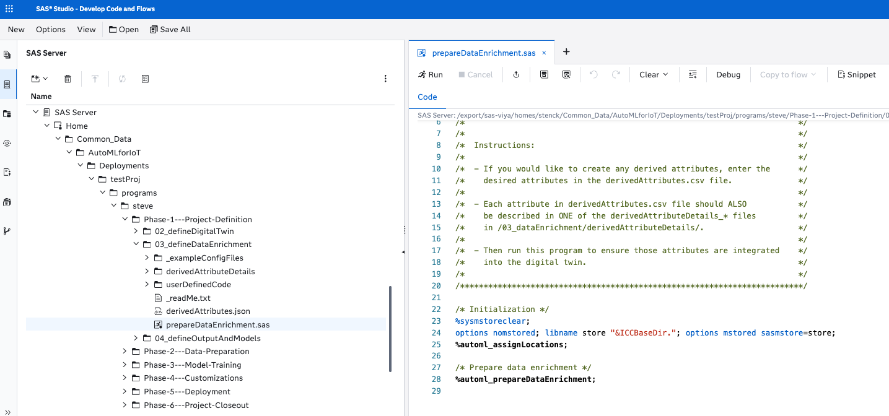

# Configure a Get Value Derived Attribute

## What It Does

A `getValue` derived attribute **copies the value of a specific attribute from one asset to another asset**.

AutoML for IoT is already designed to retrieve information from connected assets when it builds output tables and performs calculations. In most cases, you do **not** need a `getValue` derived attribute just because the value you need lives on a connected asset.

Use `getValue` when the value itself needs to become part of another asset's state.

For example, suppose a river segment has a measured height and you want the immediately upstream segment's height stored on the current segment as:

```text
riverSegment/riverHeight_upstream1
```

A `getValue` attribute can copy the upstream segment's height onto the current river segment.

## When to Use It

Use `getValue` when one of these situations applies:

### 1. You Need to Copy a Value onto Another Asset

Use `getValue` when the value should actually be stored on a different asset rather than simply retrieved from a connected asset when needed.

For example:

```text
riverSegment/height
```

might exist on an upstream river segment, but the current segment needs its own derived attribute:

```text
riverSegment/riverHeight_upstream1
```

that contains the upstream segment's height.

This is a true copy: the value from one asset becomes a derived attribute on another asset.

### 2. The Digital Twin Is Dynamic and the Value Must Persist

`getValue` is also useful when connections between assets can change and the copied value needs to remain with the receiving asset after the relationship changes.

For example, a patient might be connected to a hospital bed, and the bed might contain:

```text
hospitalBed/bloodPressure
```

While the patient is connected to that bed, a `getValue` attribute can copy the blood pressure onto the patient.

If the patient is later disconnected from the bed, the copied value can remain part of the patient's record rather than disappearing with the connection.

### 3. You Need to Avoid an Ambiguous Retrieval

Sometimes more than one connected asset could contain the requested attribute. In that case, `getValue` provides navigation options that let you be explicit about which value should be copied.

For example, suppose an HVAC location has pressure measurements available on both sides of it and you want to calculate the pressure difference.

You might create two separate copied values:

```text
location/pressure_left
location/pressure_right
```

One `getValue` definition retrieves pressure from one direction, and a second definition retrieves pressure from the other direction.

The downstream calculation can then compare:

```text
pressure_left - pressure_right
```

without ambiguity.

## When You Usually Do Not Need `getValue`

Do **not** use `getValue` simply because an attribute is stored on a connected asset.

AutoML for IoT can already retrieve attributes from connected assets when assembling output tables and when supporting other calculations.

For example, if a string-level output table needs an inverter temperature and the inverter is connected to the string, the output table can retrieve that inverter attribute directly. There is no need to first copy the inverter temperature onto every string.

Use `getValue` only when you specifically need to:

- store the value on another asset
- preserve the value when a dynamic connection may later disappear
- select among potentially ambiguous connected values using explicit navigation


## Where the Configuration Goes

Every derived attribute is defined in two parts:

1. **Define the derived attribute itself** in:

   ```text
   Phase-1---Project-Definition/
   03_defineDataEnrichment/
   derivedAttributes.json
   ```

   This is where you provide the high-level information about the new attribute, including its asset type, attribute ID, label, data type, and derived-attribute type (`getValue`).

2. **Define the logic used to calculate it** in:

   ```text
   Phase-1---Project-Definition/
   03_defineDataEnrichment/
   derivedAttributeDetails/derivedAttributeDetails_getValue.json
   ```

   For this derived-attribute type, the detail file is:

   ```text
   derivedAttributeDetails_getValue.json
   ```

Keep these two responsibilities separate: `derivedAttributes.json` defines **what the attribute is**; `derivedAttributeDetails_getValue.json` defines **how it is calculated**.

## What You Need to Configure

The configuration follows the same two-step pattern used by other derived attributes: first define **what the new attribute is**, and then define **how AutoML for IoT calculates it**.

| Location | Purpose |
|---|---|
| `03_defineDataEnrichment/derivedAttributes.json` | Defines the high-level information for the new `getValue` derived attribute. |
| `03_defineDataEnrichment/derivedAttributeDetails/derivedAttributeDetails_getValue.json` | Defines the type-specific logic used to calculate the derived attribute. |

## Step 1: Define the New Derived Attribute

Each `getValue` attribute requires a record in `derivedAttributes.json`.

### Required Fields

| Field | Type | Description |
|---|---|---|
| `assetType` | string | Asset type that receives the retrieved value. |
| `attributeID` | string | ID of the new derived attribute. Must be unique within the asset type and must not duplicate a raw attribute. |
| `SASAttributeID` | string | SAS-compatible ID. Must be 30 characters or fewer, contain only letters, numbers, and underscores, and cannot begin with a number. |
| `attributeLabel` | string | Human-readable label. |
| `attributeType` | string | Must be `"getValue"`. |
| `dataType` | string | `"double"` or `"string"`, depending on the retrieved result. |
| `dataLength` | number | `8` for a double; otherwise a positive integer large enough for the string result. |

The standard derived-attribute definition can also include the documented optional format and acceptable-range fields.

## Step 2: Identify the Source Information

Every `getValue` detail record begins by identifying the value to retrieve.

| Field | Type | Description |
|---|---|---|
| `assetType` | string | Asset type of the new derived attribute. |
| `attributeID` | string | ID of the new derived attribute. |
| `targetAssetType` | string | Asset type containing the source information. |
| `targetAttributeID` | string | Raw or derived attribute whose information should be retrieved. |
| `targetAttributeMetric` | string | Which information about the target attribute or asset should be returned. |
| `navMethod` | string | `"navigate"` or `"knownAssetID"`. |

The pair:

```text
targetAssetType/targetAttributeID
```

must identify a valid raw or derived attribute.

## Choose the Target Metric

`targetAttributeMetric` determines what is returned.

The current configuration definition documents these values:

| Value | Result |
|---|---|
| `currentValue` | Current attribute value, with raw-attribute retention-period logic applied |
| `lastValue` | Most recently received value, regardless of retention period |
| `lastTime` | Time of the most recent measurement, in epoch microseconds |
| `assetID` | Asset ID of the selected source asset |
| `assetLabel` | Asset label of the selected source asset |

For example, use:

```text
targetAttributeMetric = "currentValue"
```

when you want the current value of the target attribute.

Use:

```text
targetAttributeMetric = "lastValue"
```

when the latest observed value should be returned even if the raw value would otherwise be considered stale.

## Choose the Navigation Method That Matches Your Situation

If hierarchy-based navigation is used (navmethod=`navigate`), you can specify a fixed hierarchy, identify the hierarchy dynamically from an attribute, or leave both hierarchy fields empty to search across all hierarchies. Searching all hierarchies can increase runtime, so prefer a specific hierarchy when the correct one is known.


The `knownAssetID` method is used only when the relevant source asset is explicitly stored in an attributeID and no navigation is required.

## Navigation Method 1: `navigate`

Use:

```text
navMethod = "navigate"
```

when AutoML for IoT should search the hierarchy to find the source asset.

The navigation logic controls:

- which hierarchy to search
- whether the starting asset itself should be examined
- how far to search upward toward parents
- how far to search downward toward children
- whether an exact traversal depth is required

### Choose the Hierarchy

A navigation-based `getValue` can use either:

```text
hierarchyValue
```

for a fixed hierarchy name, or:

```text
hierarchyAttributeID
```

when another attribute on the current asset contains the hierarchy name.

At most one should be populated. If neither is populated, then all hierarchies are examined.

For a fixed hierarchy:

```text
hierarchyValue = "default"
hierarchyAttributeID = ""
```

For a dynamic hierarchy:

```text
hierarchyValue = ""
hierarchyAttributeID = "route"
```

To search all available hierarchies:

```text
hierarchyValue = ""
hierarchyAttributeID = ""
```

When `hierarchyAttributeID` is used, `assetType/hierarchyAttributeID` must identify a valid raw or derived attribute.

### Check the Starting Asset

Use:

```text
chkThisAssetYN
```

to decide whether the current asset should itself be considered as a possible source.

Supported values are:

```text
"Y"
"N"
```

### Control Upward Navigation

The upward-navigation fields work as a pair:

```text
maxUpTrav
exactUpYN
```

`maxUpTrav` specifies **how far upward** AutoML for IoT can navigate through parent relationships.

For example:

```text
maxUpTrav = "3"
```

allows the search to traverse as many as three parent relationships from the starting asset.

`exactUpYN` determines **which of those traversal depths are eligible**:

- `"Y"` — look only for matching assets that are **exactly `maxUpTrav` traversals away**
- `"N"` — look for matching assets anywhere from the first upward traversal **through `maxUpTrav` traversals**

For example, with:

```text
maxUpTrav = "3"
exactUpYN = "Y"
```

only matching assets exactly three parent connections away are considered.

With:

```text
maxUpTrav = "3"
exactUpYN = "N"
```

matching assets one, two, or three parent connections away can be considered.

A value of:

```text
maxUpTrav = "0"
```

means the search does not navigate upward.

### Control Downward Navigation

The downward-navigation fields work the same way:

```text
maxDownTrav
exactDownYN
```

`maxDownTrav` specifies **how far downward** AutoML for IoT can navigate through child relationships.

For example:

```text
maxDownTrav = "4"
```

allows the search to traverse as many as four child relationships from the starting asset.

`exactDownYN` determines **which of those traversal depths are eligible**:

- `"Y"` — look only for matching assets that are **exactly `maxDownTrav` traversals away**
- `"N"` — look for matching assets anywhere from the first downward traversal **through `maxDownTrav` traversals**

For example, with:

```text
maxDownTrav = "4"
exactDownYN = "Y"
```

only matching assets exactly four child connections away are considered.

With:

```text
maxDownTrav = "4"
exactDownYN = "N"
```

matching assets one, two, three, or four child connections away can be considered.

A value of:

```text
maxDownTrav = "0"
```

means the search does not navigate downward.

The supported field names are:

```text
exactUpYN
exactDownYN
```

They pair with:

```text
maxUpTrav
maxDownTrav
```

respectively.

## Complete `navigate` Example

The documented example retrieves the current irradiance value from a connected solar farm and stores it on each combiner box.

```json
[
  {
    "assetType": "combinerBox",
    "attributeID": "lastIrradiance",
    "targetAssetType": "solarFarm",
    "targetAttributeID": "irradiance_poa_myPV",
    "targetAttributeMetric": "currentValue",
    "navMethod": "navigate",
    "attribIDContainingKnownAssetID": null,
    "hierarchyValue": "default",
    "hierarchyAttributeID": "",
    "chkThisAssetYN": "N",
    "maxUpTrav": "5",
    "exactUpYN": "N",
    "maxDownTrav": "0",
    "exactDownYN": "N"
  }
]
```

This configuration:

- starts from each combiner box
- searches the `default` hierarchy
- does not check the combiner box itself
- can navigate up as many as five parent connections
- does not navigate downward
- looks for a `solarFarm` asset with `irradiance_poa_myPV`
- returns its current value

## Navigation Method 2: `knownAssetID`

Use:

```text
navMethod = "knownAssetID"
```

when the source asset ID is already stored in another attribute on the current asset.

Specify that attribute with:

```text
attribIDContainingKnownAssetID
```

The referenced:

```text
assetType/attribIDContainingKnownAssetID
```

must identify a valid raw or derived attribute.

### Example Use Case: Upstream River Segments

Suppose each river segment contains metadata such as:

```text
riverSegment/upstream1
```

whose value is the asset ID of an upstream segment.

A `getValue` attribute can use:

```text
navMethod = "knownAssetID"
attribIDContainingKnownAssetID = "upstream1"
```

to go directly to that upstream segment and retrieve its gauge-height value.

This avoids an ambiguous hierarchy search when a river can branch into several upstream segments.

## Example Structure for `knownAssetID`

When `knownAssetID` is used, populate the source-asset-ID attribute and do not supply navigation logic as an alternative path.

A configuration follows this pattern:

```json
[
  {
    "assetType": "riverSegment",
    "attributeID": "upstream1GaugeHeight",
    "targetAssetType": "riverSegment",
    "targetAttributeID": "gaugeHeight",
    "targetAttributeMetric": "currentValue",
    "navMethod": "knownAssetID",
    "attribIDContainingKnownAssetID": "upstream1"
  }
]
```

Use only the fields documented for the selected navigation method. Do not add hierarchy-navigation fields when they are not part of the `knownAssetID` path.

## Get Value vs. Simpler Connection Attributes

Use the simplest derived-attribute type that fully represents the requirement.

### Use `getAssetID` when:

- you need a connected asset ID
- the target asset type is known
- the result is unambiguous

### Use `getAssetLabel` when:

- you need the connected asset's human-readable label
- the target asset type is known
- the result is unambiguous

### Use `getConn` when:

- multiple connections can exist
- you need to select one using parent/child direction, connection order, and instance number

### Use `getValue` when:

- you need an attribute value from another asset
- hierarchy traversal must be controlled
- the source asset ID is stored in another attribute
- the relationship is too ambiguous for the simpler connection types

For details about those related connection-based calculations, see [Get Asset ID](get-asset-id.md), [Get Asset Label](get-asset-label.md), and [Get Connection](get-connection.md).

## Review the Result and Integrate the Attribute

After the high-level derived-attribute definition and the getValue-specific definition are complete, run the data-enrichment preparation step.

Open and run:

```text
03_defineDataEnrichment/prepareDataEnrichment
```



This integrates the derived-attribute definitions into the project and creates an updated hierarchy review.

Download and open the generated `_reviewHierarchy*` document in a browser.

The derived attributes appear in blue when you inspect the assets in the updated digital twin.


## Validate and Continue

Before continuing, verify both the high-level definition and the selected navigation method.

### High-Level Derived Attribute

Confirm that:

- `assetType` exists in the asset-type definition
- `attributeID` is unique within the asset type
- the new `assetType/attributeID` does not duplicate a raw attribute
- `SASAttributeID` follows SAS variable-name rules and is no more than 30 characters
- `attributeType` is exactly `"getValue"`
- `dataType` and `dataLength` are appropriate for the returned metric
- only documented fields are present

### Common Get-Value Fields

Confirm that:

- `assetType/attributeID` matches a derived attribute whose type is `"getValue"`
- `targetAssetType` exists
- `targetAssetType/targetAttributeID` identifies a valid raw or derived attribute
- `targetAttributeMetric` uses one of the documented values
- `navMethod` is exactly `"navigate"` or `"knownAssetID"`

### If `navMethod = "knownAssetID"`

Confirm that:

- `attribIDContainingKnownAssetID` is populated
- `assetType/attribIDContainingKnownAssetID` identifies a valid raw or derived attribute

### If `navMethod = "navigate"`

Confirm that:

- `chkThisAssetYN` is `"Y"` or `"N"`
- `maxUpTrav` represents a number greater than or equal to 0 and defines the maximum number of parent traversals
- `exactUpYN` is `"Y"` or `"N"` and determines whether matches must be exactly `maxUpTrav` traversals away or may occur anywhere up to that depth
- `maxDownTrav` represents a number greater than or equal to 0 and defines the maximum number of child traversals
- `exactDownYN` is `"Y"` or `"N"` and determines whether matches must be exactly `maxDownTrav` traversals away or may occur anywhere up to that depth
- exactly one of `hierarchyValue` and `hierarchyAttributeID` is populated
- a fixed `hierarchyValue` identifies a valid hierarchy
- a dynamic `assetType/hierarchyAttributeID` identifies a valid raw or derived attribute

After validation, rerun `prepareDataEnrichment` and review the updated digital twin to confirm that the new value appears on the expected asset type.

## Related Information

For details about the hierarchies that `navigate` uses, see [Define Hierarchies](../describing-your-digital-twin/hierarchies.md).

## Return to Derived Attributes

[Return to Configuring Derived Attributes](README.md)
