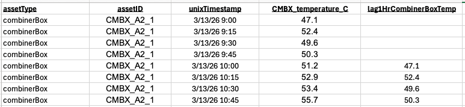

# Configure a Lag Derived Attribute

## What It Does

A `lag` derived attribute stores the value of an attribute from an earlier point in time.

For example, suppose each combiner box has a current temperature attribute:

```text
combinerBox/CMBX_temperature_C
```

You can create a new attribute such as:

```text
combinerBox/lag1HrCombinerBoxTemp
```

that contains the combiner-box temperature from one hour earlier.


The resulting value becomes part of the digital twin and can later be included in output tables or used by analytical models.



## When to Use It

Use `lag` when you need the prior value of **one attribute**.

Examples include:

- What was the pressure one hour ago?
- What was the temperature 15 minutes ago?
- What was the line speed one output period ago?

A lag retrieves a prior value. It does not calculate the difference between the current and prior values. If you need the change in one attribute between two points in time, use a `delta` derived attribute instead.

For details about calculating that type of change, see [Configure a Delta Derived Attribute](delta.md).

## Where the Configuration Goes

Every lag derived attribute is defined in two places:

1. Put the **high-level definition of the new attribute** in:

   ```text
   Phase-1---Project-Definition/
   03_defineDataEnrichment/
   derivedAttributes.json
   ```

2. Put the **lag-specific calculation details** in:

   ```text
   Phase-1---Project-Definition/
   03_defineDataEnrichment/
   derivedAttributeDetails/
   derivedAttributeDetails_lag.json
   ```

`derivedAttributes.json` defines **what the new attribute is**. `derivedAttributeDetails_lag.json` defines **how the lag is calculated**.

## What You Need to Configure

The configuration follows the same two-step pattern used by other derived attributes: first define **what the new attribute is**, and then define **how AutoML for IoT calculates it**.

Creating a lag attribute is a two-step process.

### Step 1: Define the New Derived Attribute

Add a high-level definition for the new attribute to:

```text
03_defineDataEnrichment/derivedAttributes.json
```

This definition describes what the new attribute is: its asset type, IDs, label, attribute type, data type, and length.

### Step 2: Define How the Lag Is Calculated

Add a matching lag-specific definition to:

```text
03_defineDataEnrichment/derivedAttributeDetails/derivedAttributeDetails_lag.json
```

This definition identifies:

- the attribute whose previous value should be retrieved
- how far back in time AutoML for IoT should look

The `assetType/attributeID` in the lag-specific definition must match the derived attribute created in Step 1.

## Step 1: Define the New Derived Attribute

Each lag attribute needs a record in `derivedAttributes.json`.

### Required Fields

| Field | Type | Description |
|---|---|---|
| `assetType` | string | Asset type that will receive the new lag attribute. Must exist in the asset-type configuration. |
| `attributeID` | string | ID of the new derived attribute. Must be unique within the asset type and must not duplicate a raw attribute. |
| `SASAttributeID` | string | SAS-compatible ID for the attribute. Must be 30 characters or fewer, contain only letters, numbers, and underscores, and cannot begin with a number. |
| `attributeLabel` | string | Human-readable label. Use only letters, numbers, spaces, underscores, and dashes. |
| `attributeType` | string | Must be `"lag"`. |
| `dataType` | string | `"double"` for numeric values or `"string"` for text values. |
| `dataLength` | number | `8` when `dataType` is `"double"`; otherwise a positive integer large enough for typical string values. |

### Optional Fields

The standard derived-attribute definition also supports:

- `dataFormat`
- `acceptableMin`
- `acceptableMinLogic`
- `acceptableMax`
- `acceptableMaxLogic`

If an acceptable minimum or maximum is provided, the corresponding logic field must also be provided.

Supported acceptable-value logic is:

- `missing` — ignore values outside the configured range
- `limit` — replace an out-of-range value with the configured minimum or maximum

### Example

```json
[
  {
    "assetType": "combinerBox",
    "attributeID": "lag1HrCombinerBoxTemp",
    "SASAttributeID": "lag1HrCombinerBoxTemp",
    "attributeLabel": "Lag 1 Hour Combiner Box Temp",
    "attributeType": "lag",
    "dataType": "double",
    "dataLength": 8
  }
]
```

## Step 2: Choose How Far Back to Look

A lag supports two ways to specify the time period:

1. a **fixed** number of seconds
2. a **dynamic** number of seconds stored in another attribute

Choose one approach for each lag attribute.

## Choose the Approach That Matches Your Situation

## Fixed Lag

Use a fixed lag when the lookback period is always the same.

For example, to retrieve the value from one hour (3600 seconds) earlier, the lag-specific configuration uses `timePeriodNumeric`.

### Fixed-Lag Fields

| Field | Type | Description |
|---|---|---|
| `assetType` | string | Asset type of the new lag attribute. |
| `attributeID` | string | ID of the new lag attribute. Must match the Step 1 definition. |
| `targetAttributeID` | string | Attribute whose prior value should be retrieved. It must exist as a raw or derived attribute for the same asset type. |
| `timePeriodNumeric` | string | Fixed number of seconds to look back. Must be greater than 0 and an integer multiple of `outputInterval`. |
| `timePeriodAssetType` | null | Not used for a fixed lag. |
| `timePeriodAttributeID` | null | Not used for a fixed lag. |
| `maxHistorySeconds` | null | Not used for a fixed lag. |

### Fixed-Lag Example

```json
[
  {
    "assetType": "combinerBox",
    "attributeID": "lag1HrCombinerBoxTemp",
    "maxHistorySeconds": null,
    "targetAttributeID": "CMBX_temperature_C",
    "timePeriodAssetType": null,
    "timePeriodAttributeID": null,
    "timePeriodNumeric": "3600"
  }
]
```

This stores the prior value of:

```text
combinerBox/CMBX_temperature_C
```

from one hour earlier as a new attribute named:

```text
combinerBox/lag1HrCombinerBoxTemp
```

## Dynamic Lag

Use a dynamic lag when the amount of time to look back changes based on another attribute.

This can be especially useful in manufacturing applications. For example, if material moves through a process at a changing line speed, the correct lookback period might vary throughout the day.

Instead of entering a fixed `timePeriodNumeric`, identify an attribute whose value contains the number of seconds to look back.

A dynamic lag requires all three of these fields:

- `timePeriodAssetType`
- `timePeriodAttributeID`
- `maxHistorySeconds`

### Dynamic-Lag Fields

| Field | Type | Description |
|---|---|---|
| `assetType` | string | Asset type of the new lag attribute. |
| `attributeID` | string | ID of the new lag attribute. Must match the Step 1 definition. |
| `targetAttributeID` | string | Attribute whose prior value should be retrieved. |
| `timePeriodNumeric` | null | Not used for a dynamic lag. |
| `timePeriodAssetType` | string | Asset type of the attribute that contains the dynamic lookback period. |
| `timePeriodAttributeID` | string | Attribute whose value contains the number of seconds to look back. |
| `maxHistorySeconds` | string | Maximum number of seconds that AutoML for IoT is allowed to look back. |

The combination:

```text
timePeriodAssetType/timePeriodAttributeID
```

must identify a valid raw or derived attribute.

### Why `maxHistorySeconds` Is Required

AutoML for IoT needs to know how much history it might need to retain.

Because the dynamic lookback value can change, `maxHistorySeconds` provides an upper limit so that history does not need to be maintained indefinitely.

`maxHistorySeconds` must be an integer multiple of `outputInterval`.

### Dynamic-Lag Example

Suppose a manufacturing calculation retrieves a prior temperature value, and another attribute contains the current number of seconds to look back.

A lag-specific definition follows this structure:

```json
[
  {
    "assetType": "processUnit",
    "attributeID": "priorProcessTemp",
    "maxHistorySeconds": "3600",
    "targetAttributeID": "temperature_C",
    "timePeriodAssetType": "controlPanel",
    "timePeriodAttributeID": "lookbackSeconds",
    "timePeriodNumeric": null
  }
]
```

In this example:

- `processUnit/temperature_C` is the value being retrieved
- `controlPanel/lookbackSeconds` supplies the current lookback period
- AutoML for IoT will not look back more than 3600 seconds

Use a dynamic lag only when the project actually contains a valid attribute whose value represents the lookback time in seconds.


## Derived Attributes Can Depend on Other Derived Attributes

The `targetAttributeID` and `timePeriodAttributeID` can reference either:

- a raw attribute
- another derived attribute

This makes it possible to build calculations in stages.

For example:

```text
string/current_A
    ↓
string/current_A_15m_avg
    ↓
string/current_A_15m_avg_lag1Hr
```

In this example, a temporal aggregation is calculated first and the lag retrieves an earlier value of that derived metric.

When building dependent calculations, make sure every referenced derived attribute is defined correctly before the project is prepared.

## Review the Result and Integrate the Attribute

After the high-level derived-attribute definition and the lag-specific definition are complete, run the data-enrichment preparation step.

Open and run:

```text
03_defineDataEnrichment/prepareDataEnrichment
```


This integrates the derived-attribute definitions into the project and creates an updated hierarchy review.

Download and open the generated `_reviewHierarchy*` document in a browser.

The derived attributes appear in blue when you inspect the assets in the updated digital twin.


## Validate and Continue

Before continuing, verify both parts of the configuration.

### High-Level Derived Attribute

Confirm that:

- `assetType` exists in the asset-type definition
- `attributeID` is unique within the asset type
- the new `assetType/attributeID` does not duplicate a raw attribute
- `SASAttributeID` is 30 characters or fewer and follows SAS variable-name rules
- `attributeType` is `"lag"`
- `dataType` is `"double"` or `"string"`
- `dataLength` is `8` for a double or a positive integer for a string
- any acceptable minimum or maximum has its corresponding logic field

### Lag-Specific Definition

Confirm that:

- `assetType/attributeID` matches a derived attribute whose type is `lag`
- `assetType/targetAttributeID` identifies a valid raw or derived attribute
- exactly one lag-time approach is configured:
  - a valid `timePeriodNumeric`, or
  - all three dynamic fields
- a fixed `timePeriodNumeric` is greater than 0 and is an integer multiple of `outputInterval`
- a dynamic `timePeriodAssetType/timePeriodAttributeID` identifies a valid raw or derived attribute
- a dynamic `maxHistorySeconds` is provided and is an integer multiple of `outputInterval`

## Return to Derived Attributes

[Return to Configuring Derived Attributes](README.md)
