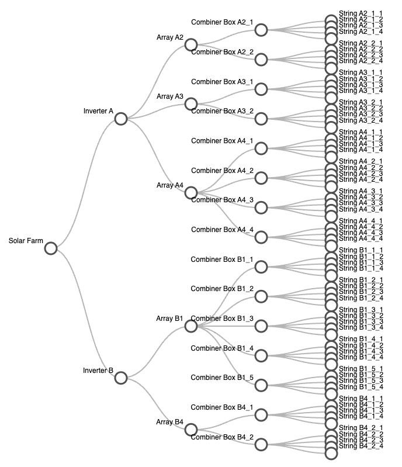
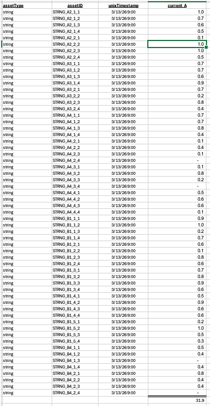
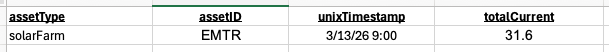

# Configure a Relational Aggregation Derived Attribute

## What It Does

A `relationalAgg` derived attribute summarizes an attribute across assets that are connected through a hierarchy.

Supported summary calculations are:

- `sum`
- `avg`
- `min`
- `max`

For example, consider a solar-farm hierarchy in which a solar farm connects through several levels to individual strings. Each string has:

```text
string/current_A
```

A new solar-farm attribute such as:

```text
solarFarm/totalCurrent
```

can sum the `current_A` values from all connected strings.



The calculation collects values from the connected target assets:



and stores the aggregated result as a new attribute on each applicable starting asset.



## When to Use It

Use `relationalAgg` when you need to summarize values **across connected assets**.

Examples include:

- What is the total current from all strings connected to this solar farm?
- What is the total airflow from fan powered boxes connected to this air handler?
- What is the maximum damper position across connected fan powered boxes?
- What is the average value of a particular measurement across connected equipment?

A relational aggregation differs from a temporal aggregation:

- `temporalAgg` summarizes one asset's values across time.
- `relationalAgg` summarizes values across assets connected in a hierarchy.

For details about summarizing values over time, see [Configure a Temporal Aggregation Derived Attribute](temporal-aggregation.md).

## Where the Configuration Goes

Every derived attribute is defined in two parts:

1. **Define the derived attribute itself** in:

   ```text
   Phase-1---Project-Definition/
   03_defineDataEnrichment/
   derivedAttributes.json
   ```

   This is where you provide the high-level information about the new attribute, including its asset type, attribute ID, label, data type, and derived-attribute type (`relationalAgg`).

2. **Define the logic used to calculate it** in:

   ```text
   Phase-1---Project-Definition/
   03_defineDataEnrichment/
   derivedAttributeDetails/derivedAttributeDetails_relationalAgg.json
   ```

   For this derived-attribute type, the detail file is:

   ```text
   derivedAttributeDetails_relationalAgg.json
   ```

Keep these two responsibilities separate: `derivedAttributes.json` defines **what the attribute is**; `derivedAttributeDetails_relationalAgg.json` defines **how it is calculated**.

## What You Need to Configure

The configuration follows the same two-step pattern used by other derived attributes: first define **what the new attribute is**, and then define **how AutoML for IoT calculates it**.

| Location | Purpose |
|---|---|
| `03_defineDataEnrichment/derivedAttributes.json` | Defines the high-level information for the new `relationalAgg` derived attribute. |
| `03_defineDataEnrichment/derivedAttributeDetails/derivedAttributeDetails_relationalAgg.json` | Defines the type-specific logic used to calculate the derived attribute. |

## Step 1: Define the New Derived Attribute

Each relational aggregation requires a record in `derivedAttributes.json`.

### Required Fields

| Field | Type | Description |
|---|---|---|
| `assetType` | string | Asset type that receives the new aggregated attribute. |
| `attributeID` | string | ID of the new derived attribute. Must be unique within the asset type and must not duplicate a raw attribute. |
| `SASAttributeID` | string | SAS-compatible ID. Must be 30 characters or fewer, contain only letters, numbers, and underscores, and cannot begin with a number. |
| `attributeLabel` | string | Human-readable label. |
| `attributeType` | string | Must be `"relationalAgg"`. |
| `dataType` | string | `"double"` or `"string"`. |
| `dataLength` | number | `8` for a double or a positive integer for a string. |

### Optional Fields

The standard derived-attribute definition also supports:

- `dataFormat`
- `acceptableMin`
- `acceptableMinLogic`
- `acceptableMax`
- `acceptableMaxLogic`

If an acceptable minimum or maximum is supplied, the matching logic field must also be supplied.

Supported acceptable-value logic is:

- `missing` — ignore values outside the configured range
- `limit` — replace an out-of-range value with the configured minimum or maximum


### Example

```json
[
  {
    "assetType": "solarFarm",
    "attributeID": "totalCurrent",
    "SASAttributeID": "totalCurrent",
    "attributeLabel": "Total Current",
    "attributeType": "relationalAgg",
    "dataType": "double",
    "dataLength": 8
  }
]
```

## Step 2: Define the Navigation and Aggregation Logic

A record in `derivedAttributeDetails_relationalAgg.json` contains exactly these required fields:

| Field | Type | Description |
|---|---|---|
| `assetType` | string | Asset type of the new derived attribute. |
| `attributeID` | string | ID of the new derived attribute. |
| `hierarchy` | string | Hierarchy to navigate. Must match a `hierarchyName` defined for the project. |
| `direction` | string | `"up"` or `"down"` or `"both"`. This controls whether the search should look upward to parent assets, down to child assets, or in both directions. |
| `numLevels` | number stored as a string | Maximum number of hierarchy levels to traverse. Must be an integer greater than 0. |
| `navigationLogic` | string | `"all"` or `"exact"`. `"all"` includes all assets found while searching the specified number of levels, while `"exact"` includes only assets found exactly that number of levels away from the given asset. |
| `summaryLogic` | string | `"sum"`, `"avg"`, `"min"`, or `"max"`. |
| `targetAssetType` | string | Asset type whose values should be collected. |
| `targetAttributeID` | string | Raw or derived attribute to aggregate on the target asset type. |

There are no optional fields in the relational-aggregation detail record. 

## Choose the Navigation and Aggregation That Match Your Situation

## Choose the Hierarchy

The `hierarchy` value identifies which project hierarchy AutoML for IoT should use to find connected assets.

For example:

```text
default
```

The value must match a valid hierarchy name defined in the project's hierarchy list. 

If you need to review how hierarchies and parent-child connections are defined, see [Define Hierarchies](../describing-your-digital-twin/hierarchies.md).

## Choose the Direction

`direction` controls whether AutoML for IoT traverses toward parent or child assets.

Use:

```text
up
```

to move from a child toward its parents.

Use:

```text
down
```

to move from a parent toward its children.

Use:

```text
both
```

to allow the search to include both parent and child assets.

For example, if a solar farm is above strings in the selected hierarchy and you want to calculate a solar-farm total from string measurements, navigate:

```text
down
```

## Choose the Number of Levels

`numLevels` is the maximum number of hierarchy steps AutoML for IoT can travel from the starting asset.

It is stored as a string and must represent an integer greater than 0. 

For example:

```text
"1"
```

examines directly connected assets only.

A value such as:

```text
"4"
```

allows the calculation to navigate as far as four connections away.

## Choose the Navigation Logic

`navigationLogic` controls which assets encountered during traversal are eligible for the calculation.

### `all`

Use:

```text
"all"
```

to include qualifying target assets found anywhere from the first hierarchy level through `numLevels`.

### `exact`

Use:

```text
"exact"
```

to include only qualifying target assets found exactly `numLevels` steps from the starting asset.

For example, suppose the hierarchy is:

```text
solarFarm
   ↓
inverter
   ↓
combinerBox
   ↓
string
```

If the starting asset is `solarFarm` and `numLevels` is `"3"`:

- `all` can consider qualifying target assets encountered up to three levels away.
- `exact` considers qualifying target assets only at the third level.

The `targetAssetType` further determines which of the assets found during traversal actually contribute values.

## Choose the Target Attribute

The value being aggregated is identified by:

```text
targetAssetType/targetAttributeID
```

For example:

```text
string/current_A
```

The target pair must identify a valid raw or derived attribute.

This makes it possible to aggregate either raw sensor readings or previously calculated derived attributes.

For example:

```text
string/current_A
    ↓ temporalAgg
string/current_A_5m_avg
    ↓ relationalAgg
inverter/inv_current_sum
```

In this example, AutoML for IoT first calculates a five-minute rolling average for each string and then sums those derived values across strings connected to each inverter.

When derived attributes depend on other derived attributes, keep those dependencies clear and ensure the prerequisite attribute definitions are valid before preparing the project. 

## Choose the Summary Calculation

`summaryLogic` determines how the values found on the connected target assets are combined.

Supported values are:

| `summaryLogic` | Calculation |
|---|---|
| `sum` | Add the values together |
| `avg` | Calculate their average |
| `min` | Return the minimum value |
| `max` | Return the maximum value |

No other summary values are supported. 

## Complete Example

The documented solar example creates:

```text
solarFarm/totalCurrent
```

by navigating down through the `default` hierarchy and summing:

```text
string/current_A
```

from connected strings.

```json
[
  {
    "assetType": "solarFarm",
    "attributeID": "totalCurrent",
    "direction": "down",
    "hierarchy": "default",
    "navigationLogic": "all",
    "numLevels": "4",
    "summaryLogic": "sum",
    "targetAssetType": "string",
    "targetAttributeID": "current_A"
  }
]
```

This structure uses all nine required fields and no additional fields. 

## How the Calculation Is Applied

The derived attribute is calculated for **each asset ID of the `assetType` specified in the derived-attribute definition**.

For example, if:

```text
assetType = airHandler
attributeID = totalAirflow
```

then each air handler receives its own `totalAirflow` value based on the connected assets found by traversing the configured hierarchy from that specific air handler. 

This is important when designing relational calculations: the starting asset type identifies where the result is stored, while `targetAssetType/targetAttributeID` identifies where the values being summarized are collected.

## Review the Result and Integrate the Attribute

After the high-level derived-attribute definition and the relationalAgg-specific definition are complete, run the data-enrichment preparation step.

Open and run:

```text
03_defineDataEnrichment/prepareDataEnrichment
```


This integrates the derived-attribute definitions into the project and creates an updated hierarchy review.

Download and open the generated `_reviewHierarchy*` document in a browser.

The derived attributes appear in blue when you inspect the assets in the updated digital twin.


## Validate and Continue

Before continuing, verify both parts of the configuration.

### High-Level Derived Attribute

Confirm that:

- `assetType` exists in the asset-type definition
- `attributeID` is unique within that asset type
- the new `assetType/attributeID` does not duplicate a raw attribute
- `SASAttributeID` follows SAS variable-name rules and is no more than 30 characters
- `attributeType` is `"relationalAgg"`
- the data type and length follow the derived-attribute rules

### Relational-Aggregation Detail

Confirm that:

- `assetType/attributeID` matches a derived attribute whose `attributeType` is `"relationalAgg"`
- `hierarchy` matches a defined hierarchy name
- `direction` is exactly `"up"` or `"down"` or `"both"`
- `numLevels` is stored as a string and represents an integer greater than 0
- `navigationLogic` is exactly `"all"` or `"exact"`
- `summaryLogic` is exactly `"sum"`, `"avg"`, `"min"`, or `"max"`
- `targetAssetType` is a valid asset type
- `targetAssetType/targetAttributeID` identifies a valid raw or derived attribute
- all nine required fields are present

## Return to Derived Attributes

[Return to Configuring Derived Attributes](README.md)
