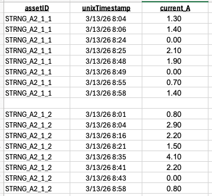
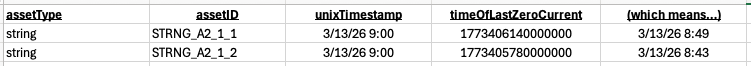

# Configure a Search Events Derived Attribute

## What It Does

A `searchEvents` derived attribute searches the individual sensor updates that occurred during a specified time period.

This makes `searchEvents` different from most other AutoML for IoT calculations. Most derived attributes operate on values that were current at an output or history interval. `searchEvents` can inspect **all individual updates** received for the selected raw attribute during the search window.

For example, suppose each string has:

```text
string/current_A
```

and intermittent outages cause some current readings to drop to zero. You can create:

```text
string/timeOfLastZeroCurrent
```

to search the individual current updates and identify the most recent time a zero-current reading was observed.


The calculation searches the individual sensor updates rather than only interval snapshots.



The selected value or event time can then become part of the digital twin.



## When to Use It

Use `searchEvents` when the analysis depends on the **individual events received**, including events that may have been superseded before the next output or history interval.

Typical uses include:

- find the minimum or maximum individual reading during a period
- retrieve the oldest or newest reading during a period
- retrieve the second-oldest, second-newest, or another ordered event
- determine when a particular value was last observed
- calculate an average or sum using every individual update received
- search events for a related asset whose ID is stored in another attribute

## Search Events vs. Temporal Aggregation

`searchEvents` and `temporalAgg` can both calculate values such as averages, sums, minimums, and maximums, but they operate on different information.

### `temporalAgg`

A temporal aggregation works with values maintained at the project's history intervals.

For example, if:

```text
historyInterval = 300
```

the temporal calculation uses values at five-minute history points.

### `searchEvents`

A search-events calculation examines the individual sensor updates received during the selected period.

If ten readings arrive within one five-minute interval, `searchEvents` can consider all ten readings.

This distinction is especially important for averages and sums. Each event receives equal weight in a `searchEvents` average, even if updates arrive close together. The source documentation therefore notes that `temporalAgg` is generally more appropriate when the goal is a time-based average.

For details about interval-based aggregation, see [Configure a Temporal Aggregation Derived Attribute](temporal-aggregation.md).

## Where the Configuration Goes

Every derived attribute is defined in two parts:

1. **Define the derived attribute itself** in:

   ```text
   Phase-1---Project-Definition/
   03_defineDataEnrichment/
   derivedAttributes.json
   ```

   This is where you provide the high-level information about the new attribute, including its asset type, attribute ID, label, data type, and derived-attribute type (`searchEvents`).

2. **Define the logic used to calculate it** in:

   ```text
   Phase-1---Project-Definition/
   03_defineDataEnrichment/
   derivedAttributeDetails/derivedAttributeDetails_searchEvents.json
   ```

   For this derived-attribute type, the detail file is:

   ```text
   derivedAttributeDetails_searchEvents.json
   ```

Keep these two responsibilities separate: `derivedAttributes.json` defines **what the attribute is**; `derivedAttributeDetails_searchEvents.json` defines **how it is calculated**.

## What You Need to Configure

The configuration follows the same two-step pattern used by other derived attributes: first define **what the new attribute is**, and then define **how AutoML for IoT calculates it**.

| Location | Purpose |
|---|---|
| `03_defineDataEnrichment/derivedAttributes.json` | Defines the high-level information for the new `searchEvents` derived attribute. |
| `03_defineDataEnrichment/derivedAttributeDetails/derivedAttributeDetails_searchEvents.json` | Defines the type-specific logic used to calculate the derived attribute. |

## Step 1: Define the New Derived Attribute

Each `searchEvents` attribute requires a record in `derivedAttributes.json`.

The appropriate data type depends on what the event search returns. For example:

- a minimum temperature would normally be a numeric result
- an event time is returned as UTC epoch microseconds
- a station name or other text reading can require a string result

### Required Fields

| Field | Type | Description |
|---|---|---|
| `assetType` | string | Asset type that receives the search result. |
| `attributeID` | string | ID of the new derived attribute. Must be unique within the asset type and must not duplicate a raw attribute. |
| `SASAttributeID` | string | SAS-compatible ID. Must be 30 characters or fewer, contain only letters, numbers, and underscores, and cannot begin with a number. |
| `attributeLabel` | string | Human-readable label. |
| `attributeType` | string | Must be `"searchEvents"`. |
| `dataType` | string | `"double"` or `"string"`, depending on the result. |
| `dataLength` | number | `8` for a double; otherwise a positive integer large enough for the string result. |

The standard derived-attribute definition can also include the documented optional format and acceptable-range fields.

## Step 2: Define the Event Search

A `derivedAttributeDetails_searchEvents.json` record uses the following core fields.

| Field | Type | Description |
|---|---|---|
| `assetType` | string | Asset type of the new `searchEvents` attribute. |
| `attributeID` | string | ID of the new derived attribute. |
| `targetAttributeID` | string | Raw attribute whose individual events should be searched. |
| `queryAssetIDFromThisAttribID` | string | Optional related-asset lookup used in the documented schema examples. Use an empty string when searching the current asset. |
| `oldTimePeriod` | integer stored as a string | Older boundary of the search window, expressed as seconds ago. |
| `recentTimePeriod` | integer stored as a string | More recent boundary of the search window, expressed as seconds ago. |
| `maxEventsToSearch` | integer stored as a string | Maximum number of individual events to retain and search. |
| `searchLogic` | string | `"min"`, `"max"`, `"oldest"`, `"newest"`, `"avg"`, or `"sum"`. |
| `returnValue` | string | `"value"` or, for ordered-event searches, `"time"`. |
| `instanceNumber` | integer stored as a string | Required for `"oldest"` or `"newest"` searches. Use an empty string when not applicable. |
| `searchSubsetValue` | string | Optional fixed value used to restrict ordered-event searches. |
| `searchSubsetAttributeID` | string | Optional attribute whose value supplies the event-search subset value. |

## The Target Must Be a Raw Attribute

`targetAttributeID` must identify a **raw attribute** for the same asset type.

The pair:

```text
assetType/targetAttributeID
```

must exist in the raw-attribute configuration.

Unlike several other derived-attribute types, `searchEvents` cannot use another derived attribute as its event source. The reason is that this calculation searches the original individual sensor updates.

## Define the Search Window

Use:

```text
oldTimePeriod
recentTimePeriod
```

to define the event-search window in seconds ago.

Both values must be integers greater than or equal to 0, stored as strings.

The older boundary must be greater than the recent boundary.

For example, to search the previous hour through the current time:

```text
oldTimePeriod = "3600"
recentTimePeriod = "0"
```

To search events from one hour ago through 15 minutes ago:

```text
oldTimePeriod = "3600"
recentTimePeriod = "900"
```

## Choose `maxEventsToSearch`

Individual events must be retained in memory so that they can be searched.

Use:

```text
maxEventsToSearch
```

to define the maximum number of events maintained for this search.

The value:

- is stored as a string
- must represent an integer greater than 0
- should be large enough to cover the number of events normally expected during the selected search window

For example:

```text
maxEventsToSearch = "100"
```

allows the search to consider as many as 100 retained events.

Choose this value based on the expected event frequency and the size of the requested time window.

## Choose the Search That Matches Your Situation

## Search for the Minimum or Maximum

Use:

```text
searchLogic = "min"
```

or:

```text
searchLogic = "max"
```

to retrieve the minimum or maximum individual event value during the selected period.

For `min` and `max`:

```text
returnValue = "value"
```

is required.

### Minimum Example

```json
[
  {
    "assetType": "combinerBox",
    "attributeID": "minTemperature",
    "targetAttributeID": "temperature",
    "queryAssetIDFromThisAttribID": "",
    "oldTimePeriod": "3600",
    "recentTimePeriod": "0",
    "maxEventsToSearch": "100",
    "searchLogic": "min",
    "returnValue": "value",
    "instanceNumber": "",
    "searchSubsetValue": "",
    "searchSubsetAttributeID": ""
  }
]
```

This searches every `combinerBox/temperature` update retained during the previous hour and returns the smallest value observed.

## Search for the Oldest or Newest Event

Use:

```text
searchLogic = "oldest"
```

or:

```text
searchLogic = "newest"
```

when event order matters.

You must also specify:

```text
instanceNumber
```

The instance number is stored as a string and must represent an integer greater than 0.

Examples:

```text
searchLogic = "oldest"
instanceNumber = "1"
```

returns the oldest event in the search window.

```text
searchLogic = "oldest"
instanceNumber = "2"
```

returns the second-oldest event.

```text
searchLogic = "newest"
instanceNumber = "1"
```

returns the newest event.

For an `oldest` or `newest` search, `returnValue` can be:

- `"value"` — return the event value
- `"time"` — return the time of the selected event in UTC microseconds

## Example: Retrieve the Most Recent Value

To retrieve the newest station-arrival event observed during the previous hour:

```json
[
  {
    "assetType": "train",
    "attributeID": "prevStationArrivedAt",
    "targetAttributeID": "stationArrivals",
    "queryAssetIDFromThisAttribID": "",
    "oldTimePeriod": "3600",
    "recentTimePeriod": "0",
    "maxEventsToSearch": "100",
    "searchLogic": "newest",
    "returnValue": "value",
    "instanceNumber": "1",
    "searchSubsetValue": "",
    "searchSubsetAttributeID": ""
  }
]
```

## Example: When Was a Value Last Observed?

Suppose:

```text
combinerBox/alertList
```

receives events containing alert values, and you want to know the most recent time `HighTemp` occurred.

The source documentation provides this pattern:

```json
[
  {
    "assetType": "combinerBox",
    "attributeID": "lastHighTempAlertTime",
    "targetAttributeID": "alertList",
    "queryAssetIDFromThisAttribID": "",
    "oldTimePeriod": "3600",
    "recentTimePeriod": "0",
    "maxEventsToSearch": "100",
    "searchLogic": "newest",
    "returnValue": "time",
    "instanceNumber": "1",
    "searchSubsetValue": "HighTemp",
    "searchSubsetAttributeID": ""
  }
]
```

This searches events from the previous hour, keeps only those with value `HighTemp`, selects the newest matching event, and returns its time in UTC microseconds.

### Restrict the Time Search to a Particular Value

The search-subset criteria apply when `returnValue` is `"time"` and you want the returned timestamp to correspond only to events with a particular value.

For example, suppose a status attribute can contain values such as:

```text
OPEN
CLOSED
FAULT
```

and you want to know:

```text
When was FAULT last observed?
```

Configure the ordered search to return the event time and use the search-subset criteria to limit qualifying events to those where the target attribute has the value:

```text
FAULT
```

AutoML for IoT then searches the qualifying events in the requested order and returns the timestamp for the matching event.

This is useful for questions such as:

- When was a fault last observed?
- When did a machine most recently enter a particular state?
- When was a specified categorical value first or last seen?

Use the search-subset criteria with the time-return behavior rather than as a general filter for other `returnValue` options.

## Calculate an Average or Sum Across Every Event

Use:

```text
searchLogic = "avg"
```

or:

```text
searchLogic = "sum"
```

to calculate across all individual updates in the search window.

For both:

```text
returnValue = "value"
```

is required.

Each observed update is given equal weight.

This behavior differs from `temporalAgg`, which uses the values maintained at history intervals. For time-based averages where measurements arrive irregularly, the source documentation notes that a temporal aggregation will generally be more appropriate.

## Search Events for a Related Asset

Normally, the calculation searches events for the current asset.

The schema examples use:

```text
queryAssetIDFromThisAttribID
```

when the event search should instead be performed for another asset whose ID is stored in an attribute.

For example, suppose each train contains:

```text
train/currentStation
```

and you want to find the previous train that arrived at that station.

The source documentation provides this pattern:

```json
[
  {
    "assetType": "train",
    "attributeID": "previousTrainInStation",
    "targetAttributeID": "trainArrivals",
    "queryAssetIDFromThisAttribID": "currentStation",
    "oldTimePeriod": "3600",
    "recentTimePeriod": "0",
    "maxEventsToSearch": "100",
    "searchLogic": "newest",
    "returnValue": "value",
    "instanceNumber": "2",
    "searchSubsetValue": "",
    "searchSubsetAttributeID": ""
  }
]
```

This stores the result on each train but searches the `trainArrivals` events for the asset ID contained in `train/currentStation`.

## Search Logic Reference

| `searchLogic` | Purpose | Valid `returnValue` | `instanceNumber` |
|---|---|---|---|
| `min` | Minimum observed event | `value` | Not used |
| `max` | Maximum observed event | `value` | Not used |
| `avg` | Average of all observed events | `value` | Not used |
| `sum` | Sum of all observed events | `value` | Not used |
| `oldest` | Ordered event from oldest forward | `value` or `time` | Required |
| `newest` | Ordered event from newest backward | `value` or `time` | Required |

## Review the Result and Integrate the Attribute

After the high-level derived-attribute definition and the searchEvents-specific definition are complete, run the data-enrichment preparation step.

Open and run:

```text
03_defineDataEnrichment/prepareDataEnrichment
```


This integrates the derived-attribute definitions into the project and creates an updated hierarchy review.

Download and open the generated `_reviewHierarchy*` document in a browser.

The derived attributes appear in blue when you inspect the assets in the updated digital twin.


## Validate and Continue

Before continuing, verify both parts of the configuration.

### High-Level Derived Attribute

Confirm that:

- `assetType` exists in the asset-type definition
- `attributeID` is unique within the asset type
- the new `assetType/attributeID` does not duplicate a raw attribute
- `SASAttributeID` follows SAS variable-name rules and is no more than 30 characters
- `attributeType` is exactly `"searchEvents"`
- `dataType` and `dataLength` match the value or event time being returned
- only documented fields are present

### Search-Events Detail

Confirm that:

- `assetType/attributeID` matches a record in `derivedAttributes.json` whose `attributeType` is `"searchEvents"`
- `assetType/targetAttributeID` exists in the raw-attribute configuration
- the target is not a derived attribute
- `oldTimePeriod` and `recentTimePeriod` represent integers greater than or equal to 0
- `oldTimePeriod` is greater than `recentTimePeriod`
- `maxEventsToSearch` represents an integer greater than 0
- `searchLogic` is exactly `"min"`, `"max"`, `"oldest"`, `"newest"`, `"avg"`, or `"sum"`
- `returnValue` is `"value"` for `min`, `max`, `avg`, and `sum`
- `returnValue` is `"value"` or `"time"` for `oldest` and `newest`
- `instanceNumber` is provided for `oldest` and `newest` and represents an integer greater than 0
- if `queryAssetIDFromThisAttribID` is populated, the referenced `assetType/attributeID` exists as a raw or derived attribute
- a fixed subset value and a subset-value attribute are not both used for the same search
- unused fields follow the documented empty-string example structure
- no unsupported fields are present

## Related Information

For interval-based averages, sums, minimums, and maximums, see [Configure a Temporal Aggregation Derived Attribute](temporal-aggregation.md).

## Return to Derived Attributes

[Return to Configuring Derived Attributes](README.md)
