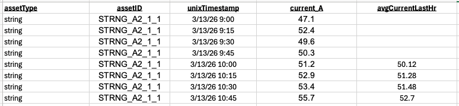

# Configure a Temporal Aggregation Derived Attribute

## What It Does

A `temporalAgg` derived attribute summarizes the values of an attribute across a period of time.

Supported summary calculations are:

- `avg` — average
- `sum` — sum
- `min` — minimum
- `max` — maximum

For example, suppose each solar-panel string has a current measurement:

```text
string/current_A
```

You can create a derived attribute such as:

```text
string/avgCurrentLastHr
```

that contains the average current generated by each string over the previous hour.


The calculated result becomes part of the digital twin and can later be included in output tables or used as an input to analytical models.



## When to Use It

Use `temporalAgg` when you need to summarize **multiple historical values of one attribute** over a defined time window.

Examples include:

- What was the average current during the past hour?
- What was the maximum temperature during the past 30 minutes?
- What was the minimum pressure between one hour ago and 15 minutes ago?
- What was the total value observed during a historical period?

A temporal aggregation is different from a lag or delta:

- `lag` retrieves one prior value.
- `delta` calculates the change between two points in time.
- `temporalAgg` summarizes the values observed across a time window.

For details about retrieving a single prior value, see [Configure a Lag Derived Attribute](lag.md). For details about calculating the change between two points in time, see [Configure a Delta Derived Attribute](delta.md).

## Where the Configuration Goes

Every derived attribute is defined in two parts:

1. **Define the derived attribute itself** in:

   ```text
   Phase-1---Project-Definition/
   03_defineDataEnrichment/
   derivedAttributes.json
   ```

   This is where you provide the high-level information about the new attribute, including its asset type, attribute ID, label, data type, and derived-attribute type (`temporalAgg`).

2. **Define the logic used to calculate it** in:

   ```text
   Phase-1---Project-Definition/
   03_defineDataEnrichment/
   derivedAttributeDetails/derivedAttributeDetails_temporalAgg.json
   ```

   For this derived-attribute type, the detail file is:

   ```text
   derivedAttributeDetails_temporalAgg.json
   ```

Keep these two responsibilities separate: `derivedAttributes.json` defines **what the attribute is**; `derivedAttributeDetails_temporalAgg.json` defines **how it is calculated**.

## What You Need to Configure

The configuration follows the same two-step pattern used by other derived attributes: first define **what the new attribute is**, and then define **how AutoML for IoT calculates it**.

| Location | Purpose |
|---|---|
| `03_defineDataEnrichment/derivedAttributes.json` | Defines the high-level information for the new `temporalAgg` derived attribute. |
| `03_defineDataEnrichment/derivedAttributeDetails/derivedAttributeDetails_temporalAgg.json` | Defines the type-specific logic used to calculate the derived attribute. |

## Step 1: Define the New Derived Attribute

Each temporal aggregation requires a record in `derivedAttributes.json`.

### Required Fields

| Field | Type | Description |
|---|---|---|
| `assetType` | string | Asset type that will receive the new temporal aggregation. Must exist in the asset-type configuration. |
| `attributeID` | string | ID of the new derived attribute. Must be unique within the asset type and must not duplicate a raw attribute. |
| `SASAttributeID` | string | SAS-compatible ID. Must be 30 characters or fewer, contain only letters, numbers, and underscores, and cannot begin with a number. |
| `attributeLabel` | string | Human-readable label. Use only letters, numbers, spaces, underscores, and dashes. |
| `attributeType` | string | Must be `"temporalAgg"`. |
| `dataType` | string | `"double"` for numeric values or `"string"` for text values. |
| `dataLength` | number | `8` when `dataType` is `"double"`; otherwise a positive integer large enough for typical string values. |

### Optional Fields

The standard derived-attribute definition also supports:

- `dataFormat`
- `acceptableMin`
- `acceptableMinLogic`
- `acceptableMax`
- `acceptableMaxLogic`

If an acceptable minimum or maximum is supplied, the matching logic field must also be supplied.

Supported acceptable-value logic is:

- `missing` — ignore values outside the configured range
- `limit` — replace an out-of-range value with the configured minimum or maximum

### Example

```json
[
  {
    "assetType": "string",
    "attributeID": "avgCurrentLastHr",
    "SASAttributeID": "avgCurrentLastHr",
    "attributeLabel": "Average Current Last Hour",
    "attributeType": "temporalAgg",
    "dataType": "double",
    "dataLength": 8
  }
]
```

## Step 2: Select the Attribute and Summary Calculation

Choose the attribute whose values should be summarized.

The target must be a valid raw or derived attribute for the same asset type.

For the example above:

```text
string/current_A
```

is the target attribute.

Then select one supported summary calculation.

| `summaryLogic` | Calculation |
|---|---|
| `avg` | Average |
| `sum` | Sum |
| `min` | Minimum |
| `max` | Maximum |

No other values are supported.

## Define the Time Window

A temporal aggregation summarizes values between:

- an **older** time boundary
- a **more recent** time boundary

The boundaries are expressed as the number of seconds ago.

For example, to summarize the past hour through the current time:

```text
older boundary = 3600 seconds ago
recent boundary = 0 seconds ago
```

A value of `0` represents the current time.

Each boundary can be defined in one of two ways:

1. as a fixed number of seconds
2. from the value of another attribute

The older and recent boundaries can be configured independently. For example, one could be fixed while the other is dynamic.

## Choose the Approach That Matches Your Situation

## Fixed Time Boundaries

For a fixed older boundary, use:

```text
oldTimePeriodNumeric
```

For a fixed recent boundary, use:

```text
recentTimePeriodNumeric
```

The older fixed value must be greater than `0`. The recent fixed value can be `0`.

If both boundaries are fixed:

```text
oldTimePeriodNumeric > recentTimePeriodNumeric
```

### Example: Average During the Past Hour

```json
[
  {
    "assetType": "string",
    "attributeID": "avgCurrentLastHr",
    "maxHistorySeconds": null,
    "oldTimePeriodAssetType": null,
    "oldTimePeriodAttributeID": null,
    "oldTimePeriodNumeric": "3600",
    "recentTimePeriodAssetType": null,
    "recentTimePeriodAttributeID": null,
    "recentTimePeriodNumeric": "0",
    "summaryLogic": "avg",
    "targetAttributeID": "current_A"
  }
]
```

This calculates the average of:

```text
string/current_A
```

from one hour ago through the current time.

## Dynamic Time Boundaries

A time boundary can instead be supplied by another raw or derived attribute.

For a dynamic older boundary, specify both:

- `oldTimePeriodAssetType`
- `oldTimePeriodAttributeID`

For a dynamic recent boundary, specify both:

- `recentTimePeriodAssetType`
- `recentTimePeriodAttributeID`

The referenced `assetType/attributeID` must exist as a raw or derived attribute.

The value contained in that referenced attribute is interpreted as the number of seconds ago for the corresponding boundary.

This can be useful when the desired aggregation window depends on another event or operating condition rather than a fixed number of seconds.

## Maximum History for Dynamic Windows

If either the older or recent time boundary is retrieved from another attribute, you must also specify:

```text
maxHistorySeconds
```

This limits how far back AutoML for IoT needs to maintain history.

`maxHistorySeconds` must be greater than `0`.

For example, if a dynamic time boundary can vary but should never require more than two hours of retained history:

```text
maxHistorySeconds = "7200"
```

For fixed time windows, `maxHistorySeconds` is not used and follows the documented example structure with a `null` value.

## Temporal Aggregation Detail Fields

A temporal-aggregation record uses the following documented fields.

| Field | Type | Description |
|---|---|---|
| `assetType` | string | Asset type of the new temporal aggregation. |
| `attributeID` | string | ID of the new derived attribute. Must match the Step 1 definition. |
| `targetAttributeID` | string | Raw or derived attribute to summarize for the same asset type. |
| `summaryLogic` | string | Must be `"sum"`, `"avg"`, `"min"`, or `"max"`. |
| `oldTimePeriodNumeric` | number stored as a string or `null` | Fixed older boundary, in seconds ago. Must be greater than `0` when used. |
| `oldTimePeriodAssetType` | string or `null` | Asset type containing the dynamic older-boundary value. |
| `oldTimePeriodAttributeID` | string or `null` | Attribute containing the dynamic older-boundary value. |
| `recentTimePeriodNumeric` | number stored as a string or `null` | Fixed recent boundary, in seconds ago. Must be `0` or greater when used. |
| `recentTimePeriodAssetType` | string or `null` | Asset type containing the dynamic recent-boundary value. |
| `recentTimePeriodAttributeID` | string or `null` | Attribute containing the dynamic recent-boundary value. |
| `maxHistorySeconds` | number stored as a string or `null` | Maximum history retained when either time boundary is dynamic. |

There are no additional optional fields.

## History Resolution Is Important

Temporal aggregations rely on one additional project-level decision: **how granular the retained history should be**. This setting is specified in the projectInformation.json config file described earlier.

This is controlled in the projectInformation config file by the field:

```text
historyInterval
```

For example, suppose you want a rolling 15-minute average.

If:

```text
historyInterval = 300
```

the calculation will use measurements spaced five minutes apart - therefore, this 15-minute average will be the average of 3 measurements each 5-minutes apart.

If:

```text
historyInterval = 60
```

the calculation will be the average of 15 measurements spaced one minute apart.

A smaller history interval therefore provides finer historical resolution.

## Choosing a History Interval

When the project contains any `temporalAgg` derived attribute, it is useful to revisit the project settings for outputInterval and historyInterval.

As an example, if:

```text
outputInterval = 300
historyInterval = 60
```

then the output occurs every five minutes while history is maintained at one-minute resolution.

Recall from the project information section that outputInterval must be an integer multiple of the historyInterval.

Choose `historyInterval` based on how much detail the temporal calculations need.

Avoid selecting a finer history resolution than the use case requires, while still ensuring that the temporal calculations can be evaluated at the necessary level of detail.

For more information about the project-level timing settings, see [Specifying Project Information](../specifying-project-information/README.md).

## Derived Attributes Can Be Targets

`targetAttributeID` can reference:

- a raw attribute
- another derived attribute

For example, a project could first create one derived measure and then calculate a rolling average of that measure.

When one derived attribute depends on another, ensure that the referenced attribute is valid before preparing the data-enrichment project.

## Review the Result and Integrate the Attribute

After the high-level derived-attribute definition and the temporal aggregation-specific definition are complete, run the data-enrichment preparation step.

Open and run:

```text
03_defineDataEnrichment/prepareDataEnrichment
```


This integrates the derived-attribute definitions into the project and creates an updated hierarchy review.

Download and open the generated `_reviewHierarchy*` document in a browser.

The derived attributes appear in blue when you inspect the assets in the updated digital twin.


## Validate and Continue

Before continuing, verify both parts of the configuration and the project history interval.

### High-Level Derived Attribute

Confirm that:

- `assetType` exists in the asset-type definition
- `attributeID` is unique within the asset type
- the new `assetType/attributeID` does not duplicate a raw attribute
- `SASAttributeID` follows SAS variable-name rules and is no more than 30 characters
- `attributeType` is `"temporalAgg"`
- `dataType` is `"double"` or `"string"`
- `dataLength` is `8` for a double or a positive integer for a string
- any acceptable minimum or maximum has its corresponding logic field

### Temporal-Aggregation Detail

Confirm that:

- `assetType/attributeID` matches a record in `derivedAttributes.json` whose `attributeType` is `"temporalAgg"`
- `assetType/targetAttributeID` identifies a valid raw or derived attribute
- `summaryLogic` is `"sum"`, `"avg"`, `"min"`, or `"max"`
- the older boundary uses either `oldTimePeriodNumeric` or both dynamic older-boundary fields
- the recent boundary uses either `recentTimePeriodNumeric` or both dynamic recent-boundary fields
- if both boundaries are fixed, the older value is greater than the recent value
- every dynamic time-boundary attribute exists as a valid raw or derived attribute
- `maxHistorySeconds` is present whenever either boundary is dynamic

## Return to Derived Attributes

[Return to Configuring Derived Attributes](README.md)
