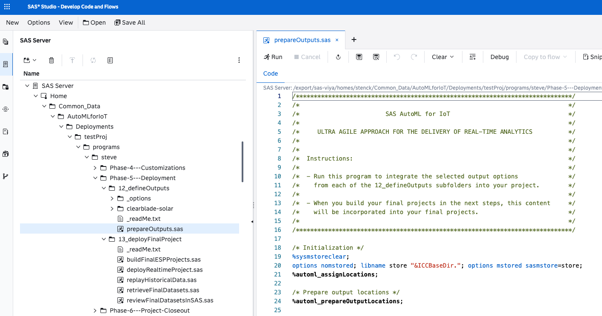

# Configuring Output Locations

By this point, AutoML for IoT has transformed the raw data feed into a much richer real-time result.

In the earlier steps, you:

- transformed raw sensor updates into structured, analytic-ready output tables
- trained models and integrated their predictions into those tables
- optionally added business rules
- optionally added ESP customizations

Now decide **where those resulting real-time outputs should be written**.

Output locations are integrated into the **real-time ESP project only**.

## Where You Work

All output-location configuration is performed under:

```text
Phase-5---Deployment/
└── 12_defineOutputs/
```

At a high level, the directory contains:

```text
12_defineOutputs/
├── _options/
├── <configured output directories>/
└── prepareOutputs.sas
```

The `_options` directory contains the built-in output approaches that you can use as starting points. Your configured output locations are created directly under `12_defineOutputs`.

## Choose an Output Approach

AutoML for IoT includes two built-in output approaches:

- **Custom ESP** — use this option when output should be written using SAS Event Stream Processing windows and connectors. This gives you access to the many built-in output destinations supported through ESP.
- **ClearBlade** — use this option when real-time output should be written back to an existing ClearBlade instance. AutoML for IoT can format and publish derived attributes and/or model results through the configured ClearBlade output connection.

For details, see:

- [Configure a ClearBlade Output](clearblade-output.md)
- [Configure a Custom ESP Output](custom-output.md)

You can configure one or more output locations for a project.

## Add an Output Location to the Project

The folders under `_options` are templates. To make either output approach part of your project:

1. Open:

   ```text
   Phase-5---Deployment/12_defineOutputs/_options
   ```

2. Copy either:

   ```text
   clearblade-example
   ```

   or:

   ```text
   customESP-example
   ```

3. Paste the copied directory directly into:

   ```text
   Phase-5---Deployment/12_defineOutputs
   ```

4. Rename the copied directory so it identifies that particular output location.

For example, a project with one ClearBlade output and one custom ESP output might look like:

```text
12_defineOutputs/
├── _options/
│   ├── clearblade-example/
│   └── customESP-example/
├── clearblade-solar/
├── customESP-cas/
└── prepareOutputs.sas
```

The folders inside `_options` remain unchanged templates. The copied folders directly under `12_defineOutputs` are the output locations that belong to this project.

## Configure Each Output Location

After a template has been copied into the project, configure the connection inside that copied directory.

The two built-in approaches use different configuration methods:

- **Custom ESP** — build and test the output connection in ESP Studio, then copy the required ESP XML into `customOutput.xml` in the copied custom ESP directory.
- **ClearBlade** — enter the ClearBlade connection settings in the copied ClearBlade directory.

Each option-specific page shows:

1. how to copy the option into the project
2. what configuration needs to be completed
3. what a completed configuration looks like

For details, see:

- [Configure a ClearBlade Output](clearblade-output.md)
- [Configure a Custom ESP Output](custom-output.md)

Repeat the copy-and-configure process for any additional output locations.

## Prepare the Output Locations

After all desired output directories have been copied, renamed, and configured, run:

```text
Phase-5---Deployment/12_defineOutputs/prepareOutputs.sas
```



The program processes the configured output directories and prepares their content for inclusion in the final real-time project.

Review the SAS log and confirm that the expected output locations were processed successfully.

## What Happens Later

When the final **real-time ESP project** is built, the configured output content is incorporated automatically.

For ClearBlade output, AutoML for IoT adds the ESP content needed to format and publish the configured results to ClearBlade.

For custom ESP output, AutoML for IoT incorporates the configured windows, edges, optional MAS modules, and connector orchestration.

## Previous

If project customizations are still needed, see [Adding Customizations](../adding-customizations/README.md).

## Next

After output locations are configured and prepared, continue to [Deploying Your Final Project](../deploying-your-final-project/README.md).
