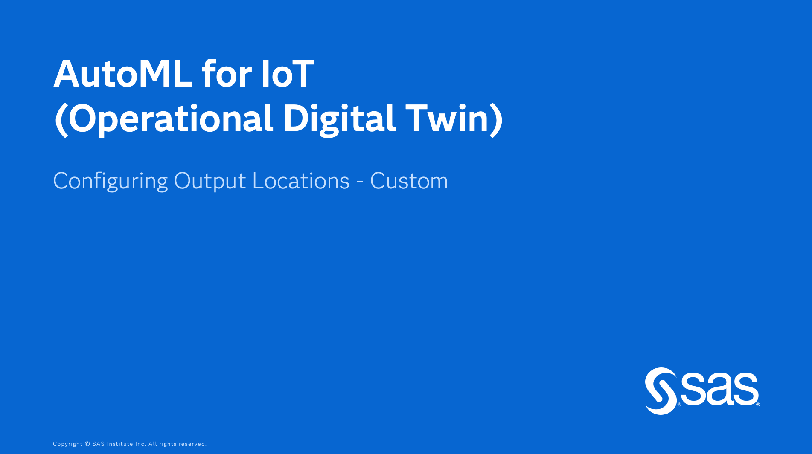

# Configuring Output Locations

If you would like to output content from your **real-time project** to an external location, this is the place to do it!  Note that the configurations made in this section ONLY IMPACT THE REAL-TIME PROJECT. These configurations will not get incorporated into the historical project used to replay old data.

If you are integrating your SAS AutoML for IoT project with an existing ClearBlade digital twin, then click [here](#outputting-to-an-existing-clearblade-instance) to ensure derived attributes and/or model predictions etc. are written back to your ClearBlade instance. 

Otherwise, continue on to the next section where you'll set use the native capabilities in SAS Event Stream Processing to output information to your desired location(s). 

## Configuring an Output Location 

The below powerpoint will walk you through how to output analytic ready datasets, derived attributes, model predictions, etc. to an output location. SAS Event Stream Processing has more than 20 existing [connectors](https://go.documentation.sas.com/doc/en/espcdc/v_070/espca/titlepage.htm) that can be used to write to various locations. This includes connecting to message feeds (kafka, mqtt, etc), writing to databases, etc. This content will show you how to set up these connections and then how to integrate that information into your AutoML for IoT project. 

Since SAS Visual Analytics natively integrates with CAS, the powerpoint includes a section at the end that specifically shows how to output your final tables to CAS. 

Step-by-Step Guide         | 
:-------------------------:|
 |

## Outputting to an Existing ClearBlade Instance

The below powerpoint will walk you through how to output derived attributes and/or model predictions to an existing ClearBlade instance (if applicable). 

Step-by-Step Guide         | 
:-------------------------:|
 |

      