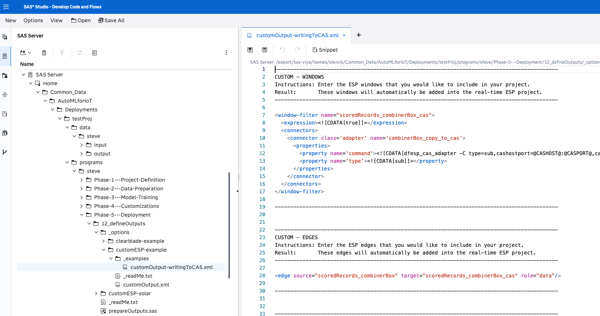
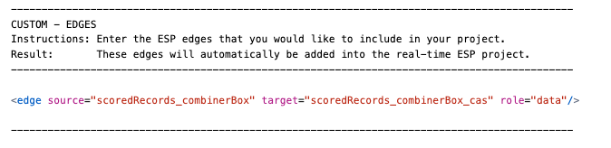
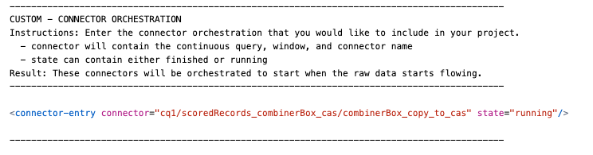

# Example: Write Output Tables to CAS

CAS is a common output destination because SAS Visual Analytics can work directly with CAS tables.

This example uses the same custom ESP output workflow described in [Configure a Custom ESP Output](custom-output.md).

## Start with the Custom ESP Template

Copy:

```text
12_defineOutputs/_options/customESP-example
```

into:

```text
12_defineOutputs
```

and rename the copied directory for the CAS output.

For example:

```text
customESP-cas
```

The `_examples` directory contains a completed custom-output example that writes an output table to CAS.

## Configure the CAS Output Window

The CAS example creates an ESP window connected to the final scored output and adds a CAS connector that writes records to a CAS table.



Adjust the CAS destination information for your environment, including the CAS table and caslib values.

If the project has several output tables, create the corresponding output window for each table that should be written to CAS.

## Connect the Scored Output to the CAS Window

Add an ESP edge from the relevant:

```text
scoredRecords_<assetType>
```

window to the new CAS output window.



If several output tables are being written to CAS, add the corresponding edge for each one.

## Configure Connector Orchestration

Add an orchestration entry for each CAS connector so it starts when the ESP project starts.



Match the orchestration entry to:

- the name of the new output window
- the name of the CAS connector
- the desired running state

Repeat the orchestration entry for each CAS connector when multiple output tables are configured.

## Prepare the Output

After the CAS configuration is complete, run:

```text
12_defineOutputs/prepareOutputs.sas
```

Review the log and confirm that the output location was processed successfully.

The CAS output content will then be incorporated when the final real-time ESP project is built.

## Return to Output Locations

[Return to Configuring Output Locations](README.md)
