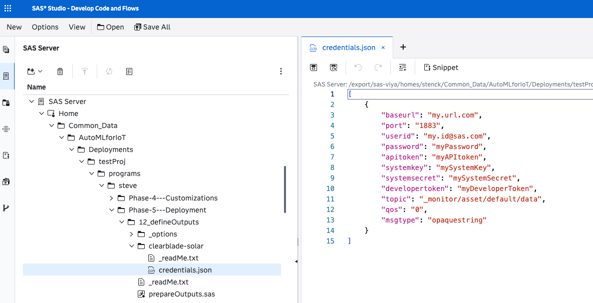
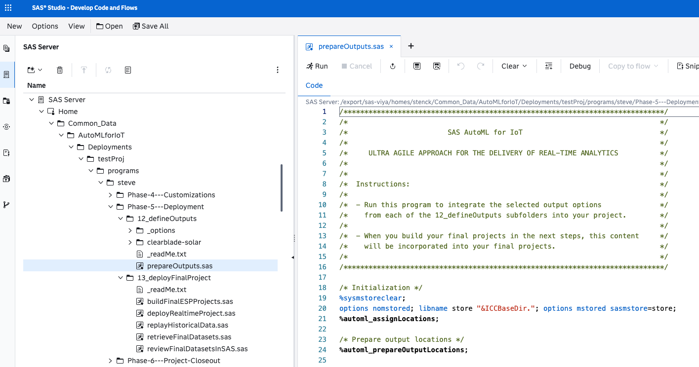
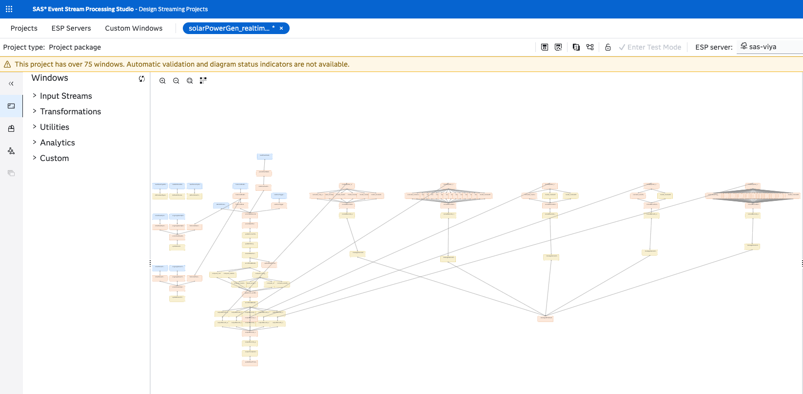

# Configure a ClearBlade Output

Use the ClearBlade output option when the real-time AutoML for IoT project should write results back to an existing ClearBlade instance.

This option is natively integrated with AutoML for IoT and writes derived attributes and/or model results back to ClearBlade.

## 1. Add ClearBlade Output to the Project

Start with:

```text
Phase-5---Deployment/
└── 12_defineOutputs/
    └── _options/
        └── clearblade-example/
```

Copy:

```text
clearblade-example
```

into:

```text
Phase-5---Deployment/12_defineOutputs
```

Then rename the copied directory so it identifies the output location.

For example:

```text
clearblade-solar
```

The copied directory is now part of the project. Leave the original template inside `_options` unchanged.

## 2. Configure the ClearBlade Connection

Open the copied ClearBlade directory and edit:

```text
credentials.json
```

Enter the connection information for the ClearBlade instance that should receive the real-time output.



If you do not know the required values, obtain them from the ClearBlade administrator and enter them directly in the project environment.

Do not share passwords, tokens, secrets, URLs containing credentials, or other sensitive connection information with the AI Assistant.

## Prepare the Output Location

After the ClearBlade configuration is complete, run:

```text
Phase-5---Deployment/12_defineOutputs/prepareOutputs.sas
```



Review the SAS log and confirm that the ClearBlade output location was processed successfully.

## What Is Added to the Real-Time Project

When the final **real-time ESP project** is built, AutoML for IoT adds the ESP content needed to publish the configured output to ClearBlade.

The generated content **will**:

- format derived attributes and/or model predictions and standard errors as properly formatted MQTT messages
- combine those messages from one or more asset types
- write those messages to the configured ClearBlade output location through MQTT so that ClearBlade then receives continuous updates regarding these new metrics and predictions



This output integration is added to the real-time project only.

## Return to Output Locations

[Return to Configuring Output Locations](README.md)
