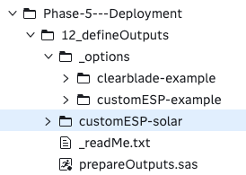
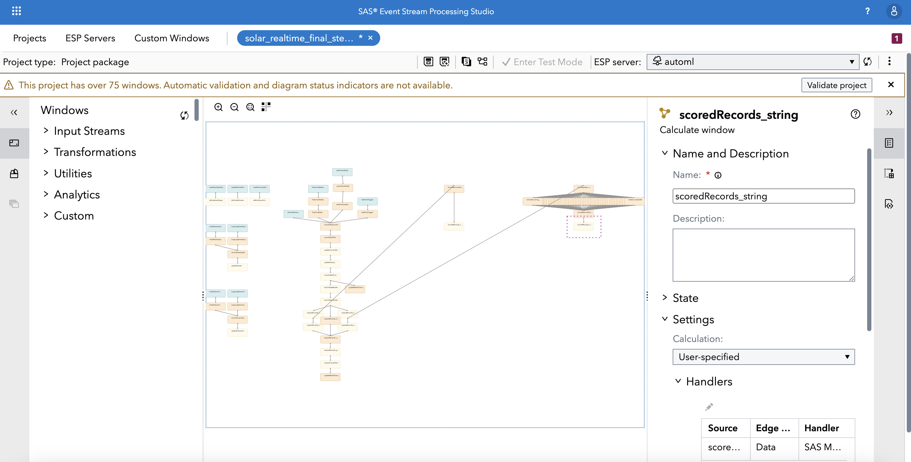
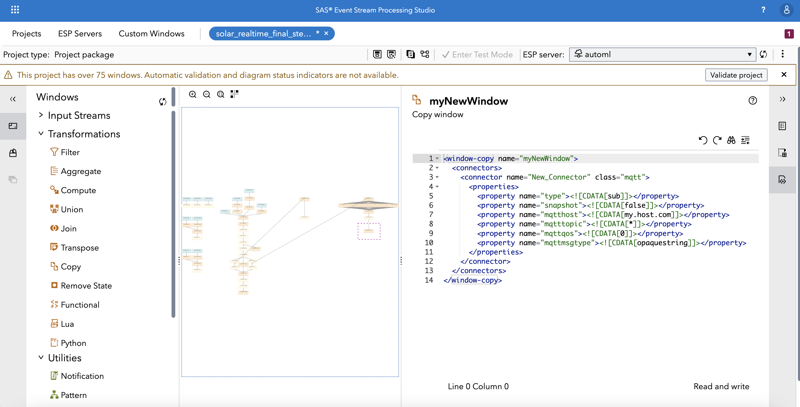
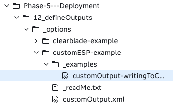
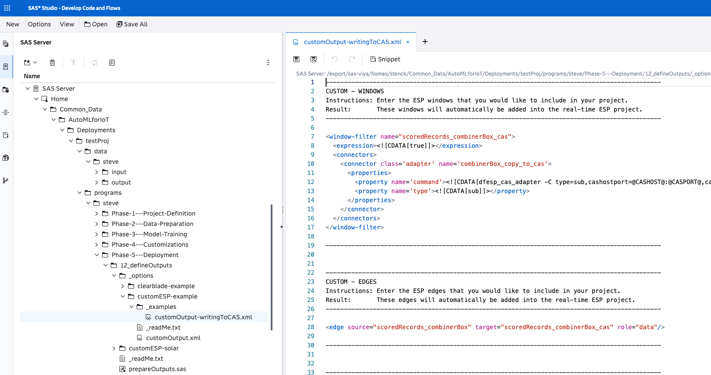
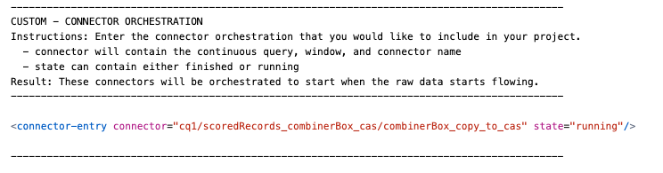
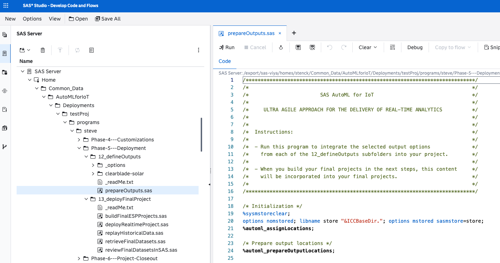

# Configure a Custom ESP Output

Use the Custom ESP output option when you want to use SAS Event Stream Processing windows and connectors to write the final real-time output to an external destination.

ESP supports many connector types, including destinations such as CAS, external databases, MQTT, Kafka, and other message or data platforms.

## 1. Add Custom ESP Output to the Project

Start with:

```text
Phase-5---Deployment/
└── 12_defineOutputs/
    └── _options/
        └── customESP-example/
```

Copy:

```text
customESP-example
```

into:

```text
Phase-5---Deployment/12_defineOutputs
```

Then rename the copied directory so it identifies the output location.

For example:

```text
customESP-solar
```



The copied directory is now part of the project. Leave the original template inside `_options` unchanged.

## 2. Configure the Output Connection in ESP Studio

Open the final real-time ESP project in SAS Event Stream Processing Studio.

Add the windows, edges, and connectors needed to write data to the desired external destination.

The final output windows for each asset type are named:

```text
scoredRecords_<assetType>
```

Custom output logic is generally connected to the appropriate `scoredRecords_<assetType>` window(s).



Test the modified ESP project directly in ESP Studio until the output connection works as intended.

## 3. Copy the Working XML into `customOutput.xml`

After the output works, use the XML view in ESP Studio.

Selecting a window or edge shows the XML for that object.



Open:

```text
customESP-<name>/customOutput.xml
```

and copy the tested XML into the matching sections:

- **custom - windows** — XML for each new ESP window
- **custom - edges** — XML for each new ESP edge
- **custom - mas modules** — XML for any MAS modules, if used

MAS modules are less common and are generally needed only when the custom output includes SAS DS2 code.

If the custom output contains connectors, also add each connector to the:

```text
custom - connector orchestration
```

section.

Each orchestration entry identifies:

- the ESP window containing the connector
- the connector name
- the desired connector state (running or finished)

A connector orchestration entry is formatted like this:

```text
<connector-entry connector="cq1/<insertWindowNameHere>/<insertConnectorNameHere>" state="running"/>
```

## 4. Review a Completed Configuration

Completed examples can be found in the project directory under:

```text
Phase-5---Deployment/12_defineOutputs/customESP-example/_examples
```



Use those examples to see how the different sections of `customOutput.xml` fit together in a completed configuration.

For example, the included CAS example shows a completed custom output with ESP windows, edges, and connector orchestration populated together:

These sections capture the windows and edges that the user would like to add:



And this section captures the connector orchestration entry to ensure that the connector starts up when the ESP project starts.



Use the completed example as a pattern, then adjust as needed for your project.

For a walkthrough of that example in more detail, see [Example: Write Output Tables to CAS](cas-output-example.md).

## Prepare the Output Location

After the custom ESP configuration is complete, run:

```text
Phase-5---Deployment/12_defineOutputs/prepareOutputs.sas
```



Review the SAS log and confirm that the custom output location was processed successfully.

When the final real-time ESP project is built, the configured windows, edges, optional MAS modules, and connector orchestration are incorporated automatically. These output-location customizations are integrated into the real-time project only.

## Return to Output Locations

[Return to Configuring Output Locations](README.md)
