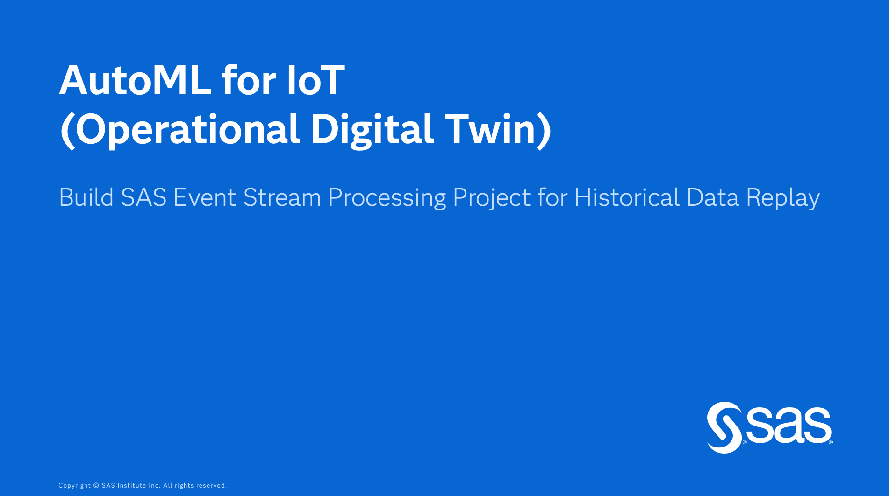
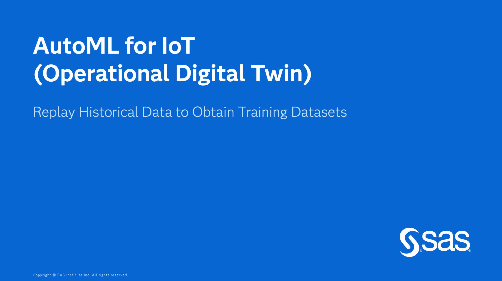
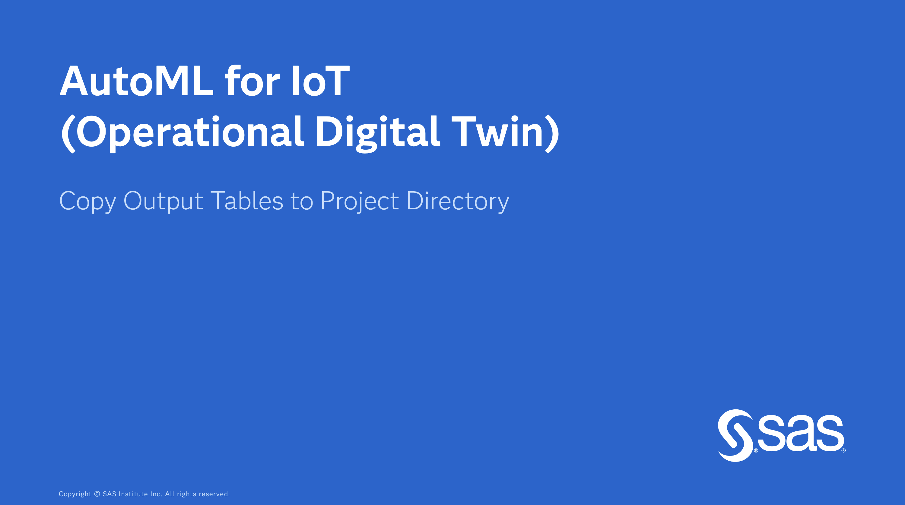

# Creating Analytic Datasets

Earlier, you designed your digital twin and specified the output tables you would like to create and the models that you would like to train. And all of this was done via a few simple configuration files. Now, AutoML for IoT will replay your historical data to create the analytic datasets requested. All of the steps required have been **fully automated**, but we've included a few separate programs to address each of the steps needed. 

At a high level, the following steps will be performed by AutoML for IoT...

- builds the SAS Event Stream Processing project needed to replay historical data to create the output tables needed (including loading the project to SAS Event Stream Processing Studio and SAS Event Stream Manager)

- replays the historical data using SAS Event Stream Processing Studio

- copies the output tables from the SAS Event Stream Processing server to your project directory

- OPTIONAL - loads the output tables into SAS datasets for review in Viya / Viya Workbench

Each of these steps is described in detail in the sections below. Each step is **fully automated**, but the user will complete them interactively.

## Build the SAS Event Stream Processing Project

The below powerpoint will show you how SAS AutoML for IoT can automatically build the SAS Event Stream Processing project needed to replay your historical data. You will learn where that project is created and how the project is structured.

Step-by-Step Guide         | 
:-------------------------:|
 |

## Replay the Historical Raw Data using SAS Event Stream Processing

The below powerpoint will show you how SAS AutoML for IoT can automatically replay your historical dataset. It will show you what you will see during the replay as well as how to view the running project in SAS Event Stream Processing Studio.

Step-by-Step Guide         |  
:-------------------------:|
 |

## Copy the Output Tables from the SAS Event Stream Processing Server to Your Project Directory

The below powerpoint will show you how to copy the output tables from the SAS Event Stream Processing server back to your project directory so that the files can later be used for model training.

Step-by-Step Guide         |  
:-------------------------:|
 |

## OPTIONAL - Load and Review the Output Tables as SAS Datasets

The below powerpoint will show you how to load the output tables into SAS datasets. With the datasets in SAS, you can explore the data using various SAS procedures, explore correlations between variables and experiment with different modeling approaches.

Step-by-Step Guide         |  
:-------------------------:|
 |

      
