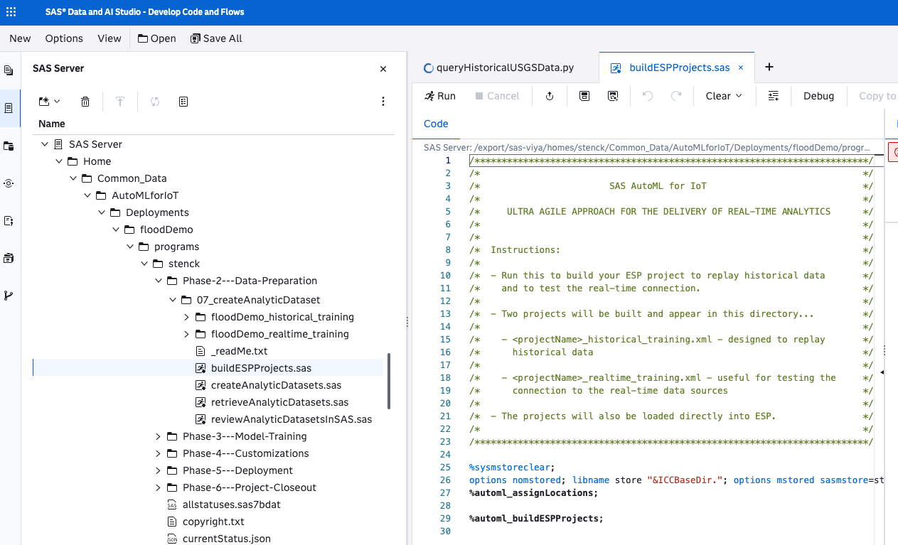
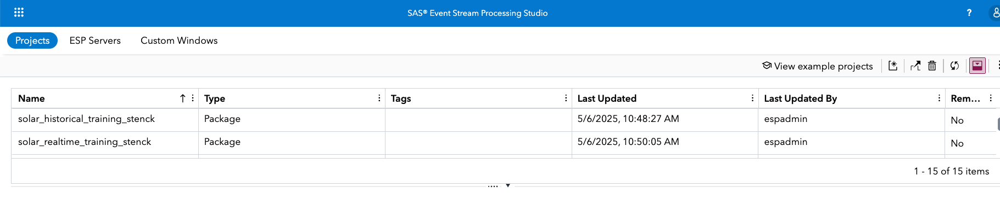
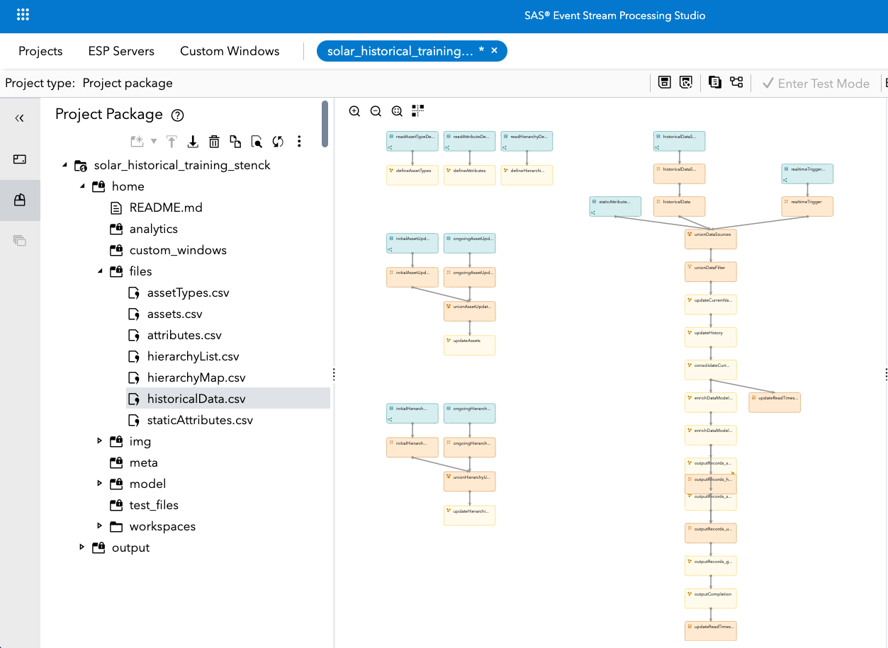
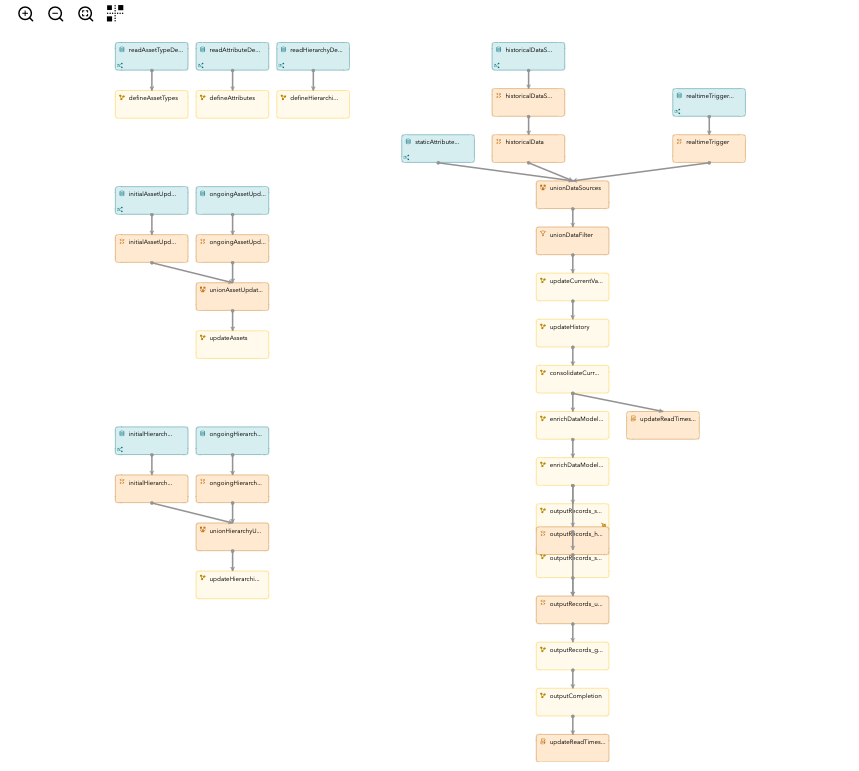

# Build the SAS Event Stream Processing Projects

The first task in analytic dataset creation is to build the SAS Event Stream Processing projects used to replay historical data and support real-time testing.

## Run `buildESPProjects`

Open and run:

```text
buildESPProjects
```

The program automatically builds the ESP projects needed for the configured digital twin, derived attributes, and output definitions.



## Projects That Are Created

Two ESP projects are automatically generated:

```text
Phase-2---Data-Preparation/
└── 07_createAnalyticDataset/
  ├── <projectName>_historical_training/
  │   └── Historical ESP project used to replay training data
  │
  └── <projectName>_realtime_training/
      └── Real-time ESP project with the same analytic logic
```

### Historical Training Project

```text
<projectName>_historical_training
```

is used to replay `historicalData.csv` and create the analytic datasets needed for model training.

### Real-Time Training Project

```text
<projectName>_realtime_training
```

runs against the live data path.

This project is useful for confirming that the real-time connection works properly and that the live feed is consistent with the historical data path.

## Review the Projects in ESP Studio

The generated projects are also loaded into SAS Event Stream Processing Studio so they can be inspected or tested.



The user's ID will be appended to the generated project name to make it easier for multiple users to work with copies of the same project.

## Optional: Test the Historical ESP Project

If you want to test the generated historical project manually in ESP Studio, the user can:

1. upload the historical dataset to the `/home/files` location associated with the historical project
2. open the project in ESP Studio
3. select **Enter Test Mode**



This test is optional. The normal analytic-dataset workflow runs the historical replay through the automated program described in the next task.

## Understand the Generated Project

The generated ESP project follows the same high-level structure as the AutoML for IoT configuration:

- digital-twin setup
  - asset types
  - attributes
  - assets
  - hierarchy
- data ingestion
- data enrichment, when derived attributes are configured
- output-table creation



The automation into AutoML for IoT has automatically translated your earlier configuration into this execution-ready streaming workflow.

## Next

After the ESP projects have been generated, use the historical project to replay the historical sensor data. See [Replay Historical Data to Create Analytic Datasets](replay-historical-data.md).
