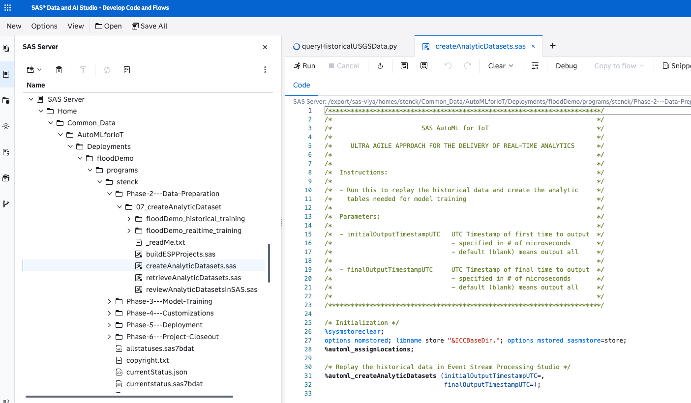
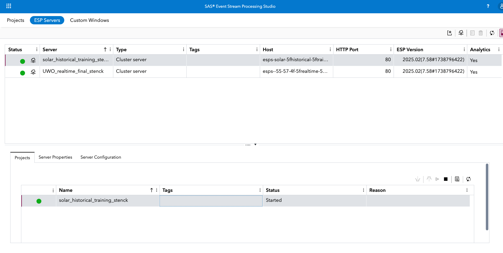
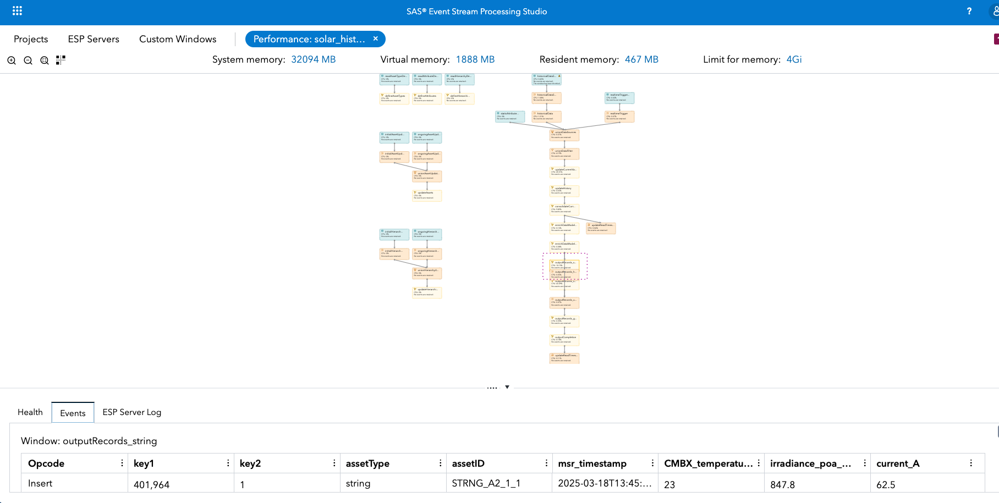
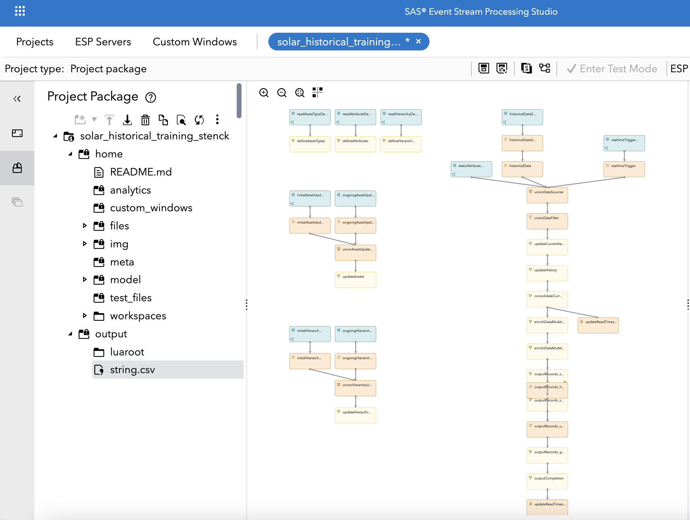

# Replay Historical Data to Create Analytic Datasets

After the historical ESP project has been built, replay the historical sensor data to create the requested analytic datasets.

## Run `createAnalyticDatasets`

Open and run:

```text
createAnalyticDatasets
```



This program automates the complete historical ESP execution lifecycle:

1. creates a new ESP server deployment
2. loads the historical ESP project into that deployment
3. starts the project
4. monitors the log while historical replay runs
5. waits for replay to complete
6. deletes the temporary ESP server deployment

As the project runs, the historical sensor events update the digital twin and the configured output tables are generated.

## Optional Replay Boundaries

Two optional parameters can restrict the replay period:

```text
initialOutputTimestampUTC
finalOutputTimestampUTC
```

Both use UTC epoch timestamps in **microseconds**.

### `initialOutputTimestampUTC`

This controls the first output time.

When left missing, the replay begins from the beginning of the historical CSV file.

It is typical to leave this value missing unless a specific replay start time is required.

### `finalOutputTimestampUTC`

This controls the final output time.

When left missing, replay continues through the end of the historical CSV file.

It is also typical to leave this value missing unless a specific replay end time is required.

## Optional: Monitor the Running ESP Project

You can monitor the replay directly in SAS Event Stream Processing Studio.

Open the **ESP Servers** area and select the running project.

The **Performance** view shows project health and server activity.



## Monitor Events

The user can inspect records flowing through individual ESP windows, if desired...

Useful windows include:

```text
historicalData
```

which shows incoming historical raw records, and:

```text
outputRecords_<assetType>
```

which shows output records for the corresponding output-table asset type.



This is optional but can be useful when confirming that replay is progressing and that the expected records are being produced.

## Generated Output Datasets

As the ESP project runs, it writes the structured output tables into the historical ESP project package.



These files are the analytic datasets produced from the historical replay.

The next task copies them from the ESP server into the project directory.

## Next

After replay completes, copy the resulting analytic datasets back into the project directory. See [Copy the Output Tables to the Project Directory](retrieve-analytic-datasets.md).
