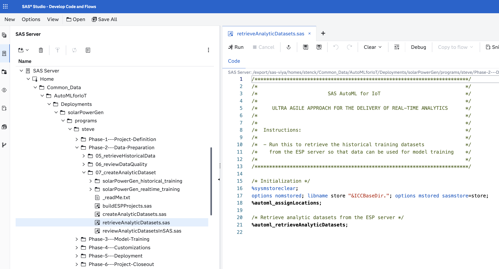
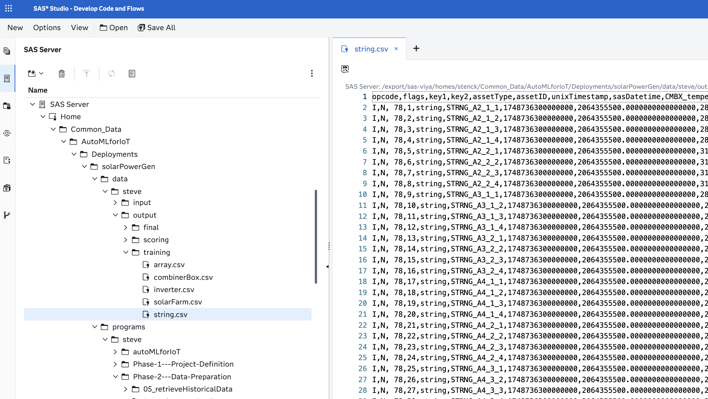

# Copy the Output Tables to the Project Directory

After historical replay completes, the generated analytic datasets reside on the SAS Event Stream Processing server.

Copy them back into the AutoML for IoT project before model training.

## Run `retrieveAnalyticDatasets`

Open and run:

```text
retrieveAnalyticDatasets
```



The program copies the generated output datasets from the ESP server into the project directory.

## Output Location

The resulting files are stored in:

```text
<projectName>/data/<user>/output/training
```



These are the structured historical output tables created from the earlier output definitions.

They are now available for downstream model training and, optionally, for direct review in SAS.

## Next

You can either proceed directly to model training or optionally load the generated output tables into SAS for review. For the optional review step, see [Load and Review Analytic Datasets in SAS](review-analytic-datasets-in-sas.md).
