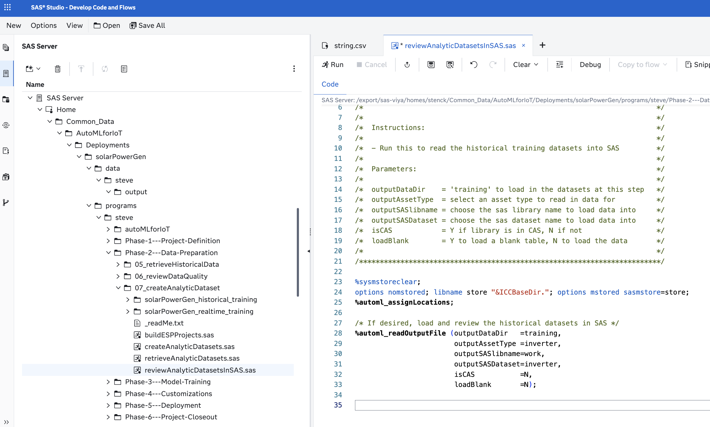
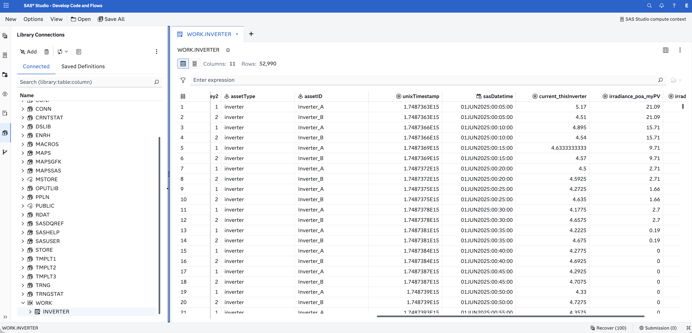

# Load and Review Analytic Datasets in SAS

This step is optional.

Use it when you want to inspect one of the generated analytic datasets in SAS before proceeding to model training.

## Run `reviewAnalyticDatasetsInSAS`

Open:

```text
07_createAnalyticDataset/reviewAnalyticDatasetsInSAS
```

The macro call can be configured with the following inputs:

- the output-table asset type
- the SAS library name
- the SAS dataset name



## Output Library

By default, the loaded dataset is written to the SAS `WORK` library.

The user can specify a different library using:

```text
outputSASlibname
```

If the selected library is a CAS library, specify:

```text
isCAS=Y
```

## Load Only the Table Structure

If you want to inspect only the expected structure of an output dataset without loading its historical rows, set the following option:

```text
loadBlank=Y
```

This creates a blank table with the output structure.

## Review the Dataset

After the table is loaded, open the SAS libraries view and navigate to the selected library and dataset.



With the analytic dataset available in SAS, you can inspect:

- output columns
- target and predictor values
- missingness
- correlations or relationships among variables
- whether the dataset is suitable for the intended analysis

This as an optional step that the user can use to explore the data in more detail.

## Next

When the analytic datasets are ready, continue to [Model Training](../model-training/README.md).
