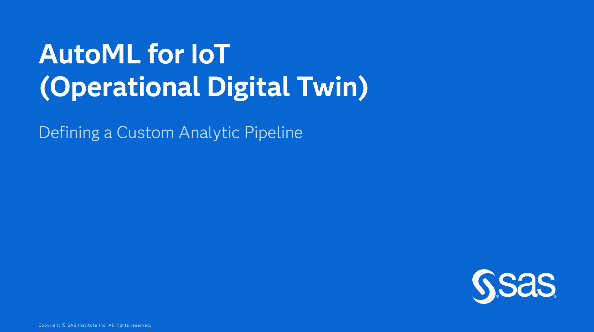

# Defining a Custom Analytic Pipeline

Several different analytic pipelines are included in SAS Model Studio, and a few additional custom python-based and sas-based pipelines are provided as part of AutoML for IoT. These are great to get started, but fundamentally, the process is designed for YOU to integrate the analytical approaches that you would like to use in your projects. The included pipelines are more intended to be a guide to assist you in that process.

The below powerpoint will walk you through step-by-step what's needed to define a new analytic pipeline using one of three different approaches...

- Model Studio (drag-and-drop functionality which integrates directly with SAS Model Manager)
- Custom Python (using common packages such as sklearn and sasviya.ml)
- Custom SAS (using SAS code and built-in capabilities that allows those models to be managed by Model Manager)

Once defined, any newly-defined pipelines can be referenced in the modelDefinitions file as the pipeline ID. 

Step-by-Step Guide         |  
:-------------------------:|
 |

More information about the sasviya.ml package can be found [here](https://go.documentation.sas.com/doc/en/workbenchcdc/v_001/workbenchwlcm/home.htm) and [here](https://communities.sas.com/t5/SAS-Communities-Library/SAS-Viya-Workbench-Python-Machine-Learning-using-sasviya-ml-and/ta-p/932628). 

         
