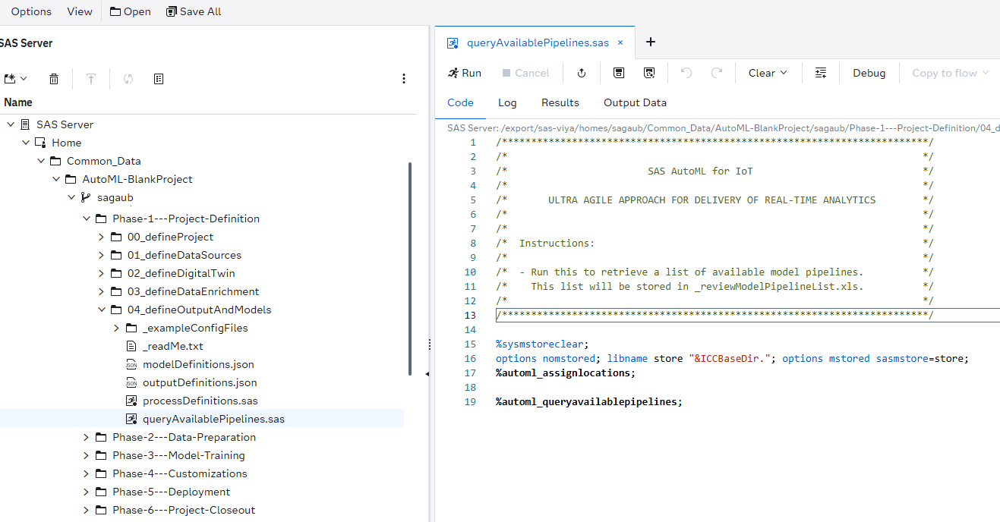

# Defining a Custom Analytic Pipeline

Each model definition references a `pipelineID`. That pipeline defines the analytical process used to train the model, including the modeling techniques that are built and compared.

AutoML for IoT includes several existing pipelines, but the documented workflow also supports creating your own.

There are three supported custom pipeline approaches:

- [Model Studio](model-studio-pipeline.md)
- [Custom Python](python-pipeline.md)
- [Custom SAS](sas-pipeline.md)

After a new pipeline is available, run `queryAvailablePipelines` to identify the pipeline ID that can be referenced by the model definition.

## Existing Pipelines

Before creating a custom pipeline, review the pipelines already available to AutoML for IoT by running the queryAvailablePipelines program.



The resulting pipeline list can be reviewed in the same directory in this Excel file:

```text
_reviewModelPipelineList.xls
```

Use the pipeline ID associated with your new pipeline as the `pipelineID` in the relevant model definition.

## Choose an Approach for Developing a New Pipeline

### Model Studio

Use Model Studio when you want to create the modeling workflow using Model Studio's visual pipeline capabilities and integrate the resulting models with SAS Model Manager.

See [Create a Model Studio Pipeline](model-studio-pipeline.md).

### Custom Python

Use a custom Python pipeline when you want model training to run from Python code and produce a `.pkl` model artifact.

The simplest approach is to copy a current working Python pipeline and change only the model-specific training, assessment, outputs, and scoring logic while retaining the common AutoML for IoT function interface and model-packaging structure.

See [Create a Custom Python Pipeline](python-pipeline.md).

### Custom SAS

Use a custom SAS pipeline when you want model training to run through SAS code and produce either SAS score code or an `astore`.

See [Create a Custom SAS Pipeline](sas-pipeline.md).

## Related Information

Custom pipelines are referenced from model definitions. For model targets, predictors, grouping options, dates, and pipeline selection, see [Define Models](../designing-output-tables-and-models/models.md).
