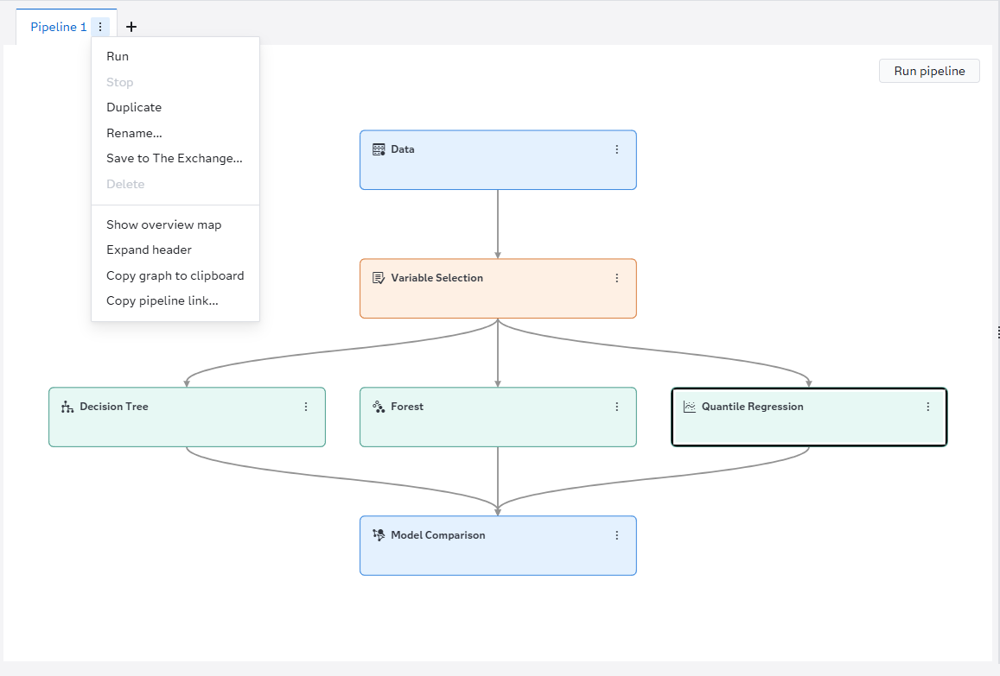
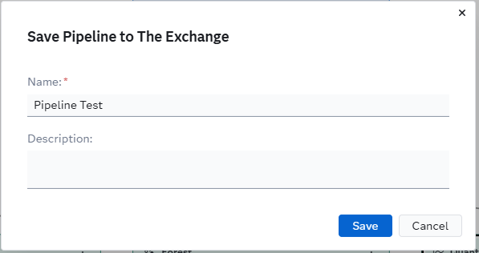
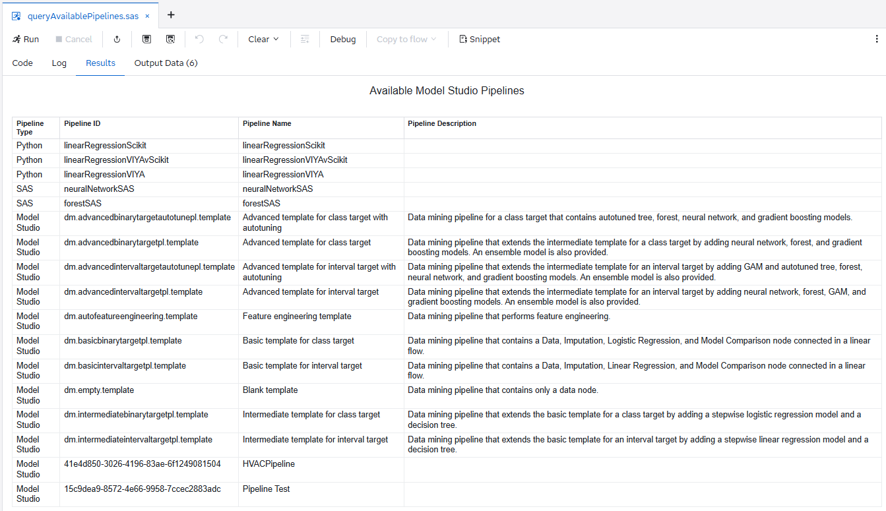

# Create a Model Studio Pipeline

Use this approach when you want to define a new model pipeline in SAS Model Studio.

To define a new pipeline, three steps are required:

1. create the pipeline
2. modify the pipeline
3. add the pipeline to the exchange

Use the native capabilities in Model Studio to drag and drop data manipulation windows, model training windows, etc. to create a new model pipeline. To save, click on the three dots and select Save to Exchange.

Specify a name for your new pipeline and save.

## Find the Pipeline ID

After the custom pipeline has been created and added to the exchange, re-run the queryAvailablePipelines program to see your new pipeline added to the list.

Record the desired pipeline's pipeline ID.

## Use the Pipeline

Reference that pipeline ID as the `pipelineID` for the appropriate model definition.

For details related to specifying the model definition, including target, predictors, grouping, training dates, and pipeline ID, see [Define Models](../designing-output-tables-and-models/models.md).

## Previous

For an overview of all three custom-pipeline approaches, see [Defining a Custom Analytic Pipeline](README.md).
