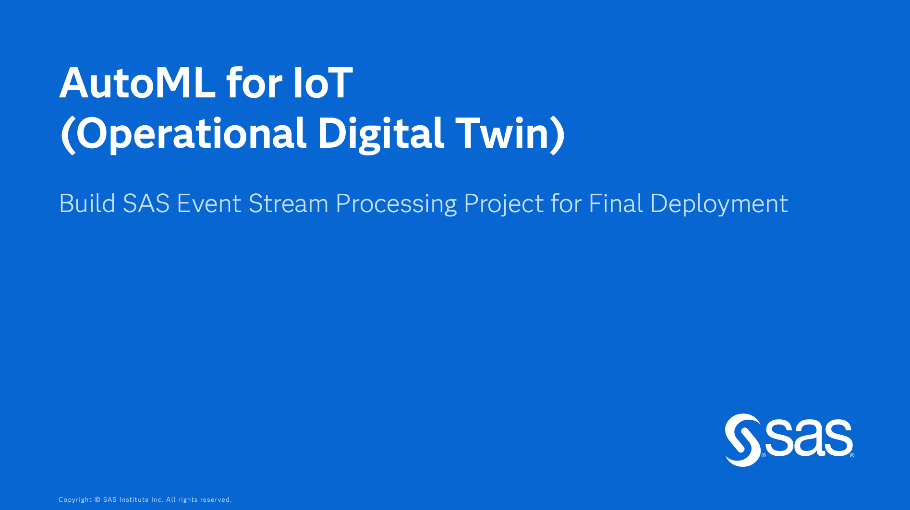
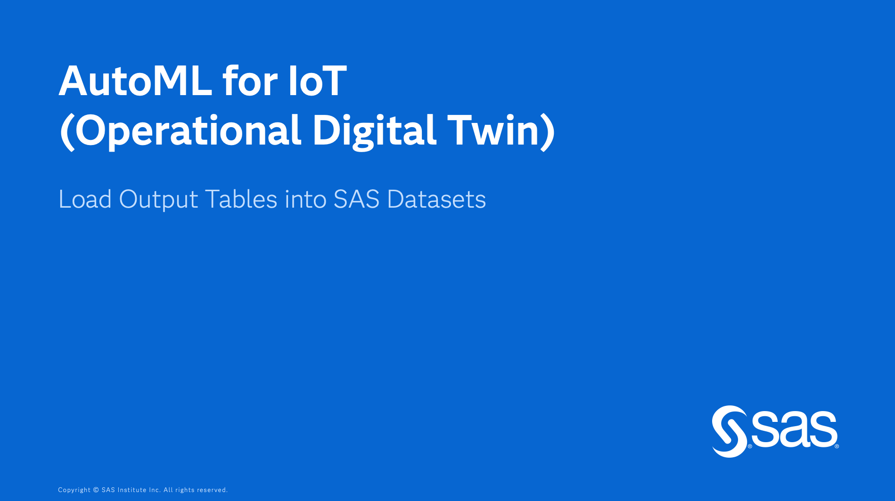

# Deploying Your Final Project

You are now ready to deploy your final AutoML for IoT project!

As before, you will first request that SAS AutoML for IoT automatically build your final SAS Event Stream Processing project that incorporates models, business rules, ESP customizations, etc.

Then you will have two options, depending on whether you would like to replay historical data or deploy the project to run in real-time...

- Deploy your final project to run live

- Replay the historical dataset using the final ESP project

Each of these steps is described in detail in the sections below. Each step is **fully automated**, but the user will complete them interactively.

Since SAS Visual Analytics natively integrates with CAS, users often find it useful to follow the below approach... This assumes that the user set up CAS as an output location for their project in the previous step.

- Replay the historical data using the final ESP project
- Copy the historical-data output tables from the ESP Server to your project directory
- Load the historical-data output tables into CAS  -or-  load blank tables into CAS (this ensures that all SAS formats are applied as ESP does not apply formats to CAS tables)
- Deploy the final ESP project to run live and append to CAS

 

***

 

## Build the Final SAS Event Stream Processing Project

The below powerpoint will show you how to request AutoML for IoT to automatically build your final SAS Event Stream Processing projects. As before, historical and real-time projects will be loaded to SAS Event Stream Processing Studio and Event Stream Manager and can be reviewed and interacted with there.

Step-by-Step Guide         | 
:-------------------------:|
 |

 

***

 

## Replay the Historical Dataset

To replay the historical dataset, follow the below steps...

### Replay the Historical Raw Data using SAS Event Stream Processing

The below powerpoint will walk you through the process of replaying your historical dataset using your final ESP project.

Step-by-Step Guide         | 
:-------------------------:|
 |

### Copy the Output Tables from the SAS Event Stream Processing Server to Your Project Directory

The below powerpoint will walk you through the process of copying the final output tables from the SAS Event Stream Processing server back to your project directory.

Step-by-Step Guide         | 
:-------------------------:|
 |

### OPTIONAL - Load and Review the Output Tables as SAS Datasets

The below powerpoint will walk you through the process of loading the final output tables into SAS datasets. It can also be used to set up blank tables in CAS for each of your asset types - if you've chosen to output your final tables to CAS, then this will ensure that those CAS tables have all of the appropriate formats for each field (ESP does not apply formats to CAS tables).

Step-by-Step Guide         |  
:-------------------------:|
 |

 

***

 

## Deploy the Final Real-Time Project to Run Live

The below powerpoint will walk you through the process of deploying your final ESP project to run live. 

Step-by-Step Guide         | 
:-------------------------:|
 |

      
