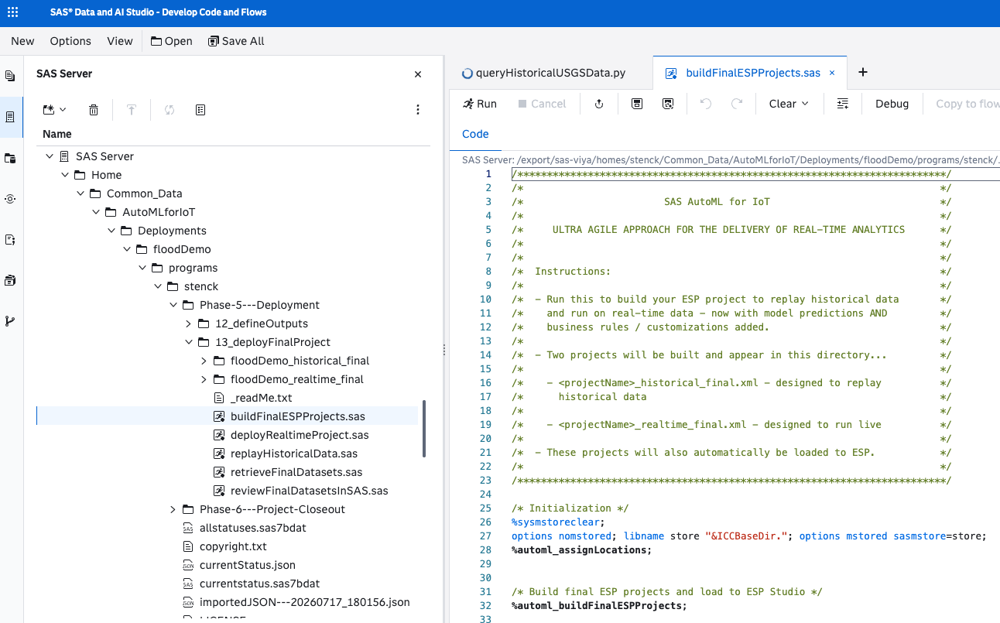
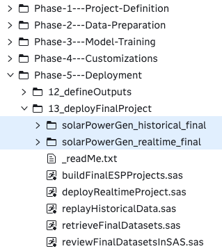
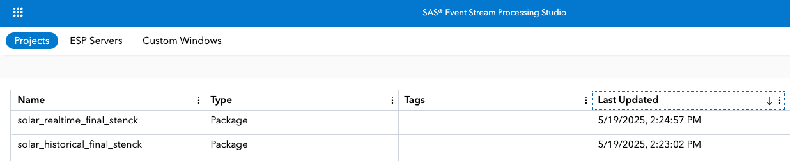
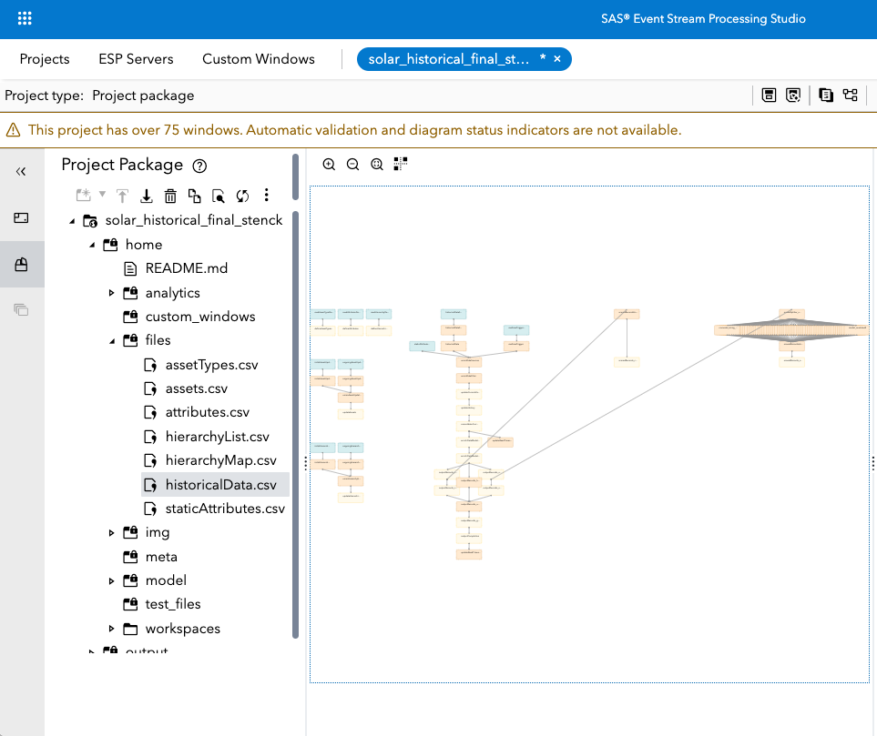
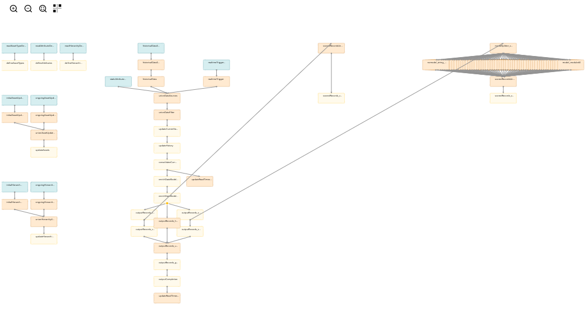

# Build the Final ESP Projects

This is the final version of the ESP-project build steps used earlier when creating and scoring analytic datasets. The difference is that these projects now contain the **complete project logic**: trained models, business rules, and ESP customizations. The real-time version also includes the configured output locations.


The first deployment task is to generate the final SAS Event Stream Processing projects.

These projects combine the project components configured throughout the workflow.

## Run `buildFinalESPProject`

Open and run:

```text
buildFinalESPProject
```



The final project can include:

- digital-twin definitions
- raw-data ingestion
- derived-attribute enrichment
- output-table creation
- deployed models
- business rules
- ESP customizations
- configured real-time output destinations

## Projects That Are Created

The program builds two final ESP projects:

```text
<projectName>_historical_final
<projectName>_realtime_final
```



### Historical Final Project

```text
<projectName>_historical_final
```

is used to replay `historicalData.csv`.

The final project transforms raw historical sensor updates into analytic-ready output, scores the data with trained models, and incorporates business rules and ESP customizations.

### Real-Time Final Project

```text
<projectName>_realtime_final
```

runs against the live data path.

It can:

- ingest real-time sensor data
- update the digital twin
- calculate derived attributes
- create analytic-ready records
- apply trained models
- calculate business rules
- include ESP customizations
- write results to configured external output locations

## Review the Projects in ESP Studio

The generated final projects are loaded into SAS Event Stream Processing Studio.



Note that the user's ID is appended to the project name to simplify multiple-user development.

## Optional: Test the Historical Final Project

To test the historical project manually in ESP Studio:

1. upload the historical dataset to the `/home/files` location for the historical project
2. open the final historical project
3. select **Enter Test Mode**



This test is optional. The normal final replay workflow is automated through `replayHistoricalData`.

## Final Project Organization

The final ESP project retains the project structure assembled throughout the earlier phases.

The final project contains several main sections of content:

- digital-twin setup
  - asset types
  - attributes
  - assets
  - hierarchy
- data ingestion
- data enrichment
- output-table creation
- deployed models
- integrated business rules



ESP customizations and configured output logic are also incorporated where applicable.

## Previous

For the output destinations that are integrated into the final real-time project, see [Configuring Output Locations](../configuring-output-locations/README.md).

## Next

If you want to generate final historical output before going live, see [Replay Historical Data with the Final Project](replay-final-historical-data.md).

If historical replay is not needed, proceed to [Deploy the Final Real-Time Project](deploy-realtime-project.md).
