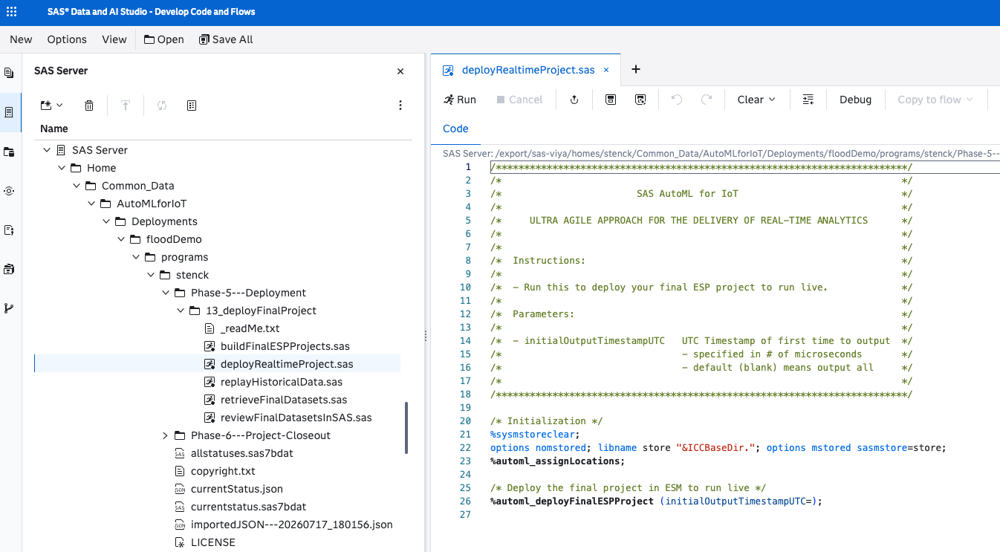
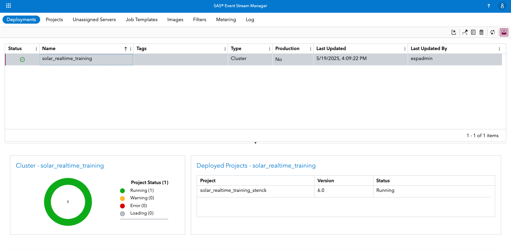
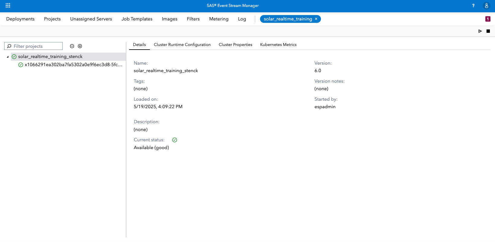
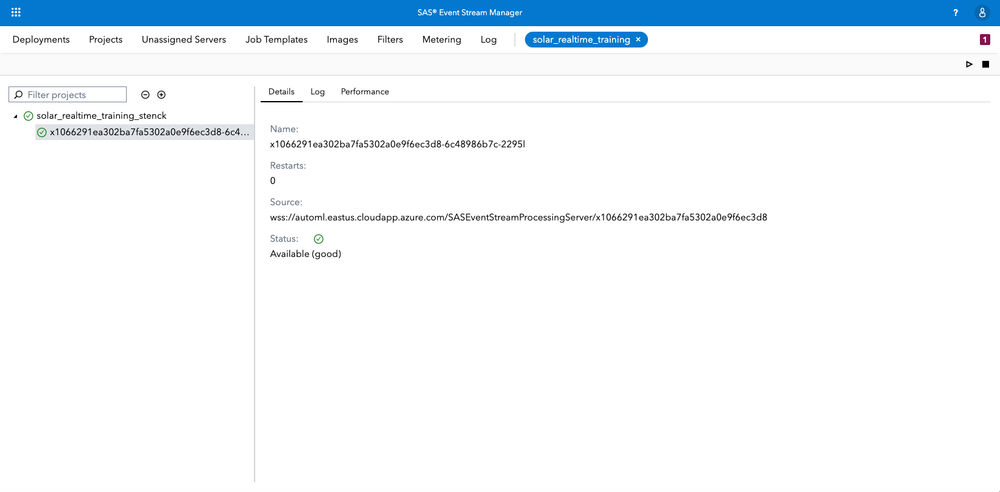

# Deploy the Final Real-Time Project

This is the key capability that is different from the earlier analytic-dataset and scoring phases. Instead of replaying historical data, AutoML for IoT can automatically deploy the completed **real-time ESP project** into SAS Event Stream Manager so it can process the live data feed continuously.

The real-time project contains the integrated models, business rules, ESP customizations, and the output locations configured for the project.


Use this task when the completed AutoML for IoT project is ready to run against live data.

## Run `deployRealtimeProject`

Open and run:

```text
deployRealtimeProject
```



This program does the following:

1. creates a new deployment in SAS Event Stream Manager
2. loads the final real-time ESP project into that deployment
3. starts the project running in real time

## Optional `initialOutputTimestampUTC`

The real-time deployment supports:

```text
initialOutputTimestampUTC
```

This is a UTC epoch timestamp in **microseconds**.

When the parameter is missing, the real-time project begins with the first available date and time observed.

It is typical to leave this parameter missing.

Use it when the live project is connected to a message feed and records before a particular timestamp should be ignored.

## Monitor the Deployment in Event Stream Manager

To review the running project, open SAS Event Stream Manager.

The project appears in the deployment list.



Open the project to review deployment details.



## Review Pod Health and Logs

Select the deployment pod to be able to view:

- project logs
- an interactive health summary



Use these views to confirm that the project is running and to investigate operational issues.

## What the Live Project Does

The final real-time ESP project applies the completed project definition to live sensor data.

Depending on configuration, it can:

- maintain the digital twin
- calculate derived attributes
- generate analytic output tables
- score records with trained models
- calculate business rules
- execute ESP customizations
- write records to configured external output locations

If `allowDynamicChangesToTwin = "Y"`, the structure of the digital twin can also change dynamically as the project runs.

## Previous

For building the final historical and real-time ESP projects, see [Build the Final ESP Projects](build-final-esp-projects.md).

If you need to populate historical output before starting live processing, see [Replay Historical Data with the Final Project](replay-final-historical-data.md).

## Next

After deployment and project completion activities are finished, continue to [Archiving Your Project](../archiving-your-project/README.md).
