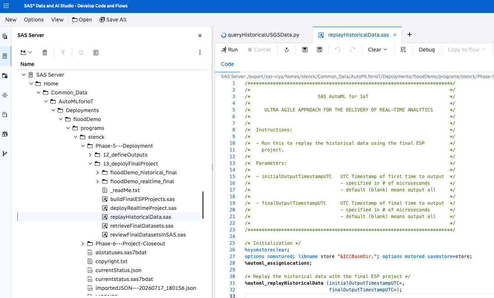
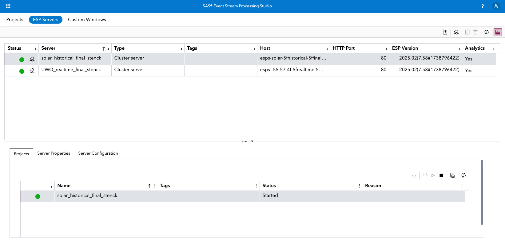
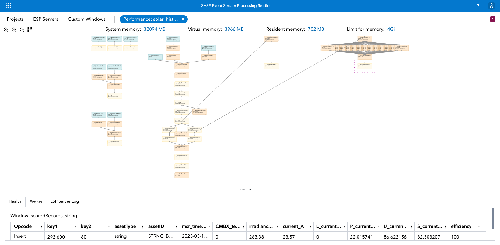
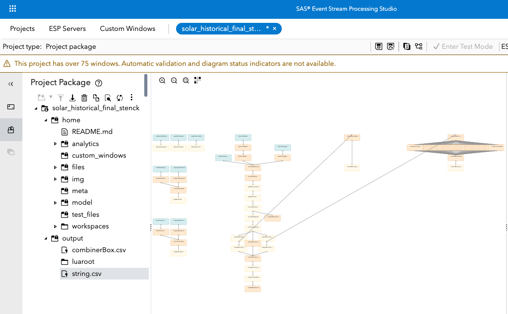

# Replay Historical Data with the Final Project

This replay works like the historical replays used earlier to create and score analytic datasets. The difference is that the final historical project now contains the complete analytic logic, including the integrated models, business rules, and ESP customizations.


Use the final historical ESP project when you want to reproduce the complete final project behavior across the historical dataset.

This creates final historical output containing the model predictions, business rules, and other applicable final-project logic.

## Run `replayHistoricalData`

Open and run:

```text
replayHistoricalData
```



This program does the following:

1. creates a new ESP server deployment
2. loads the final historical ESP project
3. starts the project
4. monitors the log while historical replay runs
5. waits for the replay to complete
6. deletes the temporary ESP server deployment

## Why Replay the Final Project

A final historical replay can be useful before live deployment because it allows you to create output for the full historical period using the same completed business logic that will operate in production.

For example, if CAS is the final output location, this replay can be used to create historical output before the real-time project begins appending live records.

## Optional Replay Boundaries

Two optional parameters control the historical replay window:

```text
initialOutputTimestampUTC
finalOutputTimestampUTC
```

Both are UTC epoch timestamps in **microseconds**.

### `initialOutputTimestampUTC`

When missing, replay begins from the start of the historical CSV file.

Use a value only when a specific historical start time is required.

### `finalOutputTimestampUTC`

When missing, replay continues through the end of the historical CSV file.

Use a value only when a specific historical end time is required.

## Optional: Monitor the Replay in ESP Studio

Open the **ESP Servers** area in SAS Event Stream Processing Studio and select the running final historical project.

The **Performance** view provides health and server information.



The user can inspect records flowing through the project by examining these windows:

```text
historicalData
outputRecords_<assetType>
scoredRecords_<assetType>
```

`scoredRecords_<assetType>` contains the final scored output, including model predictions and business-rule results.



## Generated Final Datasets

As replay runs, the final historical ESP project writes the completed output tables into its project package.



The next task copies these files back into the AutoML for IoT project directory.

## Previous

If the final ESP projects have not yet been built, see [Build the Final ESP Projects](build-final-esp-projects.md).

## Next

After final historical replay completes, see [Copy the Final Datasets to the Project Directory](retrieve-final-datasets.md).
