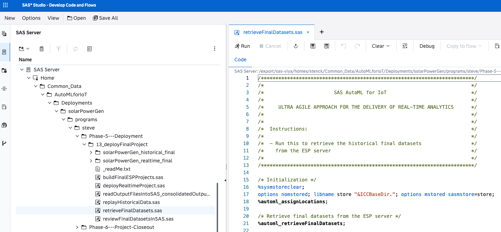
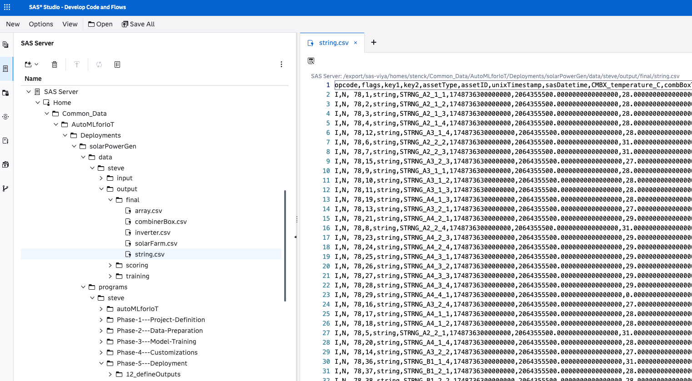

# Copy the Final Datasets to the Project Directory

After the final historical replay completes, copy the generated final output datasets from the SAS Event Stream Processing server into the AutoML for IoT project.

## Run `retrieveFinalDatasets`

Open and run:

```text
retrieveFinalDatasets
```



The program copies the final output tables from the ESP server to the project directory.

## Output Location

The final datasets are stored in:

```text
<projectName>/data/<user>/output/final
```



These final datasets can contain:

- analytic-ready sensor and derived values
- model predictions
- standard errors
- business-rule results

depending on the project's configuration.

## Previous

If final historical replay has not yet been run, see [Replay Historical Data with the Final Project](replay-final-historical-data.md).

## Next

You can optionally load the final datasets into SAS for review or CAS initialization. See [Load and Review Final Datasets in SAS](review-final-datasets-in-sas.md).

If that review is not needed, proceed to [Deploy the Final Real-Time Project](deploy-realtime-project.md).
