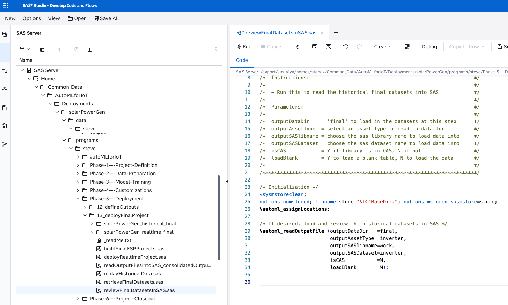
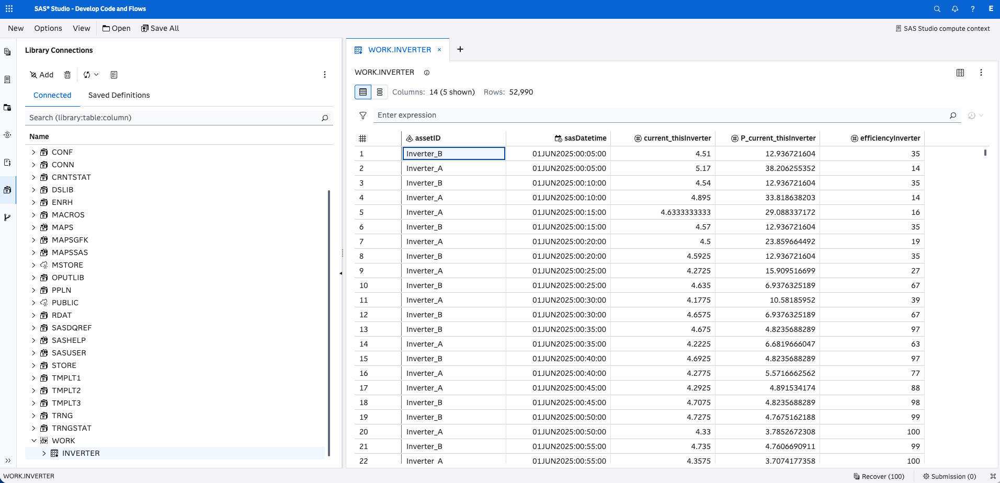

# Load and Review Final Datasets in SAS

This step is optional.

Use it to inspect the final historical datasets in SAS or to create appropriately structured CAS tables before starting the live project.

## Run `reviewFinalDatasetsInSAS`

Open:

```text
13_deployFinalProject/reviewFinalDatasetsInSAS
```

For each output-table asset type, populate the asset type, destination library, and dataset name, then execute the macro.



## Default SAS Library

By default, the table is created in the SAS `WORK` library.

To use another SAS library, specify:

```text
outputSASlibname
```

If the destination is a CAS library, specify:

```text
isCAS=Y
```

## Create a Blank Formatted Table

To create the output-table structure without loading historical records, specify:

```text
loadBlank=Y
```

It creates a blank table with:

- the proper output-table structure
- the appropriate SAS formats applied

This can be particularly useful when writing datasets to CAS, as formats are established prior to data being written to the table. ESP does **not** apply SAS formats when it creates CAS tables directly.

A common workflow is therefore to create the correctly formatted CAS table first and then allow the live ESP project to append records to it.

## Review the Final Data

Open the SAS libraries view and navigate to the loaded table.



Note that the final dataset can include:

- model predictions
- standard errors
- business-rule variables

along with the other output-table columns.

## Common CAS Sequence

When CAS is the final output destination, this pattern is commonly used:

1. replay the historical dataset using the final project
2. retrieve the final historical output
3. load the historical data into CAS, **or** create blank formatted CAS tables with `loadBlank=Y`
4. deploy the final real-time project
5. allow the real-time project to append new records to CAS

## Previous

If the final datasets have not yet been copied from the ESP server, see [Copy the Final Datasets to the Project Directory](retrieve-final-datasets.md).

## Next

When the destination tables are ready, start the live project. See [Deploy the Final Real-Time Project](deploy-realtime-project.md).
