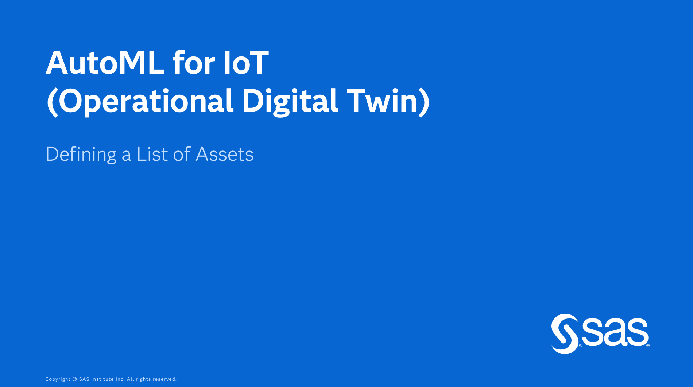
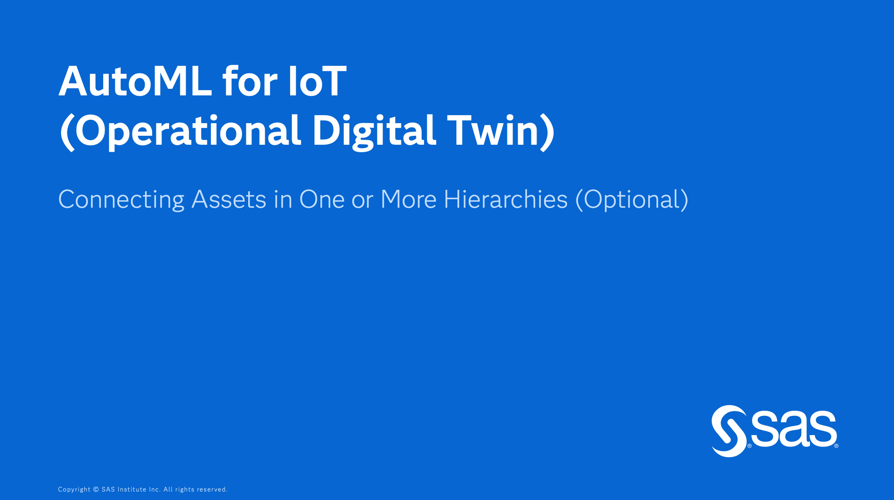
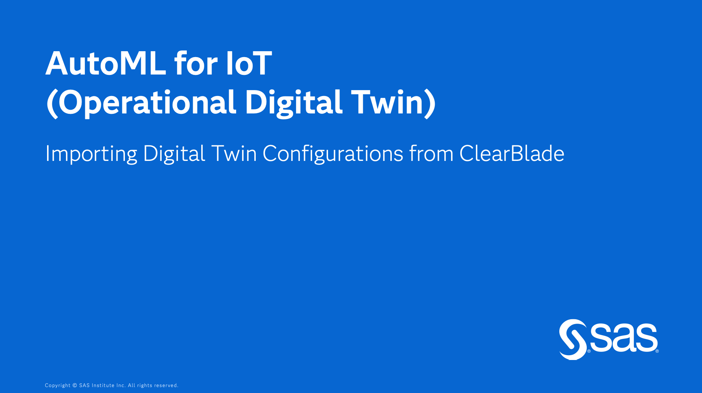

# Describing Your Digital Twin

AutoML for IoT is built on the concept that you will design a digital twin for your use case. But what does that mean?

At a high level, it means that you will create some structure around your use case. Specifically, you'll describe the following...

**REQUIRED**

- asset types - these are the types of things you have in your use case. For HVAC, you may have chillers and boilers and air handlers. For solar farms, you may have inverters and combiner boxes and solar panels. For patient health monitoring, you may have patients, hospital beds, physicians, etc. For flood prediction, you may have river segments and weather stations.

- attributes - these are the things you will measure for each of those asset types. For example, for chillers, we might expect to see what the chilled water temperature is and a valve position or flow rate. For solar panels, we'd expect to see the amount of energy being generated by that solar panel. For hospital beds, we might expect to see blood pressure and heart rate being captured. And for river segments, we might expect to see the river height being measured. And going forward, any time we see an asset of a particular type, we'll be on the lookout for these attributes. Keep in mind that the attributes you define here are the raw attributes that you'll receive periodic updates about - later, we'll define derived attributes which calculate new measures based on information from your digital twin.

- assets - these are the specific assets you have of each type. Asset types and attributes told us about the *types* of things. Assets tells us about the assets you *actually have* of each type.

**OPTIONAL**

- static attributes (aka asset metadata) - In many applications, there are certain things about an asset that are important to know but which don't really change. Typically, we refer to this as *metadata*. In AutoML for IoT, we view this kind of information the same as any other attribute. The only difference is that the values will not change as new data flows in. Therefore, the user would set these attributes up like any other attribute in the *attributes* file. And then you would set the value of those attributes here in the *staticAttributes* file.

- hierarchies - while it's important to track individual assets, it is rarely this case that one asset is completely independent of other assets. By defining a hierarchy, users can connect assets to one another to reflect how they function in real life. This makes it easy to pull information from connected assets and allows us to easily create comprehensive output tables and define models that integrate metrics for the broader system.

As a result of this step, you'll have a digital picture of your assets that looks something like this (click on each image to zoom)...

Tree View         | Directed Graph View |
:-------------------------:|:-------------------------:|
</a> | </a>

If you are using ClearBlade, then you've already described your digital twin, so there is no need to do it again! Click [here](#importing-digital-twin-configurations-from-clearblade) to import those configurations. 

Otherwise, continue on to the next section where you'll describe your digital twin using a few simple json files. 

## Instructions for Designing Your Digital Twin

### Defining the Asset Types 

The below powerpoint will walk you through the process of defining the asset types in your use case. These are the types of things you will have - and depends entirely on the use case.  You have total control to define the problem you want to tackle.

Step-by-Step Guide         |  
:-------------------------:|
 |

### Defining the Attributes for Each Asset Type 

The below powerpoint will walk you through the process of defining the attributes you will measure for each of those asset types. These are the **raw** measures that we will receive updates about as they are updated.

Step-by-Step Guide         |  
:-------------------------:|
 |

### Defining a List of Assets 

The below powerpoint will walk you through the process of listing the specific assets you have of each asset type.

Step-by-Step Guide         |  
:-------------------------:|
 |

### OPTIONAL - Defining Static Attributes (aka Asset Metadata) 

The below powerpoint will walk you through the process of defining the metadata about each asset. This is an optional step and only is required if there is specific metadata that is useful to know about your assets that is static in nature (it does not change regularly). Typical examples are capturing the latitude and longitude of an asset or the manufacturer and/or age of a piece of equipment.

Step-by-Step Guide         |  
:-------------------------:|
 |

### OPTIONAL - Connecting Assets in One or More Hierarchies 

The below powerpoint will walk you through the process of connecting your assets together via one or more hierarchies. This is an optional step - but by connecting assets, you allow data from connected assets to be output into the output tables you define and used in the machine learning models you train.

Step-by-Step Guide         |  
:-------------------------:|
 |

### Now that your digital twin is set up, let's get connected to data about it!

Now that you have set up your digital twin, click [here](../configuring-data-sources/README.md#setting-up-real-time-and-historical-data-connections) to return to the data sources step to configure a real-time connection to retrieve continuous updates about the assets/attributes in your digital twin and/or connection to a database to be able to retrieve historical data. 

## Importing Digital Twin Configurations from ClearBlade

If you've already configured your digital twin in ClearBlade (and set ClearBlade up as a data source), then the below powerpoint will walk you through the process of importing your digital twin configurations from your ClearBlade instance.

Step-by-Step Guide         |  
:-------------------------:|
 |

      
