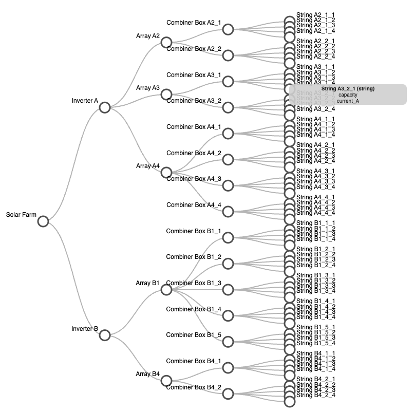
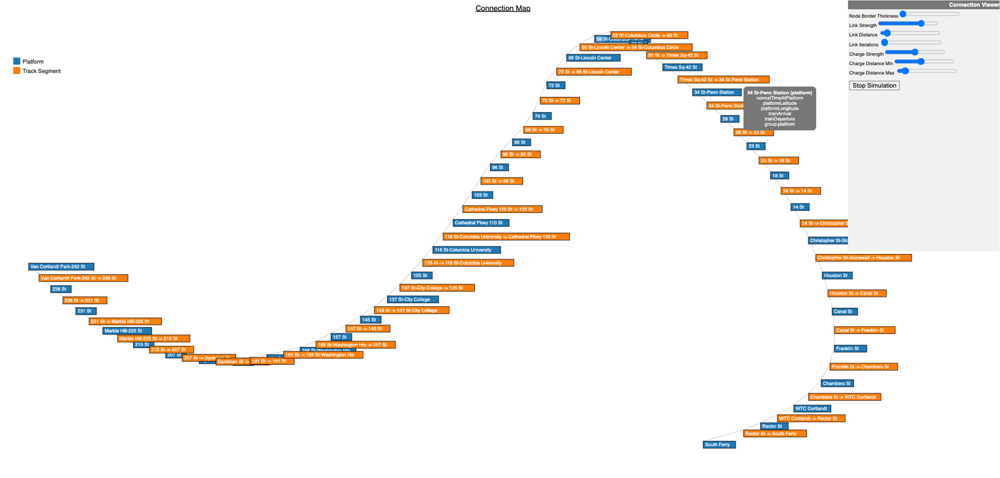

# Describing Your Digital Twin

AutoML for IoT is built on the concept that you will design a digital twin for your use case. At a high level, that means creating structure around the assets you monitor, the information you measure about them, and the relationships between them.

## Required Digital Twin Definitions

### Asset Types

Asset types are the types of things in your use case.

Examples include:

- HVAC: chillers, boilers, air handlers
- solar farms: inverters, combiner boxes, strings
- patient monitoring: patients, hospital beds, physicians
- flood prediction: river segments and weather stations

For details about deciding what should be modeled as an asset type, naming asset types, and entering the required AutoML for IoT configuration, see [Define Asset Types](asset-types.md).

### Attributes

Attributes are the raw values that you measure or store for each asset type.

For example, a chiller might have chilled-water temperature and valve position; a solar asset might have electrical current or irradiance; and a patient might have heart rate or blood pressure.

The attributes defined here are raw attributes. Calculated metrics are defined later as derived attributes.

For details about identifying raw attributes, defining data types and SAS-compatible identifiers, configuring retention periods and acceptable ranges, and entering the required AutoML for IoT configuration, see [Define Attributes](attributes.md).

### Assets

Assets are the actual instances of each asset type that exist in your system.

Asset types describe the classes of things. Assets identify the specific equipment, people, locations, or other entities that you actually have.

For details about identifying the individual assets in your system and entering their IDs, asset types, and display labels, see [Define Assets](assets.md).

## Optional Digital Twin Definitions

### Static Attributes

Static attributes are metadata values that are important to know about an asset but do not normally change as new sensor data arrives.

Examples include:

- latitude and longitude
- manufacturer
- equipment capacity
- age
- an ID that identifies another related asset

The attribute itself is defined in the attributes definitions, while the value to use for each individual asset is assigned as static metadata.

For details about defining asset metadata, assigning values to individual assets, and configuring static values correctly, see [Define Static Attributes](static-attributes.md).

### Hierarchies

Hierarchies connect assets to reflect how they function together in the real world.

Defining these relationships makes it possible to:

- calculate measures using connected assets
- retrieve values from connected assets
- build output tables with broader system context
- use connected-asset measures as analytical predictors

For details about designing asset relationships, defining hierarchy names and parent-child connections, and reviewing the resulting hierarchy visually, see [Define Hierarchies](hierarchies.md).

## What the Digital Twin Looks Like

A digital twin can often be represented as a tree.

A project does not have to follow a strict tree structure. More complex relationships can be represented as a directed graph.

## If Your Digital Twin Already Exists in ClearBlade

If the digital twin has already been configured in ClearBlade and ClearBlade is configured as a data source, AutoML for IoT can retrieve those definitions rather than requiring you to create them again manually.

For details about retrieving an existing digital twin from ClearBlade, reviewing the imported configuration, and validating the resulting hierarchy, see [Import a Digital Twin from ClearBlade](clearblade.md).

## Recommended Order

If you are defining the digital twin manually, complete the steps in this order:

1. For details about deciding what should be modeled as an asset type, naming asset types, and entering the required AutoML for IoT configuration, see [Define Asset Types](asset-types.md).
2. For details about identifying raw attributes, defining data types and SAS-compatible identifiers, configuring retention periods and acceptable ranges, and entering the required AutoML for IoT configuration, see [Define Attributes](attributes.md).
3. For details about identifying the individual assets in your system and entering their IDs, asset types, and display labels, see [Define Assets](assets.md).
4. For details related to assigning asset-specific metadata, see [Define Static Attributes](static-attributes.md) [optional].
5. For details related to defining connections between assets using one or more hierarchies, see [Define Hierarchies](hierarchies.md) [optional].

## Previous

After defining the digital twin, return to the data-source configuration if you still need to configure a real-time feed and/or historical database connections. See [Configuring Data Sources](../configuring-data-sources/README.md#setting-up-real-time-and-historical-data-connections) for the available connection options and setup instructions.

## Next

Enhance the raw metrics in your digital twin by [Configuring Derived Attributes / Data Enrichment](../configuring-derived-attributes/README.md)

## General Navigation

[Back to Enablement Home](../enablement-home/README.md)
