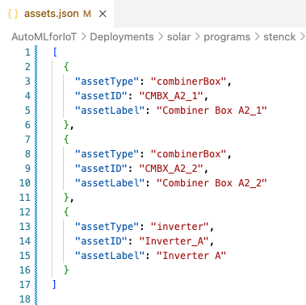

# Define Assets

After defining the asset types and their raw attributes, list the actual assets that exist in your system.

For example, an HVAC project might describe Building A as having:

- 2 chillers
- 18 air handlers
- 142 fan powered boxes

This step identifies those individual assets.


## Where the Configuration Goes

Define individual assets in:

```text
Phase-1---Project-Definition/
└── 02_defineDigitalTwin/
    └── assets.json
```

Use `assets.json` to list the specific asset instances in the project and associate each one with an asset type defined in `assetTypes.json`.

## Fields

Each asset contains exactly three fields.

| Field | Type | Description |
|---|---|---|
| `assetID` | string | Unique ID for the individual asset. |
| `assetType` | string | Type of asset. Must exist in `assetTypes.json`. |
| `assetLabel` | string | Human-readable label for dashboards and other displays. |

There are no optional fields.

## Example



## Rules

- Every `assetID` must be unique.
- `assetID` can contain letters, numbers, spaces, underscores, and dashes.
- Every `assetType` must already exist in `assetTypes.json`.
- `assetLabel` can contain letters, numbers, spaces, underscores, and dashes.

## Previous

To review the raw attributes that will be tracked for each asset type, [Define Attributes](attributes.md)

## Next

To specify static attributes (metadata) about assets, [Define Static Attributes](static-attributes.md)
