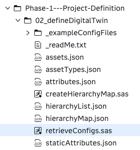
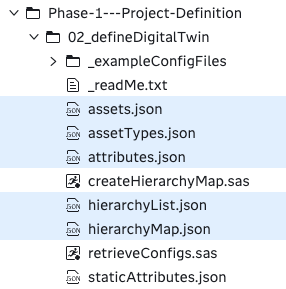
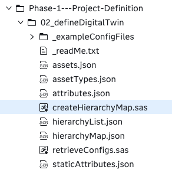
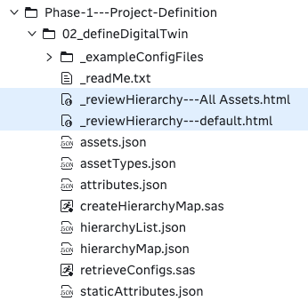
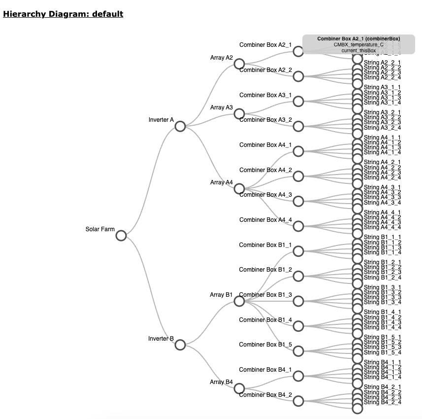

# Import a Digital Twin from ClearBlade

If the digital twin has already been designed in ClearBlade and ClearBlade has been configured as a data source, AutoML for IoT can retrieve the digital-twin definitions automatically.

## Where the Configuration Goes

The retrieveConfigs program used to query your ClearBlade instance is stored in:

```text
Phase-1---Project-Definition/
└── 02_defineDigitalTwin/
    ├── retrieveConfigs.sas
    ├── assetTypes.json
    ├── attributes.json
    ├── assets.json
    ├── hierarchyList.json
    └── hierarchyMap.json
```

Run `retrieveConfigs.sas` to retrieve the available digital-twin definitions from ClearBlade. The retrieved asset types, attributes, assets, and hierarchy definitions are written into the corresponding files in this directory.

## Before You Begin

Configure the ClearBlade data source first.

[Configure a ClearBlade Data Source](../configuring-data-sources/clearblade.md)

## Retrieve the Configuration

Open and run:

```text
02_defineDigitalTwin/retrieveConfigs
```



## Review the Imported Files

The retrieval process creates:

- `assetTypes.json` — asset types
- `attributes.json` — attributes associated with the asset types
- `assets.json` — individual assets

If the imported digital twin includes hierarchy relationships, it will also create:

- `hierarchyList.json` — available hierarchy names
- `hierarchyMap.json` — connections between assets



## Create a Hierarchy Diagram

To review the imported relationships:

1. Open and run `createHierarchyMap` in `02_defineDigitalTwin`.
2. Review the generated `_reviewHierarchy*.html` file.
3. Download and open the HTML file.
4. Hover over assets in the interactive diagram to review their information.







## Edit the Imported Digital Twin

The imported configuration can be updated when additional organization or analytical context is useful.

Common changes include:

- defining new asset types and assets to organize existing equipment into buildings, floors, customers, or other useful groups
- defining new hierarchies that reflect how assets interact
- defining static attributes to store metadata required by derived attributes or analytics

Refer to the other pages in this section for related configuration rules:

- [Define Asset Types](asset-types.md)
- [Define Attributes](attributes.md)
- [Define Assets](assets.md)
- [Define Static Attributes](static-attributes.md)
- [Define Hierarchies](hierarchies.md)

## Previous

Return to the main menu related to [Describing Your Digital Twin](README.md).

## Next

Enrich the raw metrics by defining new calculated metrics in the section [Derived Attributes / Data Enrichment](../configuring-derived-attributes/README.md).
