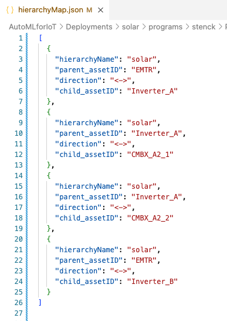
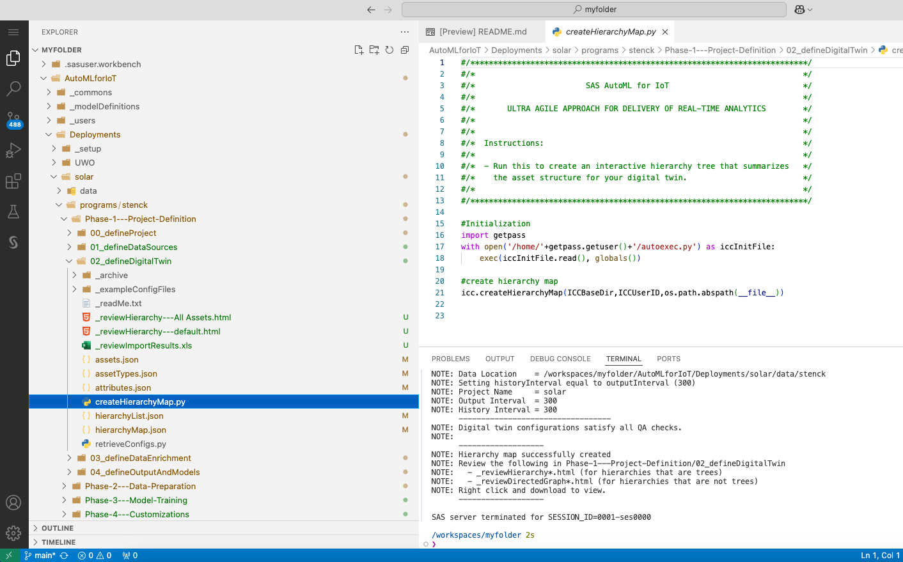
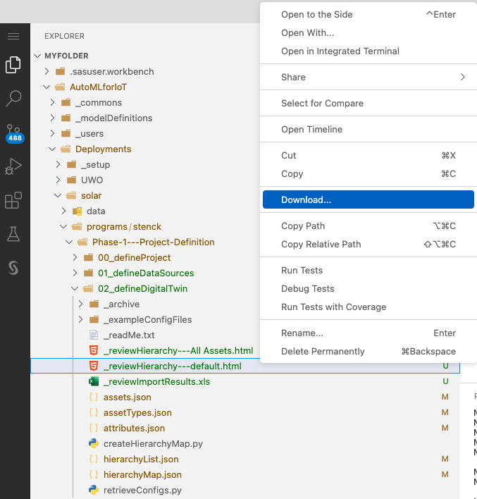
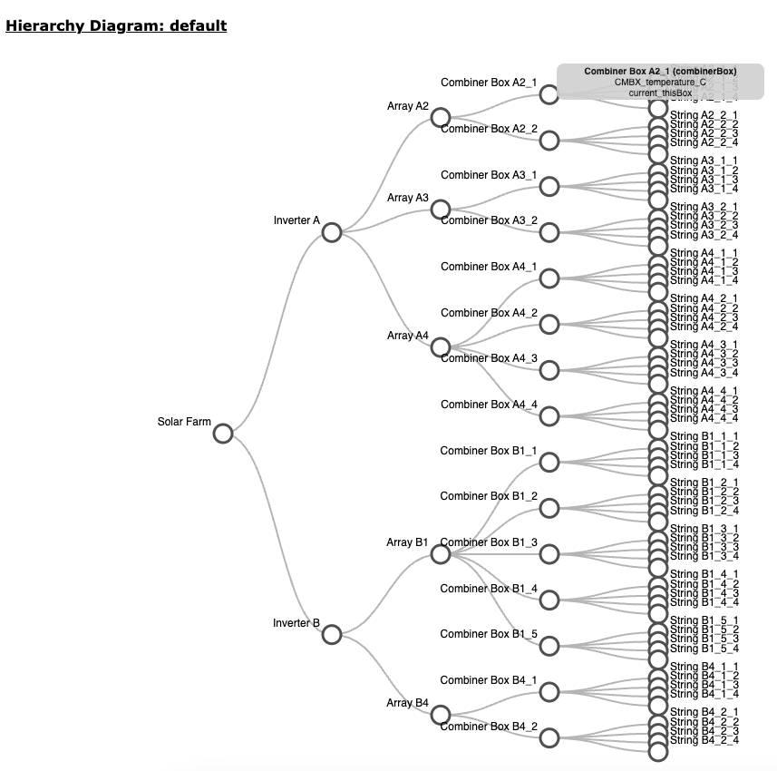
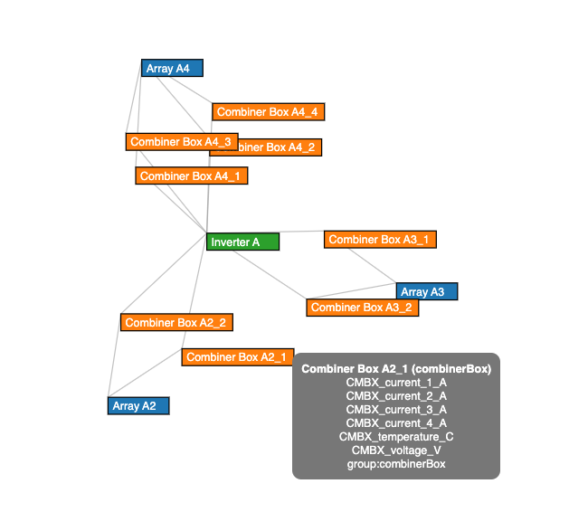

# Define Hierarchies

Hierarchies connect assets to reflect relationships that exist in the real system.

This step is optional, but relationships can provide important context for derived attributes, output tables, and machine learning models.

A hierarchy can enable AutoML for IoT to:

- aggregate measurements from connected assets
- retrieve values from connected assets
- include connected-asset information in output tables
- use connected-asset measures as model predictors

## Where the Configuration Goes

Hierarchies use two files under the digital-twin definition:

```text
Phase-1---Project-Definition/
└── 02_defineDigitalTwin/
    ├── hierarchyList.json
    └── hierarchyMap.json
```

Use `hierarchyList.json` to define the hierarchy names that exist in the project. Use `hierarchyMap.json` to define the parent-child asset connections that belong to those hierarchies.

The `createHierarchyMap.sas` program in the same directory can be run to generate a visual review of the configured relationships.

## Design the Relationships

You can create multiple hierarchies in the same project.

For example:

- a physical hierarchy might connect a building to floors and floors to equipment
- a hot-water hierarchy might connect a boiler to multiple air handlers
- an airflow hierarchy might connect air handlers to fan powered boxes

You can also create organizing asset types, such as buildings or floors, when those entities help describe the digital twin.


## Define the Hierarchy List

The hierarchyList.json file contains a list of the unique hierarchies that you will define.

Each hierarchy-list record contains one field.

| Field | Type | Description |
|---|---|---|
| `hierarchyName` | string | Unique name of the hierarchy. |

Example:

```json
[
  { "hierarchyName": "default" },
  { "hierarchyName": "airFlow" }
]
```

Hierarchy names should contain only letters, numbers, underscores, and dashes.

## Define the Hierarchy Map

The hierarchyMap.json file contains the list of parent-child relationships (connections) that exist in the specified hierarchy.

Each hierarchy connection contains:

| Field | Type | Description |
|---|---|---|
| `hierarchyName` | string | Hierarchy that contains the relationship. Must exist in `hierarchyList.json`. |
| `parent_assetID` | string | Parent asset in the connection. Must exist in `assets.json`. |
| `direction` | string | OPTIONAL - this specifies which direction assets are allowed to navigate. Typically set to `<->` to allow navigation in both directions (default), other options are `<--` and `-->`. |
| `child_assetID` | string | Child asset in the connection. Must exist in `assets.json`. |

Example:

```json
[
  {
    "hierarchyName": "default",
    "parent_assetID": "SF1",
    "child_assetID": "INV1"
  },
  {
    "hierarchyName": "default",
    "parent_assetID": "INV1",
    "child_assetID": "CBX1"
  },
  {
    "hierarchyName": "default",
    "parent_assetID": "CBX1",
    "child_assetID": "STR1"
  }
]
```




## Review the Hierarchy Visually

As you edit the hierarchy:

1. Open and run the `createHierarchyMap` program in `02_defineDigitalTwin`.
2. The program creates one or more `_reviewHierarchy*.html` files.
3. Download and open the generated HTML file.
4. Review the connections visually.
5. Hover over an asset in the interactive diagram to review information about that asset.





A tree-structured hierarchy can look like this:



If the assets do not follow a tree structure, AutoML for IoT will generate a directed-graph review instead.



## Validate the Hierarchy

Confirm that:

- every hierarchy name is unique
- every `hierarchyName` used in the map exists in `hierarchyList.json`
- every parent asset exists in `assets.json`
- every child asset exists in `assets.json`

## Previous

To review the static attributes used to hold asset metadata, see [Define Static Attributes](static-attributes.md).

## Next

To return to the main menu related to describing your digital twin, see [Describing Your Digital Twin](README.md)
