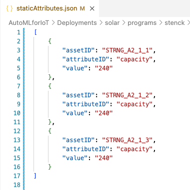

# Define Static Attributes

Static attributes, also called asset metadata, are values that are known about individual assets and do not normally change as new sensor data arrives.

This step is optional.

Typical examples include:

- latitude and longitude
- manufacturer
- equipment age
- equipment capacity
- an asset ID that identifies a specific related asset

When the generated ESP project starts, these values are used to initialize the corresponding attributes associated with the assets.

## Where the Configuration Goes

Static metadata uses two files under the digital-twin definition:

```text
Phase-1---Project-Definition/
└── 02_defineDigitalTwin/
    ├── attributes.json
    └── staticAttributes.json
```

First define the attribute itself in `attributes.json`. Then use `staticAttributes.json` to assign the value for a specific asset.

This keeps the attribute definition separate from the asset-specific value used to initialize it.

## Define the Attribute First

Before assigning a static value, define the attribute itself in `attributes.json`.

For example, if you want to set the manufacturer of an air handler, first define:

```text
airHandler/manufacturer
```

as a raw string attribute.

Static metadata normally uses:

```text
retentionPeriod = 0
```

so the value remains available indefinitely.


## Fields

Then assign the static attributes, which set the value for each individual asset. The required fields are:

| Field | Type | Description |
|---|---|---|
| `assetID` | string | Asset whose attribute should be initialized. Must exist in `assets.json`. |
| `attributeID` | string | Attribute to set. It must exist for the asset's asset type in `attributes.json`. |
| `value` | string | Value to assign when the project initializes. All values are stored as strings in this file. |

There are no optional fields.

If the underlying attribute is numeric, AutoML for IoT converts the stored string value as needed when the configuration is processed.

## Example



## Rules

- `assetID` must exist in `assets.json`.
- Determine the asset type for the selected asset, then confirm that `assetType/attributeID` exists in `attributes.json`.
- Store `value` as a string, even when the corresponding attribute is numeric.
- For metadata that should never become stale, use `retentionPeriod = 0` in the raw-attribute definition.

## Previous

To review the individual asset instances in the system, see [Define Assets](assets.md).

## Next

To connect assets in one or more hierarchies, see [Define Hierarchies](hierarchies.md)
