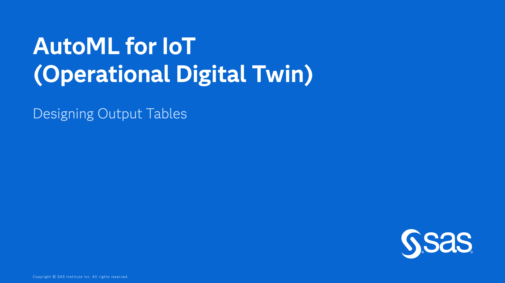
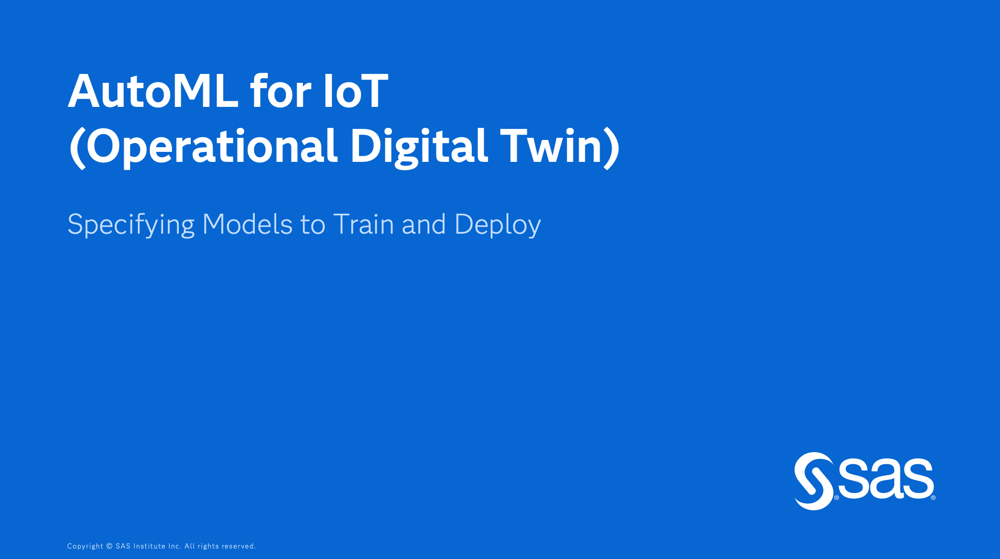

# Designing Output Tables and Models

In the previous steps, you defined your digital twin and enriched it with new calculated metrics (derived attributes).

Now, you will choose what to output and what to model using that digital twin. Specifically, you will design the output tables that you would like to create and specify the models you would like to train. Both tasks have been designed to be simple and straightforward. 

Depending on your use case, you may want to use **ONE** or **BOTH** of these options. In some cases, you may just want to train and deploy models and really are only concerned with obtaining model predictions. In other cases, the focus may be on obtaining nicely structured output tables that can be used to drive dashboards and visualizations. And in many cases, you will want to do both.

Generally, we suggest that new users begin by defining an output table or two - and then later add models once you've had a chance to review the analytic-ready datasets.

The sections below cover in detail how to design the output tables and models that you want.

## Designing Output Tables

The below powerpoint will walk you through the process of designing your output tables. This is a simple step - and really just involves you choosing the attributes that you would like to output for each table.

Step-by-Step Guide         |  
:-------------------------:|
 |

## Specifying Models to Train and Deploy

The below powerpoint will walk you through the process of specifying the models that you would like to train and deploy. Again, this was designed to be simple and straightforward. Choose what you'd like to analyze, which attributes to use as predictors, a date range to use for training, and a model pipeline from one of the available options (or [design your own](../defining-a-custom-analytic-pipeline/README.md)). Predictions from these ML models will appear as additional columns in your output tables.

Step-by-Step Guide         |  
:-------------------------:|
 |

## FAQ

We've included a frequently asked questions section here to clarify a few common questions...

- What if I just want to output nicely formatted tables and am not ready for models yet?
    - Then just configure your output tables by following the steps shown in "Designing Output Tables". 

- If I start by just outputting tables, can I add models later?
    - Yes! Just return to this step when you are ready and follow the steps shown in "Specifying Models to Train and Deploy". Model predictions will automatically get added to your output tables.

- Do I need to output a table for every asset type?
    - No. You can output tables for only the asset types that you are interested in. Keep this in mind... in each output table, you can request information from connected asset types. For example, for my solar farm application, in my output table focused on combiner boxes, I can request attributes for combiner boxes AND inverters AND the solar farm itself. 
    
- How do I know what model pipelines are available?
    - Run the queryAvailablePipelines program in the 04_defineOutputAndModels directory. This will create a list of the available model pipelines in _reviewModelPipelineList.xlsx.

- Is it possible to define my own model pipeline?
    - Yes! There are a few guidelines you will need to follow. Refer to this [page](../defining-a-custom-analytic-pipeline/README.md) to learn how to define your own model pipeline.

- Do I need to train a different model for every asset?  Is it possible to create a model for a group of assets?
    - You have total flexibility! When you follow the steps in "Specifying Models to Train and Deploy", you will notice that there is a field called modelGroupLogic. It has three options... "One Model Per AssetID" will train a separate model for each asset, "One Model Applicable to All Assets" will train a single model, and "One Model Per Unique AttributeID Value" will train a separate model for groups of assets. If you choose this last option, then you will need to also specify an attributeID to group on in a separate field (modelGroupByAttributeID).

      
