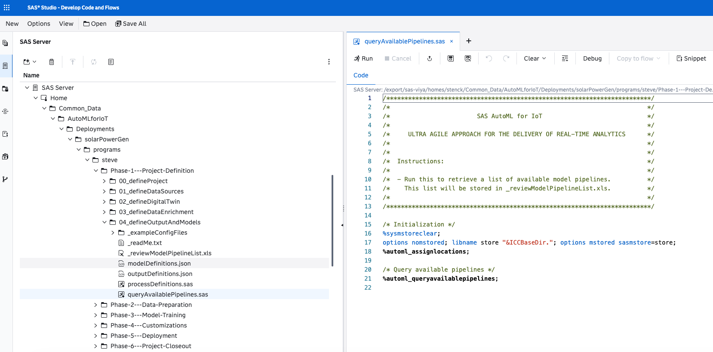
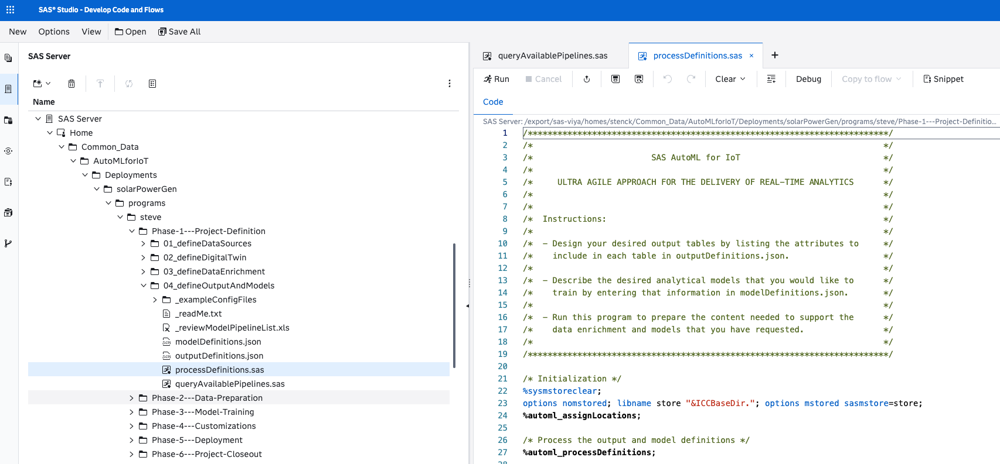

# Specify Models to Train and Deploy

## What You Are Doing in This Step

In this step, you describe the machine learning models that you want AutoML for IoT to train and later deploy.

For each desired model, you answer a small set of questions:

1. **What attribute do you want to predict?**
2. **Which attributes should be used as predictors?**
3. **Should AutoML for IoT train one model per asset, one model for all assets, or separate models for groups of assets?**
4. **Which analytic pipeline should be used to train the model?**
5. **What historical date range should be used for training?**
6. **If you are training multiple models, should training be limited to a particular subset of assets or groups?**

Those choices provide AutoML for IoT with the information it needs to create the analytic datasets, train the requested models, and later deploy scoring into the final project.

## A Simple Example

Suppose you want to predict:

```text
string/current_A
```

using:

```text
solarFarm/irradiance_poa_myPV
combinerBox/CMBX_temperature_C
```

and you want a separate model for each string.

You might describe that model as:

> Predict string current from solar-farm irradiance and connected combiner-box temperature, training one model per string.

The corresponding configuration is:

```json
[
  {
    "targetAssetType": "string",
    "targetAttributeID": "current_A",
    "modelGroupLogic": "One Model Per AssetID",
    "pipelineID": "linearRegressionScikit",
    "dateRangeStart": "01Jun2025",
    "dateRangeEnd": "07Jun2025",
    "predictorAttributes": [
      {
        "assetType": "solarFarm",
        "attributeID": "irradiance_poa_myPV"
      },
      {
        "assetType": "combinerBox",
        "attributeID": "CMBX_temperature_C"
      }
    ]
  }
]
```

That one record gives AutoML for IoT the target, predictors, grouping approach, pipeline, and training period for the model.

## Where the Configuration Goes

Define analytical models in:

```text
Phase-1---Project-Definition/
└── 04_defineOutputAndModels/
    └── modelDefinitions.json
```

Use `modelDefinitions.json` to define the models AutoML for IoT should train, including the target attribute, predictor attributes, and model-related settings described below.

## Decide What to Predict

Choose the target attribute using:

```text
targetAssetType/targetAttributeID
```

For example:

```text
string/current_A
```

The target can be either a raw attribute or a derived attribute, provided that the selected `assetType/attributeID` exists in the project.

## Choose the Predictors

List the attributes that should be used as inputs to the model.

Predictors can be:

- raw attributes
- derived attributes
- attributes from the target asset type
- attributes from connected asset types elsewhere in the digital twin

For example, a string-level model can use:

```text
string/temperature_C
solarFarm/irradiance_poa_myPV
combinerBox/CMBX_temperature_C
```

AutoML for IoT uses the digital-twin relationships to retrieve predictor values from connected assets when it prepares the analytic dataset.

Avoid predictor choices that are ambiguous. For example, if the target asset is connected to several assets of the same type and it is unclear which connected value should be used, make that relationship explicit first rather than selecting an ambiguous predictor.

Also avoid predictors that are essentially alternate versions of the target, such as using a rolling average of current to predict that same current.

## Choose How Many Models to Train

Use `modelGroupLogic` to choose one of three approaches.

### One Model Per AssetID

Use:

```text
One Model Per AssetID
```

to train a separate model for each target asset.

For example, if the target asset type is `string`, AutoML for IoT can train a separate model for each individual string.

### One Model Applicable to All Assets

Use:

```text
One Model Applicable to All Assets
```

to train one model that is used across all assets of the target asset type.

### One Model Per Unique AttributeID Value

Use:

```text
One Model Per Unique AttributeID Value
```

to train separate models for groups of assets based on the value of another attribute.

Also specify:

```text
modelGroupByAttributeID
```

For example, if each asset has a `manufacturer` attribute, AutoML for IoT can train one model per manufacturer.

## Optionally Limit Which Models Are Trained

Use `modelGroupSubset` only when you want to restrict training to selected assets or selected group values.

If:

```text
modelGroupLogic = "One Model Per AssetID"
```

then each `splitID` identifies an asset ID.

If:

```text
modelGroupLogic = "One Model Per Unique AttributeID Value"
```

then each `splitID` identifies one value of `modelGroupByAttributeID`.

For example:

```json
"modelGroupSubset": [
  { "splitID": "Honeywell" },
  { "splitID": "Rockwell" }
]
```

## Choose the Analytic Pipeline

Each model definition identifies the analytic pipeline to use for training.

To review the pipelines available in the current environment, run:

```text
04_defineOutputAndModels/queryAvailablePipelines.sas
```

This creates:

```text
_reviewModelPipelineList.xls
```

in the same directory.



Download and review that file, then use the desired pipeline ID in `pipelineID`.

The available pipelines can include Model Studio pipelines as well as custom SAS or Python pipelines.

If the project requires a pipeline that is not already available, see [Defining a Custom Analytic Pipeline](../defining-a-custom-analytic-pipeline/README.md).

## Choose the Training Date Range

Specify:

```text
dateRangeStart
dateRangeEnd
```

using:

```text
DDMonYYYY
```

For example:

```text
01Jun2025
07Jun2025
```

The start date must occur before the end date.

Choose a period that contains appropriate historical data for the target and predictor attributes.

## How the Decisions Map to `modelDefinitions.json`

Once the modeling decisions are clear, represent them in `modelDefinitions.json`.

## Configuration Structure

Models are defined in:

```text
04_defineOutputAndModels/modelDefinitions.json
```

### Required Fields

| Field | Type | Description |
|---|---|---|
| `targetAssetType` | string | Asset type of the prediction target. |
| `targetAttributeID` | string | Attribute to predict. |
| `modelGroupLogic` | string | One of the three documented model-grouping values. |
| `pipelineID` | string | Analytical pipeline used to train the model. |
| `dateRangeStart` | string | Training start date in `DDMonYYYY` format. |
| `dateRangeEnd` | string | Training end date in `DDMonYYYY` format. |
| `predictorAttributes` | array | Raw or derived attributes used as predictors. |

When:

```text
modelGroupLogic = "One Model Per Unique AttributeID Value"
```

also specify:

```text
modelGroupByAttributeID
```

### Optional Field

| Field | Type | Description |
|---|---|---|
| `modelGroupSubset` | array | Restricts model training to selected asset IDs or selected group values, depending on `modelGroupLogic`. |


## Validate a Model Definition

Before processing the definitions, confirm that:

- `targetAssetType` exists
- `targetAssetType/targetAttributeID` satisfies the current model-definition requirements
- every predictor `assetType/attributeID` exists as a raw or derived attribute
- no predictor is ambiguous for the target asset
- predictors are analytically distinct from the target rather than trivial reformulations of it
- `modelGroupLogic` is exactly one of the three documented values
- `pipelineID` is a valid available pipeline
- `dateRangeStart` and `dateRangeEnd` use `DDMonYYYY`
- `dateRangeStart` is earlier than `dateRangeEnd`
- `modelGroupByAttributeID` is present and valid when grouping by unique attribute value
- every `splitID` is valid for the selected grouping approach
- only documented fields are present

## Integrate and Check the Definitions

After the output and model definitions are complete, run:

```text
04_defineOutputAndModels/processDefinitions
```

This validates and integrates both sets of definitions.



Resolve any validation issues before moving into the historical-data and model-training phases.

## What Happens Next

After project definition is complete:

- Phase 2 transforms historical sensor data into analytic-ready datasets.
- Phase 3 trains the requested machine learning models and integrates them into the project.

These later phases use the output and model definitions created here.

## Previous

If you need to define the structured datasets that should be generated from the digital twin, see [Design Output Tables](output-tables.md).

## Next

After the output and model definitions are complete, prepare the historical data used to create analytic datasets and train models. For details, see [Retrieving Historical Data](../retrieving-historical-data/README.md).

## Related Information

If the project needs a pipeline that is not available in the standard list, see [Defining a Custom Analytic Pipeline](../defining-a-custom-analytic-pipeline/README.md).
